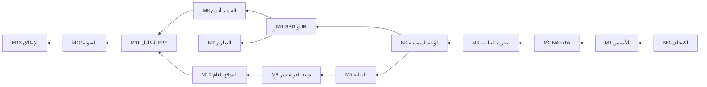

# Milestone Sheet — منصة CoWorkSpaces

**المرجع:** وثيقة SRS — منصة CoWorkSpaces (الوثيقة الرئيسية + ملحق أ: جرد الواجهة + ملحق ب: تكامل MikroTik)
**النطاق:** ما استُخرج من النظام الفعلي: لوحة صاحب المساحة، وتكامل MikroTik، ولوحة السوبر أدمن، ولوحة الفريلانسر، والتكامل بينها.
**الإصدار:** 1.0 — 29 أكتوبر 2026

---

## 1. الافتراضات

| البند | القيمة |
| --- | --- |
| الفريق | 2 Backend · 1 Frontend · 1 QA · 1 PM/BA (5 أشخاص) |
| وحدة المدة | أسابيع عمل (5 أيام). لا تواريخ ثابتة؛ الأسبوع 1 = بداية المشروع |
| الجهد | أيام-شخص (person-days)، تقدير أولي ±20% |
| الـ Sprint | أسبوعان؛ كل Milestone ينتهي بعرض (Demo) وقبول |
| التقنية | كما في النظام الحالي: تطبيق ويب يُرسم من الخادم + API لـ MikroTik + سكربتات RouterOS 7.12+ |
| ما هو موثّق | لوحة صاحب المساحة وتكامل MikroTik (مستخرجان من النظام مباشرة) |
| ما هو مستنتج | لوحة السوبر أدمن، وبوابة الفريلانسر، والموقع العام (موسومة بـ **[مستنتج]** وتؤكَّد في M0) |

**مفتاح الحالة:** ⬜ لم يبدأ · 🟨 قيد التنفيذ · ✅ مكتمل · ⛔ متوقف

---

## 2. ملخص الـ Milestones

| # | Milestone | المدة (أسابيع) | من أسبوع → إلى | الجهد (أيام-شخص) | يعتمد على | الحالة |
| --- | --- | --- | --- | --- | --- | --- |
| M0 | الاكتشاف وتأكيد المتطلبات | 1 | 1 → 1 | 15 | — | ⬜ |
| M1 | الأساس: المستأجرون والهوية والأدوار | 2 | 2 → 3 | 40 | M0 | ⬜ |
| M2 | تكامل MikroTik (النقل والتثبيت) | 3 | 4 → 6 | 55 | M1 | ⬜ |
| M3 | محرك البيانات: الحضور والإحصاءات والتنبيهات | 3 | 6 → 8 | 55 | M2 | ⬜ |
| M4 | لوحة صاحب المساحة — التشغيل والمشتركون | 3 | 8 → 10 | 60 | M3 | ⬜ |
| M5 | المالية والفوترة ونقطة البيع | 4 | 9 → 12 | 75 | M1, M4 (جزئيًا) | ⬜ |
| M6 | برنامج GSG وUR وإقفال الشهر | 3 | 11 → 13 | 55 | M3, M4 | ⬜ |
| M7 | التحليلات والتقارير ومنشئ التقارير | 2 | 13 → 14 | 35 | M3, M6 | ⬜ |
| M8 | لوحة السوبر أدمن | 3 | 14 → 16 | 55 | M6 | ⬜ |
| M9 | بوابة الفريلانسر | 3 | 15 → 17 | 50 | M4, M5 | ⬜ |
| M10 | الموقع العام ومنشئ الموقع وتسجيل الضيوف | 1.5 | 17 → 18 | 25 | M2, M9 | ⬜ |
| M11 | التكامل بين اللوحات الثلاث (End-to-End) | 2 | 18 → 19 | 35 | M8, M9, M10 | ⬜ |
| M12 | التقوية: الأمان والأداء والتعريب | 1.5 | 20 → 21 | 25 | M11 | ⬜ |
| M13 | UAT وتجربة TAQAT GAZA والإطلاق | 2 | 21 → 22 | 30 | M12 | ⬜ |
| | **الإجمالي** | **≈ 22 أسبوعًا** | | **≈ 610** | | |

بعض الـ Milestones تتداخل (M5 مع M4/M6، وM9 مع M8) لأن الفريق يعمل على مسارين: مسار Backend/تكامل ومسار Frontend/لوحات.

### المسار الحرج

المسار الحرج: M0 → M1 → M2 → M3 → M4 → M6 → M8 → M11 → M12 → M13. أي تأخير في تكامل MikroTik (M2) أو محرك البيانات (M3) يؤخر كل ما بعده، لأن كل اللوحات تعتمد على بيانات الحضور.

---

## 3. تفاصيل كل Milestone

### M0 — الاكتشاف وتأكيد المتطلبات (أسبوع 1 · 15 يوم-شخص)

**الهدف:** تحويل الأجزاء المستنتجة في الـ SRS إلى أجزاء موثّقة قبل البناء.

| # | المهمة | الدور | الجهد |
| --- | --- | --- | --- |
| 0.1 | مراجعة حساب السوبر أدمن الفعلي وتوثيق شاشاته | PM/BA | 3 |
| 0.2 | مراجعة حساب فريلانسر فعلي (إن وُجد) أو كتابة متطلباته مع أصحاب المساحات | PM/BA | 3 |
| 0.3 | تشغيل الموقع العام `/s/{slug}` وتوثيق صفحاته (الرئيسية، حالتي، النماذج) | PM/BA + FE | 2 |
| 0.4 | مراجعة كود الخادم لمعالجة `/sync` وصيغة UR (إن كان متاحًا) | BE | 4 |
| 0.5 | اعتماد نطاق MVP وترتيب الأولويات وتحديث الـ SRS | PM/BA | 3 |

**مخرجات:** SRS v1.1 معتمد، وقائمة أولويات، وBacklog.
**معيار القبول:** لا يبقى أي متطلب موسوم [مستنتج] دون قرار (يُعتمد أو يُحذف أو يُؤجَّل).

---

### M1 — الأساس: المستأجرون والهوية والأدوار (أسابيع 2–3 · 40 يوم-شخص)

| # | المهمة | مرجع SRS | الدور | الجهد |
| --- | --- | --- | --- | --- |
| 1.1 | نموذج Multi-tenant: المساحة (slug ثابت، رمز، خطة، حالة) | §2، §7.2 | BE | 5 |
| 1.2 | تسجيل الدخول لصاحب المساحة + تغيير كلمة المرور + المصادقة الثنائية | §3.7 الحساب | BE + FE | 6 |
| 1.3 | الأدوار والصلاحيات: سوبر أدمن، صاحب مساحة، موظف (صندوق/ضيافة/مشرف مالي/يدوي)، فريلانسر | §6 المصفوفة | BE | 6 |
| 1.4 | دعوة الموظفين بالبريد وصلاحيات مالية دقيقة (إصدار/إلغاء الفواتير بمصادقة ثنائية) | §3.7 الموظفون | BE + FE | 5 |
| 1.5 | الإعدادات العامة: الهوية، الاتصال، البنك/IBAN، المنطقة الزمنية، العملة، الواي فاي | ملحق أ §أ.5 | FE + BE | 6 |
| 1.6 | إعدادات التشغيل (السعة، ساعات وأيام العمل، الأسعار، الضريبة) مع «إرسال للموافقة» | §3.7 التشغيل | BE + FE | 5 |
| 1.7 | سجل تدقيق عام (من غيّر ماذا ومتى ولماذا) | §7.1 التدقيق | BE | 3 |
| 1.8 | هيكل الواجهة: القائمة الجانبية، RTL، اختصارات لوحة المفاتيح | §7.1 | FE | 4 |

**معيار القبول:** صاحب مساحة يدخل بمصادقة ثنائية، ويدعو موظفًا بصلاحيات محدودة، وأي تغيير في السعة يذهب للموافقة ولا يُطبَّق مباشرة.

---

### M2 — تكامل MikroTik: النقل والتثبيت (أسابيع 4–6 · 55 يوم-شخص)

| # | المهمة | مرجع | الدور | الجهد |
| --- | --- | --- | --- | --- |
| 2.1 | مولّد المثبّت `install.rsc` مخصص لكل مساحة وراوتر (الرمز، المفتاح، الرقم التسلسلي) | ملحق ب §ب.2 | BE | 6 |
| 2.2 | سكربتات RouterOS: الفحوص المسبقة، الخطافات on-login/on-logout، اللقطة كل 30 دقيقة، مخازن الذاكرة، المجدول كل 50 ثانية | ملحق ب §ب.2–ب.3 | BE | 12 |
| 2.3 | نقطة النهاية `POST /api/v1/hotspot/{code}/sync`: المصادقة بـ X-API-Key، بصمة الراوتر، الأحداث، أجزاء اللقطة، التأكيدات | ملحق ب §ب.3 | BE | 8 |
| 2.4 | الرد بالأوامر: بادئة `# CWS-SYNC <nonce>`، التحديث بالحزم المجزأة، الإزالة عن بُعد، سلسلة requested→delivered→acknowledged | ملحق ب §ب.3 | BE | 6 |
| 2.5 | قفل الراوتر بالرقم التسلسلي + «فتح جهاز التوجيه» + تجديد مفتاح API | ملحق ب §ب.5 | BE + FE | 4 |
| 2.6 | التحديث التلقائي للسكربتات (فحص كل 5 دقائق + «دفع التحديث الكامل») | ملحق ب §ب.5 | BE | 4 |
| 2.7 | صفحة «تكامل ميكروتيك»: الحالة، بطاقة الراوتر، الأوامر، مصدر المثبّت | ملحق أ §أ.5 | FE | 5 |
| 2.8 | صفحة «تشخيصات API» (سجل الطلبات، الفلاتر، تحديث كل 30 ثانية) | ملحق أ §أ.5 | FE + BE | 4 |
| 2.9 | اختبار على راوتر حقيقي (RB3011 أو مشابه): انقطاع إنترنت، إعادة تشغيل، 2,048 جلسة | — | QA | 6 |

**معيار القبول:**
- التثبيت بأمر واحد ينجح على راوتر نظيف، وإعادة تشغيله لا تكرر شيئًا.
- انقطاع الإنترنت ساعة لا يفقد أي حدث بعد عودته.
- راوتر آخر بنفس المفتاح يُرفض.
- 100 طلب متتالي بنجاح ≥ 99%.

---

### M3 — محرك البيانات: الحضور والإحصاءات والتنبيهات (أسابيع 6–8 · 55 يوم-شخص)

| # | المهمة | مرجع | الدور | الجهد |
| --- | --- | --- | --- | --- |
| 3.1 | ربط اسم مستخدم Hotspot ← المشترك، وMAC ← الجهاز، وإنشاء مشترك/جهاز جديد تلقائيًا | ملحق ب §ب.4 | BE | 6 |
| 3.2 | تجميع أجزاء اللقطة وحفظها بـ snapshot_id وحساب «متصلون الآن» | ملحق ب §ب.3 | BE | 4 |
| 3.3 | حساب الجلسات والحضور بأنماط Active Actual / Day Span / Hour Bucket / Half-Hour، واستبعاد الفجوات | §3.4 Tracker | BE | 10 |
| 3.4 | الإحصاءات اليومية والأسبوعية والشهرية والملخصات + «إعادة حساب» | ملحق أ الأدوات | BE | 6 |
| 3.5 | كشف فجوات الاتصال وأيام البيانات المفقودة | §3.1 الشبكة | BE | 4 |
| 3.6 | درجات الولاء والقوة والشرائح (أبطال، منتظمون، معرّضون للتوقف…) بأوزان قابلة للضبط | §3.1، المعلمات | BE | 6 |
| 3.7 | محرك التنبيهات: 6 قواعد، الخطورة، التهدئة، القنوات (لوحة/بريد)، الساعات الهادئة | §3.1، ملحق أ | BE | 8 |
| 3.8 | أدوات سلامة البيانات: تقسيم الأسماء المشتركة حسب MAC، دمج الحسابات | ملحق أ الأدوات | BE + FE | 5 |
| 3.9 | اختبارات دقة الحساب على بيانات حقيقية (شهر من TAQAT GAZA) | — | QA | 6 |

**معيار القبول:** ساعات أي مشترك في شهر اختباري تطابق الحساب اليدوي بفرق ≤ 5%، والتنبيهات تُطلق مرة واحدة ضمن فترة التهدئة.

---

### M4 — لوحة صاحب المساحة: التشغيل والمشتركون (أسابيع 8–10 · 60 يوم-شخص)

| # | المهمة | مرجع | الدور | الجهد |
| --- | --- | --- | --- | --- |
| 4.1 | لوحة الأداء التنفيذية (صحة المساحة، 11 مؤشرًا، الرسوم، التوقع بـ OLS) | FR-DSH-01..09 | FE + BE | 8 |
| 4.2 | الشبكة: متصلون الآن، الفجوات، الاستخدام، الاتجاهات | FR-NET-01..03 | FE | 5 |
| 4.3 | مركز التنبيهات وإعداداته | FR-ALR-01..02 | FE | 4 |
| 4.4 | مركز المشتركين بتبويباته العشرة (اليوم، المشتركون، أسبوعيًا، الشهر، التقويم، العقود، زوار مباشرون، التنبيهات، الملفات، إدارة جماعية) | FR-MEM-01..07 | FE + BE | 14 |
| 4.5 | ملف المشترك + التحليلات + تحليل UTR | FR-MEM-08 | FE | 5 |
| 4.6 | العقود: آلة الحالات (مسودة/نشط/معلق/منتهٍ/ملغى)، التمديد، التجديد الجماعي | FR-MEM-03 | BE | 5 |
| 4.7 | القائمة الشهرية (Roster): تعبئة، نسخ الشهر، Gift Hours | FR-MEM-09 | FE + BE | 5 |
| 4.8 | مركز الحجز + المخطط: حجز، عقد، تأكيد الحضور، سبب التجاوز | FR-BKG-01..06 | FE + BE | 8 |
| 4.9 | المكاتب: المخزون، الآن، مصفوفة الشهر، الفروع، الإضافة المجمّعة | FR-STN-01..02 | FE + BE | 6 |

**معيار القبول:** كل شاشات القسم في ملحق أ (§أ.1، §أ.3 مركز المشتركين والحجز، §أ.5 المكاتب) تعمل ببيانات حقيقية من M3.

---

### M5 — المالية والفوترة ونقطة البيع (أسابيع 9–12 · 75 يوم-شخص)

| # | المهمة | مرجع | الدور | الجهد |
| --- | --- | --- | --- | --- |
| 5.1 | الكتالوج: الخطط (6 طرق تسعير)، الأصناف، التصنيفات برموز ثابتة | ملحق أ §أ.2 | BE + FE | 8 |
| 5.2 | الاشتراك المالي للمشترك (مسبق/آجل، سعر خاص، ساعات متعاقدة، مقعد) | §3.3 | BE | 6 |
| 5.3 | المحفظة والتأمين (استلام، إعادة، تسوية، مصادرة) | ملف المشترك المالي | BE | 6 |
| 5.4 | نقطة البيع: اختيار المشترك (F2)، بنود، خصم، إضافة للحساب أو تحصيل، 4 وسائل دفع | ملحق أ POS | FE + BE | 8 |
| 5.5 | الفواتير: مسودة ← إصدار ← إلغاء، التجهيز الجماعي الشهري، المعاينة | BR-FIN-01 | BE + FE | 10 |
| 5.6 | سندات القبض وتوزيعها على الفواتير + دورة الشيك (لم يُحصّل/مُحصّل/مرتجع) | ملحق أ | BE + FE | 6 |
| 5.7 | الإشعارات الدائنة والمبالغ المستردة (سند صرف) | ملحق أ | BE | 4 |
| 5.8 | التحصيل وأعمار الديون ومتابعات التواصل | ملحق أ | FE + BE | 4 |
| 5.9 | المصروفات + مطابقة الصندوق + ضريبة القيمة المضافة (معدل مجمّد) | BR-FIN-02..03 | BE + FE | 7 |
| 5.10 | الاستيراد الذري لملفات XLSX (الكتالوج، المسحوبات) بمعاينة | ملحق أ | BE | 5 |
| 5.11 | المؤسسات (فاتورة موحدة) + المقاعد المخصصة + الوقت الإضافي | ملحق أ | BE + FE | 6 |
| 5.12 | لوحة المالية + سجل النشاط المالي (17 إجراء) | FR-FIN-01..03 | FE + BE | 5 |

**معيار القبول:** دورة كاملة لمشترك: اشتراك ← حركات ← فاتورة ← دفعة جزئية ← إشعار دائن ← استرداد، وكل خطوة في سجل النشاط، وأرقام لوحة المالية تطابق السجلات.

---

### M6 — برنامج GSG وUR وإقفال الشهر (أسابيع 11–13 · 55 يوم-شخص)

| # | المهمة | مرجع | الدور | الجهد |
| --- | --- | --- | --- | --- |
| 6.1 | المعلمات (32 حقلًا) وطلبات تغييرها، والعطلات وطلبات اعتمادها | ملحق أ §أ.5 | BE + FE | 6 |
| 6.2 | صيغة UR: AR → C → max(Actual, Contract × C) → TypeW → ΣH / Tmax، والقراءات الثلاث، وQualified-C | §3.4 FR-TRK-03 | BE | 10 |
| 6.3 | GSG UR Tracker: Audit وMaster Data وKPIs | FR-TRK-01..03 | FE + BE | 8 |
| 6.4 | معالج إقفال الشهر: 22 فحصًا في 7 فئات، إصلاح تلقائي وذكي، إعادة الحساب | FR-MCL-01..03 | BE + FE | 8 |
| 6.5 | مراجعة UTR: الساعات المقفلة، ملاحظات التبرير، اقتراحات النوع الذكي، التحليل السلوكي | FR-UR-04 | BE + FE | 7 |
| 6.6 | صفحة Utilization والتقرير النهائي (الشذوذ، المحاكاة، المساهمة) | FR-UR-01..03 | FE | 5 |
| 6.7 | البرامج (عرض لصاحب المساحة): المحفظة، لوحة المقاعد، تقرير المساحة، لايف، المطالبات وخطاب PDF/Word | FR-PRG-01..05 | FE + BE | 8 |
| 6.8 | تشخيصات المشتركين (`/debug`) ومركز الإصلاح | ملحق أ | BE | 3 |

**معيار القبول:** إعادة حساب UR لشهر أكتوبر 2026 تعطي القراءات نفسها التي يعرضها النظام الحالي (3.8% الآن، 71.8% بعد الاعتماد)، والمطالبة يُجمَّد مبلغها لحظة الإرسال.

---

### M7 — التحليلات والتقارير ومنشئ التقارير (أسابيع 13–14 · 35 يوم-شخص)

| # | المهمة | مرجع | الدور | الجهد |
| --- | --- | --- | --- | --- |
| 7.1 | التحليلات: 7 تبويبات + الأجهزة + الخريطة الحرارية | FR-ANL-01 | FE + BE | 10 |
| 7.2 | التقارير الـ 19 مع اختيار السنة والشهر والإنشاء السريع | FR-RPT-01 | BE + FE | 12 |
| 7.3 | منشئ التقارير: 21 مكوّنًا، سحب وإفلات، JSON استيراد/تصدير | ملحق أ §أ.4 | FE | 8 |
| 7.4 | التصدير: PDF / Word / Excel / CSV / طباعة | §7.1 | BE | 5 |

**معيار القبول:** تقرير «GSG — Monthly UR Report» يُنتج ملفًا مطابقًا لأرقام M6.

---

### M8 — لوحة السوبر أدمن (أسابيع 14–16 · 55 يوم-شخص) [مستنتج، يؤكَّد في M0]

| # | المهمة | مرجع | الدور | الجهد |
| --- | --- | --- | --- | --- |
| 8.1 | إدارة المساحات: إنشاء، تفعيل/إيقاف، تعيين الخطة وحدودها | FR-SA-01 | BE + FE | 6 |
| 8.2 | طابور اعتماد UTR لكل المساحات بالشهر (اعتماد/رفض لكل مشترك، قراءة ملاحظات التبرير) | FR-SA-02 | BE + FE | 10 |
| 8.3 | البرامج والاتفاقيات: إنشاء اتفاقية (المانح، المقاعد، السعر، الفترة، متبرع بها/مدفوعة) | FR-SA-03 | BE + FE | 8 |
| 8.4 | لوحة إسناد المقاعد وإخراجها مع سجل حوكمة (السبب، تاريخ السريان، المنفّذ) | FR-SA-03 | FE + BE | 6 |
| 8.5 | استلام المطالبات ومتابعة صرفها وحالاتها | FR-SA-04 | BE + FE | 6 |
| 8.6 | طابور الموافقات: المعلمات، السعة، العطلات، النطاقات المخصصة | FR-SA-05..06 | BE + FE | 7 |
| 8.7 | مراقبة الراوترات لكل المساحات (آخر مزامنة، الإصدار، الأخطاء) مع تنبيه عند التوقف | FR-SA-07 | BE + FE | 6 |
| 8.8 | تقارير مجمّعة للجهة المانحة عبر المساحات | §5 | BE | 6 |

**معيار القبول:** السوبر أدمن يعتمد ساعات مشترك فيرتفع UR الرسمي في لوحة المساحة فورًا، ويُسند مقعدًا فيظهر في «لوحة المقاعد» عند صاحب المساحة.

---

### M9 — بوابة الفريلانسر (أسابيع 15–17 · 50 يوم-شخص) [مستنتج، يؤكَّد في M0]

| # | المهمة | مرجع | الدور | الجهد |
| --- | --- | --- | --- | --- |
| 9.1 | الدخول بـ OTP على رقم الهاتف | FR-FL-01 | BE + FE | 6 |
| 9.2 | «حالتي»: الاشتراك، الحالة، تاريخ الانتهاء، المقعد | FR-FL-02 | FE | 5 |
| 9.3 | حضوري وساعاتي: أيام وساعات الشهر، AR%، تقويم النشاط | FR-FL-02 | FE + BE | 6 |
| 9.4 | فواتيري ورصيد المحفظة، مع تنزيل الفاتورة PDF | FR-FL-02 | FE + BE | 6 |
| 9.5 | طلبات: تجديد، تغيير خطة، حجز غرفة (تصل لصاحب المساحة للموافقة) | FR-FL-03 | BE + FE | 8 |
| 9.6 | الاعتراض على ساعات أو رسوم (يصل كطلب مع سبب) | FR-FL-04 | BE + FE | 5 |
| 9.7 | أجهزتي المرتبطة بالحساب | FR-FL-05 | FE | 3 |
| 9.8 | إشعارات الفريلانسر (انتهاء العقد، فاتورة جديدة، موافقة على طلب) | — | BE | 5 |
| 9.9 | ملفي الشخصي (الجنس، التعليم، التخصص، الحالة الوظيفية) لاستكمال بيانات الجهة المانحة | FR-MEM-06 | FE | 6 |

**معيار القبول:** فريلانسر يدخل بـ OTP، ويرى ساعاته مطابقة لما في لوحة المساحة، ويطلب تجديدًا فيظهر الطلب عند صاحب المساحة.

---

### M10 — الموقع العام ومنشئ الموقع وتسجيل الضيوف (أسابيع 17–18 · 25 يوم-شخص)

| # | المهمة | مرجع | الدور | الجهد |
| --- | --- | --- | --- | --- |
| 10.1 | منشئ الموقع (14 قسمًا) والموقع العام `/s/{slug}` | ملحق أ §أ.5 | FE + BE | 8 |
| 10.2 | نموذج طلب الاشتراك ← «طلبات الاشتراك» | FR-REQ-01 | BE + FE | 4 |
| 10.3 | نموذج حجز الغرف بحدود المدة والحجز المسبق ← «حجوزات الغرف» | FR-RMB-01..02 | BE + FE | 4 |
| 10.4 | تسجيل الضيوف الذاتي: `/hotspot/{code}/register`، تجهيز حساب Hotspot بملف visitor، Walled Garden | ملحق ب §ب.4 | BE | 6 |
| 10.5 | النطاق المخصص (طلب ← موافقة السوبر أدمن) | §3.7 | BE | 3 |

**معيار القبول:** زائر يتصل بالواي فاي، يضغط «تسجيل زائر جديد»، فيُنشأ حسابه على الراوتر خلال دقيقة ويتصل بالإنترنت.

---

### M11 — التكامل بين اللوحات الثلاث: End-to-End (أسابيع 18–19 · 35 يوم-شخص)

**الهدف:** التأكد أن كل تدفق يعبر اللوحات الثلاث يعمل من أوله إلى آخره.

| # | التدفق | المسار | الدور | الجهد |
| --- | --- | --- | --- | --- |
| 11.1 | دورة UR الشهرية | فريلانسر يتصل ← ترجيح الساعات ← إقفال الشهر ← تبرير ← اعتماد السوبر أدمن ← UR رسمي ← تقرير GSG | BE + QA | 8 |
| 11.2 | دورة المطالبة | سجل الحوكمة ← مطالبة المساحة (مجمّدة) ← استلام وصرف عند السوبر أدمن | BE + QA | 5 |
| 11.3 | من طلب إلى مشترك | طلب من الموقع العام ← موافقة ← مشترك + عقد + خطة ← يظهر في بوابة الفريلانسر | BE + FE + QA | 6 |
| 11.4 | تحويل زائر مباشر | جهاز بلا اشتراك ← «زوار مباشرون» ← «اشترك» ← فوترة | BE + QA | 4 |
| 11.5 | دورة الفوترة للفريلانسر | حركات POS ← فاتورة ← يراها الفريلانسر ← دفعة ← رصيد | BE + FE + QA | 5 |
| 11.6 | تغيير المعلمات | طلب صاحب المساحة ← موافقة السوبر أدمن ← إعادة حساب Tmax وUR | BE + QA | 4 |
| 11.7 | إسناد مقعد ممول | السوبر أدمن يُسند ← لوحة المقاعد ← «لايف» ← تقرير البرنامج ← يراه الفريلانسر في «حالتي» | BE + QA | 3 |

**معيار القبول:** التدفقات السبعة تنجح آليًا في بيئة Staging مع راوتر اختبار حقيقي.

---

### M12 — التقوية: الأمان والأداء والتعريب (أسابيع 20–21 · 25 يوم-شخص)

| # | المهمة | مرجع | الدور | الجهد |
| --- | --- | --- | --- | --- |
| 12.1 | المثبّت بـ `check-certificate=yes` | ملحق ب §ب.5 | BE | 1 |
| 12.2 | استبدال المفتاح في رابط التثبيت برمز تثبيت لمرة واحدة قصير العمر | ملحق ب §ب.5 | BE | 3 |
| 12.3 | قائمة أوامر مسموحة لما ينفّذه الراوتر من رد الخادم | ملحق ب §ب.5 | BE | 4 |
| 12.4 | تصحيح WAN IP في اللقطة، وفصل «التبادل 50 ث» عن «اللقطة 30 د» في الواجهة | ملحق ب §ب.5 | BE + FE | 2 |
| 12.5 | مخزن احتياطي على flash لأحداث ما قبل إعادة التشغيل، وخيار لقطة كل 10 دقائق في الدوام | ملحق ب §ب.5 | BE | 4 |
| 12.6 | مراجعة التعريب وتوحيد المصطلحات (النصوص الآلية والإنجليزية المتبقية) | §7.3 | FE + PM | 4 |
| 12.7 | اختبار حمل: 2,048 جلسة، 50 مساحة متزامنة | — | QA | 4 |
| 12.8 | اختبار اختراق أساسي للـ API وصلاحيات الأدوار | — | QA | 3 |

**معيار القبول:** لا ثغرات حرجة أو عالية، وزمن معالجة `/sync` ≤ 300 ms عند الحمل.

---

### M13 — UAT وتجربة TAQAT GAZA والإطلاق (أسابيع 21–22 · 30 يوم-شخص)

| # | المهمة | الدور | الجهد |
| --- | --- | --- | --- |
| 13.1 | ترحيل بيانات TAQAT GAZA (461 مشتركًا، 1,149 جهازًا، العقود، الإحصاءات) | BE | 6 |
| 13.2 | إعداد المساحة الفعلي: 80 مكتبًا، الخطط، ربط 82 مشتركًا نشطًا بالاشتراكات المالية | PM + BE | 5 |
| 13.3 | UAT مع صاحب المساحة والسوبر أدمن وعينة فريلانسرز | PM + QA | 8 |
| 13.4 | تدريب صاحب المساحة والموظفين وأدلة الاستخدام | PM | 4 |
| 13.5 | الإطلاق ومراقبة أسبوع أول (Hypercare) | الكل | 7 |

**معيار القبول:** شهر تشغيل تجريبي يُغلق بنجاح، ويُعتمد UR، وتُرسل المطالبة دون تدخل يدوي من الفريق.

---

## 4. توزيع الجهد حسب الدور

| الدور | الجهد التقريبي (أيام-شخص) | السعة خلال 22 أسبوعًا |
| --- | --- | --- |
| Backend (2) | ≈ 300 | 220 |
| Frontend (1) | ≈ 170 | 110 |
| QA (1) | ≈ 70 | 110 |
| PM/BA (1) | ≈ 70 | 110 |

**ملاحظة:** عمل Backend وFrontend يتجاوز سعة 22 أسبوعًا بنحو 40% (470 يوم-شخص مقابل 330)، بينما لدى QA وPM/BA سعة فائضة. لذلك أمامكم أحد ثلاثة خيارات:

- إضافة Backend ثالث وFrontend ثانٍ، فتبقى المدة ≈ 22 أسبوعًا.
- الإبقاء على الفريق، فتمتد المدة إلى ≈ 30 أسبوعًا.
- تأجيل M7.3 (منشئ التقارير) وM9.6–9.8 وM10.1 إلى مرحلة ثانية، فتنخفض الحاجة نحو 60 يوم-شخص.

---

## 5. المخاطر

| # | الخطر | الأثر | الاحتمال | التخفيف |
| --- | --- | --- | --- | --- |
| R1 | متطلبات السوبر أدمن والفريلانسر مستنتجة | إعادة عمل في M8 وM9 | عالٍ | M0 إلزامي قبل البدء |
| R2 | اختلاف إصدارات RouterOS وقدرات الراوترات | فشل التثبيت أو الالتقاط | متوسط | مصفوفة اختبار لإصدارات 7.12+ و3 موديلات |
| R3 | انقطاع الكهرباء والإنترنت في غزة | فجوات في الحضور تؤثر على UR | عالٍ | مخزن flash، UPS، ووسم أيام الفجوات في UTR |
| R4 | أسماء مستخدمين مشتركة | حضور مختلط وتمويل خاطئ | عالٍ | تسجيل الضيوف الذاتي + shared-users=1 + أداة التقسيم |
| R5 | تنفيذ الراوتر لنص الرد كاملًا | اختراق الخادم يعني التحكم بالراوترات | منخفض/حرج | قائمة أوامر مسموحة (M12.3) |
| R6 | دقة صيغة UR مقابل النظام الحالي | رفض الجهة المانحة للتقارير | متوسط | معيار قبول M6: مطابقة أكتوبر 2026 |
| R7 | سعة الفريق أقل من الجهد | تأخير ≈ 8 أسابيع | عالٍ | انظر §4 |

---

## 6. أسئلة مفتوحة (تُحسم في M0)

1. هل توجد بوابة فريلانسر حاليًا أم تُبنى من الصفر؟ وهل الدخول بـ OTP أو بحساب Hotspot نفسه؟
2. ما صلاحيات السوبر أدمن الدقيقة؟ وهل يوجد أكثر من مستوى (مشغّل، مدقق مالي، ممثل مانح)؟
3. هل يرى الفريلانسر ساعاته المرجّحة بعامل C، أم الفعلية فقط؟
4. هل الدفع الإلكتروني مطلوب في بوابة الفريلانسر أم الدفع في المساحة فقط؟
5. هل تُفعَّل الضريبة لمساحات معينة؟ وبأي معدل؟
6. ما سياسة الاحتفاظ بالبيانات (MAC، الجلسات) وحذفها؟

---

## 7. سجل الإصدارات

| الإصدار | التاريخ | التغيير |
| --- | --- | --- |
| 1.0 | 29 أكتوبر 2026 | الإصدار الأول المبني على SRS والملحقين أ وب |
