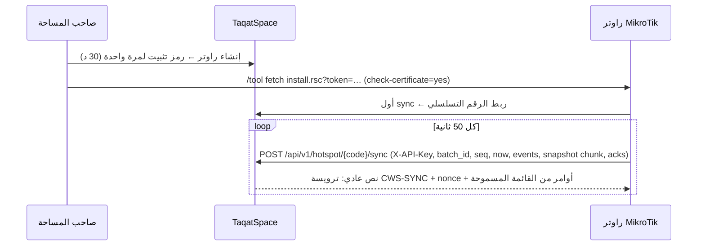
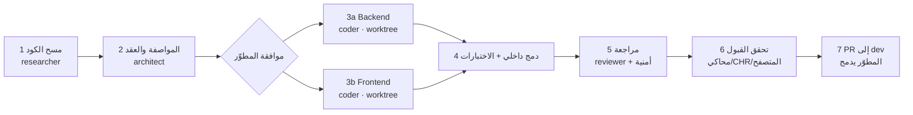

# خطة التطوير — TaqatSpace: من منصة سوق مساحات إلى منصة تشغيل كاملة (وفق SRS CoWorkSpaces)

**الإصدار:** 1.0 — 29 أكتوبر 2026  
**الوثائق المرافقة:** `TaqatSpace-Milestone-Sheet.md` (المهام والجهد والجدول) · `TaqatSpace-Milestone-Sheet.xlsx` (نسخة المتابعة)  
**المراجع:** `SRS — الوثيقة الرئيسية.md` · `CoWorkSpaces-Milestone-Sheet.md` · فحص كود TaqatSpace على فرع `dev` (PR #185)

---

## 1. الهدف والنطاق

**الهدف:** تطوير TaqatSpace ليغطي **كامل** منظومة تشغيل مساحات العمل الموصوفة في الـ SRS، فوق ما هو مبني فعلًا، بحيث تنتقل مساحة TAQAT GAZA من CoWorkSpaces إلى TaqatSpace بالكامل، ثم تُفتح المنصة لمساحات أخرى.

**النطاق (من الألف إلى الياء):**

| # | المجال | يشمل |
| --- | --- | --- |
| 1 | الأساس | المستأجرون (slug/code/خطة)، الفروع، الموظفون بمجموعات صلاحيات، 2FA، سجل التدقيق، الموافقات، الإعدادات الخمسة |
| 2 | الشبكة | تكامل MikroTik (المثبّت، المزامنة، الأوامر، القفل، التحديث، التشخيص) |
| 3 | محرك البيانات | الأجهزة، الجلسات، الحضور بأربعة أنماط، الإحصاءات، الفجوات، الولاء والشرائح، التنبيهات، أدوات السلامة |
| 4 | التشغيل | اللوحة التنفيذية، المراقب المباشر، مركز المشتركين، العقود، Roster، مركز الحجوزات، المكاتب والغرف، طلبات الاشتراك |
| 5 | المالية | الكتالوج، الخطط، الفواتير، السندات، الإشعارات الدائنة، المحفظة، POS، التحصيل، المصروفات، الصندوق، الضريبة، الاستيراد، المؤسسات، الساعات الإضافية، سجل النشاط |
| 6 | برنامج GSG | المعلمات، العطلات، صيغة UR، Tracker، إقفال الشهر، مراجعة UTR، الاستخدام، البرامج، المطالبات |
| 7 | التحليلات | تبويبات التحليلات، 19 تقريرًا، منشئ التقارير، التصدير PDF/Word/Excel/CSV/JSON |
| 8 | السوبر أدمن | المساحات والخطط، اعتماد UTR، الاتفاقيات والمقاعد الممولة، المطالبات، الموافقات، مراقبة الراوترات، التقارير المجمّعة |
| 9 | الفريلانسر | حالتي، الحضور، الفواتير والمحفظة، الطلبات، الاعتراضات، الأجهزة، الملف، الإشعارات |
| 10 | العام | الموقع `/s/{slug}`، منشئ الموقع، النماذج، تسجيل ضيوف الهوتسبوت، النطاق المخصص |
| 11 | القائم | الاكتشاف، الحجز، الدردشة، CMS، المراجعات، الإعلانات، البث، Academy API، الإشعارات — تبقى وتُربط (§8) |
| 12 | الجودة والانتقال | E2E، التقوية، التعريب، الترحيل، UAT، القطع عن CoWorkSpaces |

**خارج النطاق (بقرار):** بوابة دفع إلكتروني، الدخول بـ OTP، شراء خطط المنصة ذاتيًا.

---

## 2. القرارات المعتمدة (2026-10-29)

| # | المحور | القرار | السبب |
| --- | --- | --- | --- |
| D1 | الاتجاه | دمج فوق الموجود | المنصة القائمة تغطي الهوية والحجز والفوترة الأساسية وPOS؛ إعادة البناء هدر |
| D2 | المالية | مالية كاملة لصاحب المساحة **بلا بوابة دفع** | الدفع في غزة نقدي/تحويل/شيك؛ المنصة تسجّل وتتابع |
| D3 | الدخول | Taqat SSO + ربط اسم مستخدم MikroTik؛ تسجيل ضيف ذاتي من الهوتسبوت | SSO مبني ومعتمد؛ الهوتسبوت يغطي الضيوف بلا حساب |
| D4 | الفريق | مطوّر واحد + Claude بوكلاء متعددين | التوازي داخل المرحلة لا بين المراحل |
| D5 | الاستضافة | VPS (2vCPU/4GB + Redis + Supervisor) قبل أول راوتر حقيقي | cPanel المشتركة بلا worker دائم ولا Redis، وحدود عمليات PHP تُسقط اندفاع عودة الكهرباء |
| D6 | البيانات | تشغيل متوازٍ على راوتر TAQAT GAZA بعد M2 + ترحيل بتصدير CSV/Excel | بيانات حقيقية لاختبار الدقة قبل القطع |
| D7 | تكامل الراوتر | **PUSH** (الراوتر يرسل) بدل PULL في `DOCS/mikrotik-integration-plan.md` | الراوترات خلف NAT/CGNAT ولا يصلها الخادم |
| D8 | العقد | توسيع `Subscription` ليصبح Contract | الحجز والفواتير وPOS والاختبارات تعتمد عليه |
| D9 | المالية v2 | تغييرات إضافية خلف flag `finance_v2` مع مزامنة الحالات القديمة | لا كسر للفواتير الحالية أو ≈607 اختبارًا |
| D10 | UR | حاسبة نقية `UrCalculator` + معلمات بإصدارات + نتائج مجمّدة | دقة قابلة للإثبات أمام الجهة المانحة |
| D11 | المكونات المشتركة | `audit_logs` و`approval_requests` مخصصان، TOTP، `phpoffice/phpspreadsheet` و`phpoffice/phpword` | أبسط من الحزم العامة ويناسب نطاق المساحة |
| D12 | المخرجات | Markdown + Excel في `DOCS/new plan/` | مرجع مقروء + نسخة متابعة |

---

## 3. الوضع الحالي للنظام

### 3.1 المستودع والإصدارات

| البند | الحالة |
| --- | --- |
| `dev` | PR #185 (2026-07-07) — آخر عمل: POS/الكاشير |
| `origin/main` (الإنتاج) | PR #162 (2026-06-30) — **32 commit (كل POS) غير منشورة** |
| آخر نشاط | 2026-07-07 (المشروع خامل منذ ≈ 16 أسبوعًا) |
| النشر | GitHub Actions: `dev` → staging، `main` → production (`.github/workflows/deploy-*.yml`) على cPanel |
| وثائق متقادمة | `README.md` (06-11)، `DOCS/presentation/FEATURES.md` (06-09)، `DOCS/taqat_space_dev_plan.xlsx` (كلها Todo) |

### 3.2 التقنية

| الطبقة | التفاصيل |
| --- | --- |
| Backend | Laravel 13، PHP 8.3، MySQL 8 (sqlite للاختبارات)؛ Controllers → Services → Eloquent (مستودعان فقط: `WorkspaceRepository`، `UserRepository`)؛ 74 FormRequest، 27 Resource، 23 Enum، `ApiResponse`؛ UUID؛ مسارات معيارية `backend/routes/api/*.php` |
| الحجم | 40 migration، 27 model، 66 controller، ≈50 service، 23 إشعارًا، 5 أوامر مجدولة، ≈607 اختبار Feature |
| الحزم | Sanctum، spatie/laravel-permission، mPDF، firebase/php-jwt، S3، Scramble (OpenAPI) — لا Excel ولا 2FA ولا سجل نشاط |
| Frontend | Next 16 App Router، React 19، next-intl (ar/en)، مكونات UI خاصة (`frontend/src/components/ui/`)، recharts، MapLibre؛ قراءة بـ `serverFetch` وكتابة بـ Server Actions؛ 65 صفحة، 171 مكوّنًا، Vitest (17) وPlaywright (1) |
| الوقت الحقيقي | Firestore (دردشة) + FCM (إشعارات) — اختياري عبر env |
| الاستضافة | cPanel مشترك؛ Next.js standalone خلف mod_proxy؛ الطابور `database` يُفرّغ بالـ cron كل دقيقة |

### 3.3 الجرد حسب الدور

| الدور | الصفحات | أهم الموجود |
| --- | --- | --- |
| الزائر العام | 7 | الرئيسية (CMS)، الاستكشاف بالخريطة والفلاتر، صفحة المساحة مع BookingPanel، من نحن، الأسئلة، التواصل |
| المصادقة | 9 | Taqat SSO (OIDC + PKCE)، اختيار الدور عند أول دخول، قبول دعوة الكاشير، دخول محلي للأدمن |
| صاحب المساحة | 26 | لوحة KPIs، الأعضاء، الاشتراكات، لوحة المقاعد، طلبات الحجز، باقات الإنترنت، الموارد، POS (terminal/منتجات/تقارير)، الكاشيرية، الفواتير، المصروفات، الدردشة، البث، الإعلانات، التقارير (aging، P&L، الباقات) + تصدير CSV، الإعدادات (7 تبويبات) |
| الكاشير | 4 | نقطة البيع، المنتجات (بصلاحية)، التقارير، الملف |
| الفريلانسر | 8 | الرئيسية مع بيانات دخول الإنترنت، الاشتراك (إلغاء/تقييم)، الفواتير ورفع الإيصال، طلب من الكافيه، الدردشة، الإشعارات، الملف |
| السوبر أدمن | 19 | لوحة KPIs، المساحات (موافقة/تعليق/نشر)، المستخدمون، الأدمنز بسبع صلاحيات **مطبّقة** (`can.permission` في 12 ملف routes)، الاشتراكات والفواتير (تعليم مدفوع + إيصال)، التقارير والتحليلات (مدينة/جنس)، CMS (الرئيسية، المحتوى، الهوية، من نحن، المدن)، المراسلة (SMS/SMTP، البث، الاستهلاك، صندوق التواصل)، الدردشة |
| التكامل | — | Partner API لـ Academy بـ `X-Api-Key` مُجزّأ + webhooks موقّعة (`backend/app/Services/Partner/`) |

### 3.4 مشاكل قائمة يجب معالجتها

| المشكلة | الأثر | المعالجة |
| --- | --- | --- |
| مسار غير محمي `ops/clear-cache-9f3a2c` في `backend/routes/web.php` | أي شخص يمسح الكاش | M0.2 |
| لا شيء يحوّل الاشتراك إلى `expired` | اشتراكات منتهية تبقى نشطة | M0.4، M4.7 |
| `InvoiceService::delete` يحذف أي فاتورة حذفًا فعليًا | يخالف BR-FIN-01 | M5.5 |
| تنبيه الانتهاء قبل 3 أيام بدل 14 | يخالف FR-MEM-03 | M4.7 |
| `PaymentMethod` = نقدي/تحويل فقط، `PlanType` = شهري/يومي/مخصص | لا بطاقة ولا شيك ولا أنواع أسبوعي/ساعة/زائر/موظف | M4.8، M5.7 |
| `SeatService::assign` لا يتحقق من نوع الخطة | يخالف BR-FIN-04 | M5.17 |
| أسرار مكشوفة سابقًا (DB، AWS، Firebase، SSO) | خطر أمني | M0.3 |
| لا عملة ولا منطقة زمنية لكل مساحة | يخالف §3.7 عام | M1.7 |

---

## 4. قاموس المصطلحات (SRS → TaqatSpace)

| مصطلح الـ SRS | المقابل في TaqatSpace | ملاحظة |
| --- | --- | --- |
| المساحة (Workspace) | `Workspace` | يضاف slug وcode وخطة المنصة وحالتها |
| صاحب المساحة | `User` بدور `workspace_owner` | مساحة واحدة لكل مالك حاليًا |
| موظف المساحة | `User` بدور `cashier` ← يُعمَّم إلى «موظف» | مجموعات: صندوق، ضيافة، مشرف مالي |
| المشترك / الفريلانسر | `User` بدور `freelancer` + `Subscription` | يضاف: حقول المانح، اسم MikroTik، الأجهزة؛ ويُسمح بمشترك **بلا حساب SSO** (من الاستيراد/الاكتشاف/الضيف) يُدمج عند أول دخول (M1.13) |
| العقد / الاشتراك المالي | `Subscription` بعد توسيعه | مسودة، سماح، تجديد تلقائي، خطة، ساعات |
| طلب الاشتراك | `BookingRequest` | يُفتح للزوار بلا حساب |
| المكتب (Station) | `Seat` بعد توسيعه | منطقة، فرع، سعة، خصوصية، تبعية |
| غرفة الاجتماعات | `workspace_resources` (meeting_room) | تصبح قابلة للحجز |
| الخطة (Plan) | جدول `plans` جديد | `seat_type_prices` يبقى للعرض العام |
| الصنف / التصنيف | `catalog_items` / `catalog_categories` | منتجات POS تُربط بها |
| سند القبض | `receipts` + `receipt_allocations` | تُرحَّل إليها `invoice_payments` |
| باقة الإنترنت | `InternetPackage` | تُترجم إلى ملف هوتسبوت (سرعة وحد بيانات) |
| بيانات دخول الإنترنت | `hotspot_accounts` | بدل `subscriptions.internet_username` |
| مفتاح API للراوتر | `routers.api_key_hash` + `AuthenticateRouter` | على نمط `AuthenticatePartner` |
| السوبر أدمن | `User` بدور `admin` + Spatie `super_admin`/`admin` | تضاف صلاحيات للوحدات الجديدة |

---

## 5. مصفوفة الفجوة التفصيلية

كل متطلب في الـ SRS مقابل الكود الحالي، بمسارات ملفات مُتحقَّق منها. الحالة: ✅ موجود · 🟨 جزئي · ⬜ جديد. ربط كل بند بمهمة موجود في عمود «مرجع SRS» في الشيت.

**الإجمالي:** 136 بندًا — ✅ موجود 3 · 🟨 جزئي 59 · ⬜ جديد 74.

مفتاح الحالة: ✅ موجود / 🟨 جزئي / ⬜ جديد

ملاحظات عامة تم التحقق منها:
- لا يوجد أي ذكر لـ MikroTik/RADIUS/أجهزة/حضور في `backend/` أو `frontend/src/` (InternetAccessService يولّد اسم مستخدم/كلمة مرور ويرسلها فقط، والتزويد على الراوتر "مرحلة لاحقة" بحسب تعليق الملف).
- لا يوجد: 2FA، VAT/ضريبة، wallet/محفظة، slug/code للمساحة، سجل نشاط/تدقيق، استيراد XLSX، مؤسسات، فروع/مناطق.
- `PaymentMethod` = cash/transfer فقط. `PlanType` = monthly/daily/custom فقط. `InvoiceStatus` = pending/under_review/payment_rejected/partially_paid/paid/overdue/cancelled (لا مسودة).
- حذف الفاتورة (`InvoiceService::delete`) حذف فعلي، وليس إلغاءً منطقيًا.
- `BookingRequest` = طلب عضوية من فريلانسر مسجّل (`role.freelancer`)، وليس حجز غرفة اجتماعات من زائر عام. حالاته pending/approved/rejected فقط.
- اختصارات لوحة المفاتيح: فقط `Escape` في `DashShell.tsx` — لا F2 ولا Alt+x.

### §2.3 أنواع الاشتراك

| المعرّف | المتطلب (مختصر بالعربية) | الحالة | الموجود حاليًا (مسارات ملفات مؤكدة) | الناقص |
|---|---|---|---|---|
| SUBTYPE | أنواع الاشتراك: شهري، أسبوعي، يومي، بالساعة، زائر، موظف + طرق تسعير الخطط (ثابت، بالساعات، بالـGB، باقة بحد وصلاحية) | 🟨 | `backend/app/Enums/PlanType.php` (monthly/daily/custom)، `backend/app/Models/Subscription.php`، `backend/app/Models/InternetPackage.php` | إضافة weekly وhourly وvisitor وstaff إلى PlanType؛ نموذج خطة مالية بـ6 طرق تسعير (ساعات/GB/باقة بصلاحية)؛ ربط الاشتراك بالخطة وسعر الزيادة |

### §2.2 / §6 موظف المساحة

| المعرّف | المتطلب (مختصر بالعربية) | الحالة | الموجود حاليًا (مسارات ملفات مؤكدة) | الناقص |
|---|---|---|---|---|
| STAFF-01 | دعوة موظف بالبريد + مجموعات جاهزة (صندوق/ضيافة/مشرف مالي) أو صلاحيات فردية | 🟨 | `backend/app/Services/Pos/CashierManagementService.php`، `backend/app/Enums/PosPermission.php` (4 صلاحيات POS فقط)، `frontend/src/components/features/owner/CashiersManager.tsx` | توسيع الدور من "كاشير POS" إلى موظف مساحة عام بصلاحيات مالية (فواتير، مصروفات، أصناف، استيراد، تقارير)؛ مجموعات جاهزة؛ صفحة `/settings/staff` |
| SEC-2FA | مصادقة ثنائية لإصدار/إلغاء الفواتير (للموظف) | ⬜ | لا يوجد (لا TOTP/OTP في `backend/app`) | TOTP أو OTP عبر البريد/SMS، تسجيل جهاز، middleware يفرضها على إصدار/إلغاء الفاتورة |
| UX-KBD | اختصارات لوحة المفاتيح (F2 اختيار مشترك، Alt+S/A/R/L) | ⬜ | `frontend/src/components/layout/DashShell.tsx` (Escape فقط) | hook اختصارات عام، F2 في `PosTerminal.tsx`، اختصارات اللوحة، مساعدة اختصارات |

### §3.1 الرئيسية

| المعرّف | المتطلب (مختصر بالعربية) | الحالة | الموجود حاليًا (مسارات ملفات مؤكدة) | الناقص |
|---|---|---|---|---|
| FR-DSH-01 | درجة صحة المساحة /100 بأربعة مكونات + توصيات | ⬜ | `backend/app/Services/OwnerDashboardService.php` (إشغال، إيراد فقط) | خوارزمية الدرجة (استخدام/احتفاظ/نشاط/اتصال) وتوصيات نصية؛ تعتمد الاتصال والنشاط على بيانات الحضور غير الموجودة |
| FR-DSH-02 | بطاقات KPI: نشطون، متصلون الآن، حضور اليوم، UR، تنزيل/رفع، DAU/WAU/MAU، الأجهزة | 🟨 | `backend/app/Services/OwnerDashboardService.php`، `frontend/src/app/[locale]/(dashboard)/owner/page.tsx` | الموجود: نشطون، إشغال، مقاعد متاحة، طلبات معلقة، فواتير متأخرة. الناقص: كل بطاقات الشبكة والحضور وUR |
| FR-DSH-03 | رسوم: نشاط 30 يومًا، توزيع الأنواع، استهلاك الإنترنت، ساعات الذروة، أيام الأسبوع | 🟨 | `backend/app/Services/OwnerDashboardService.php` (revenue_chart 6 أشهر، members_by_status، members_by_gender)، `frontend/src/app/[locale]/(dashboard)/owner/page.tsx` | رسوم النشاط والاستهلاك وساعات الذروة وأيام الأسبوع (تتطلب حضور/شبكة)؛ توزيع أنواع الاشتراك بدل الحالة |
| FR-DSH-04 | النمو والتفاعل: جدد، احتفاظ، معرّضون للتوقف 14+ يومًا، DAU/MAU | ⬜ | لا يوجد (OwnerDashboardService لا يحسبها) | حساب الجدد والاحتفاظ؛ مؤشر التوقف يتطلب بيانات النشاط |
| FR-DSH-05 | إيراد متوقع، ARPU، نسبة إشغال المقاعد (كتقدير) | 🟨 | `backend/app/Services/OwnerDashboardService.php` (occupancy_pct، revenue_this_month/last_month) | الإيراد المتوقع وARPU وتوضيح أنه تقدير |
| FR-DSH-06 | شرائح المشتركين: أبطال، معرّضون، منسحبون، جدد، خاملون، منتظمون | ⬜ | لا يوجد | محرك تقسيم (segmentation) يعتمد سجل الحضور/الاستخدام |
| FR-DSH-07 | توقع الشهر القادم بانحدار OLS مع R² وموثوقية | ⬜ | لا يوجد | خدمة توقع (OLS) على الإيراد/الحضور وعرض R² |
| FR-DSH-08 | قائمة "يحتاجون متابعة" وجدول ولاء + اختصارات Alt+S/A/R/L | ⬜ | لا يوجد (انظر UX-KBD) | مؤشر الولاء وقائمة المتابعة والاختصارات |
| FR-DSH-09 | آخر مزامنة وعدد اللقطات 24 ساعة + زر تحديث يدوي | ⬜ | لا يوجد (لا مزامنة شبكة) | يتبع بناء تكامل MikroTik وجدول snapshots |
| FR-NET-01 | جدول الأجهزة المتصلة (مستخدم، نوع، MAC، IP، uptime، تنزيل/رفع) | ⬜ | لا يوجد؛ الأقرب `backend/app/Services/InternetAccessService.php` (اعتمادات فقط) | نموذج Device وربطه بالمشترك، مزامنة MikroTik، صفحة `/live-monitor` |
| FR-NET-02 | تحديث تلقائي كل 30 ثانية | ⬜ | لا يوجد | polling أو WebSocket في صفحة المراقب |
| FR-NET-03 | تبويبات: متصلون الآن، الفجوات، الاستخدام، الاتجاهات | ⬜ | لا يوجد | تخزين جلسات وتحليل الانقطاعات والاتجاهات |
| FR-ALR-01 | توليد تنبيهات آلية: استهلاك مرتفع، جهاز جديد، خطر تسرب، غير نشط | ⬜ | لا يوجد (يوجد نظام إشعارات عام `owner/notifications/page.tsx` لكنه ليس محرك تنبيهات) | نموذج Alert + مهام مجدولة بعتبات؛ تعتمد بيانات الشبكة/الحضور |
| FR-ALR-02 | تصنيف الخطورة وعدادات وترقيم 30 | ⬜ | لا يوجد | صفحة `/alerts` وعدادات (إجمالي/غير مقروءة/اليوم/حرجة) |

### §3.2 التجاري

| المعرّف | المتطلب (مختصر بالعربية) | الحالة | الموجود حاليًا (مسارات ملفات مؤكدة) | الناقص |
|---|---|---|---|---|
| FR-SUB-01 | جدول شهري: أيام، نسبة الحضور، ساعات، GB، خطة، غير المفوتر، رصيد | 🟨 | `backend/app/Services/OwnerSubscriptionService.php`، `frontend/src/components/features/owner/SubscriptionsTable.tsx`، `frontend/src/app/[locale]/(dashboard)/owner/subscriptions/page.tsx` | الموجود: قائمة الاشتراكات بالحالة/السعر. الناقص: الأيام والحضور والساعات وGB (حضور/شبكة)، "غير المفوتر" والرصيد (محفظة/دفتر حساب مشترك) |
| FR-SUB-02 | بحث (اسم/هاتف/مستخدم) وترتيب بـ6 معايير | 🟨 | `backend/app/Services/OwnerSubscriptionService.php` (applySearch/applySort)، `backend/app/Services/MemberService.php` | مراجعة حقول البحث (اسم مستخدم الإنترنت) ومعايير الترتيب الستة |
| FR-SUB-03 | بطاقات: حاضرون، عليهم مبالغ، إجمالي مستحق، رصيد محافظ، اشتراكات نشطة | 🟨 | `backend/app/Services/InvoiceService.php` (workspaceSummary)، `backend/app/Services/OwnerDashboardService.php` | الموجود: ملخص فواتير وعدد النشط. الناقص: الحاضرون ورصيد المحافظ (المحفظة غير موجودة) |
| FR-RMB-01 | استقبال حجوزات غرف الاجتماعات من الموقع العام ومراجعتها (معلق/موافق/مرفوض/ملغى/قادم) | 🟨 | `backend/app/Services/BookingService.php`، `frontend/src/app/[locale]/(dashboard)/owner/bookings/page.tsx`، `backend/app/Models/Resource.php` (ResourceType::MeetingRoom كمخزون فقط) | الموجود: طلبات عضوية (pending/approved/rejected) من مستخدم مسجّل. الناقص: حجز غرفة بتاريخ/وقت من زائر عام بدون حساب، حالتا ملغى/قادم، منع التعارض، ربط بـResource |
| FR-RMB-02 | بحث باسم الضيف/بريده وتصفية بالتاريخ | ⬜ | لا يوجد (طلبات العضوية بلا حقول ضيف/تاريخ حجز) | حقول guest_name/email/date وفلاتر البحث |

### §3.3 المالية

| المعرّف | المتطلب (مختصر بالعربية) | الحالة | الموجود حاليًا (مسارات ملفات مؤكدة) | الناقص |
|---|---|---|---|---|
| FR-FIN-01 | قسم "ما يحتاج انتباهك" (مثل مشتركون فعالون بلا اشتراك مالي) | ⬜ | `frontend/src/components/features/invoices/OwnerInvoiceAlert.tsx` (تنبيه فواتير فقط) | لوحة `/finance` وقواعد الانتباه وروابطها |
| FR-FIN-02 | أربعة أرقام: مقبوض، مصروف، نتيجة تشغيلية، مفوتر غير مدفوع؛ كل بطاقة تفتح سجلاتها | 🟨 | `backend/app/Services/OwnerReportsService.php` (profit_loss)، `backend/app/Services/ExpenseService.php` (summaryForWorkspace)، `backend/app/Services/InvoiceService.php` (workspaceSummary) | ما تجمّع في لوحة مالية واحدة مع drill-down؛ دمج مقبوضات POS مع الفواتير |
| FR-FIN-03 | أعمار الذمم وأعلى الأرصدة + خيار إظهار تفاصيل الفوترة والضريبة | 🟨 | `backend/app/Services/OwnerReportsService.php` (aging)، `frontend/src/components/features/owner/OwnerReportsSections.tsx` | أعلى الأرصدة حسب المشترك؛ تبديل إظهار الضريبة (لا ضريبة) |
| FIN-POS | POS: اختيار مشترك F2، كتالوج أو بند يدوي، خصم وسببه، "إضافة للحساب" أو "تحصيل" (نقدي/بطاقة/تحويل/شيك)، لوحة أرقام، استخدام مقاعد | 🟨 | `backend/app/Services/Pos/PosOrderService.php`، `frontend/src/components/features/cashier/PosTerminal.tsx`، `frontend/src/app/[locale]/(dashboard)/owner/pos/terminal/page.tsx` | الموجود: طلبات POS بكتالوج ومخزون وخصم وطريقتي دفع cash/transfer وحالات وإرجاع. الناقص: بطاقة/شيك، بند يدوي، سبب الخصم، "إضافة إلى الحساب" (دفتر مشترك)، F2، لوحة أرقام، بيع استخدام مقاعد |
| FIN-INV | فاتورة يدوية، تجهيز جماعي بالشهر مع معاينة، مسودة→إصدار، حالات ودفع، فلتر المتأخر | 🟨 | `backend/app/Services/InvoiceService.php`، `backend/app/Services/InvoicePdfService.php`، `frontend/src/components/features/invoices/IssueInvoiceModal.tsx` | الموجود: فاتورة يدوية (مبلغ واحد)، توليد شهري آلي (أمر مجدول)، مدفوعات جزئية، PDF، متأخر، تذكير. الناقص: بنود متعددة، مسودة/إصدار، معاينة التجهيز الجماعي، ضريبة، عدم قابلية التعديل |
| FIN-COL | تحصيلات: أعمار الديون 0–90+، تسجيل متابعة بملاحظة، فلتر "لا أستطيع التواصل" | 🟨 | `backend/app/Services/OwnerReportsService.php` (aging)، `backend/app/Services/InvoiceService.php` (sendReminder/remindOverdue)، `frontend/src/components/features/owner/OwnerReportsSections.tsx` | شاشة `/finance/collections` ونموذج متابعة (ملاحظة، نتيجة تواصل) وفلتر عدم الاستجابة |
| FIN-RCP | سندات قبض: دفعة موزعة على فواتير، حالات الشيك، فرز بتاريخ التحصيل/الاستلام | 🟨 | `backend/app/Models/InvoicePayment.php`، `backend/app/Services/InvoiceService.php` (recordPayment، approveReceipt)، `frontend/src/components/features/invoices/RecordPaymentButton.tsx` | الموجود: دفعات على فاتورة واحدة مع إيصال مرفوع ومراجعة. الناقص: سند قبض مستقل بترقيم، توزيع دفعة على عدة فواتير، حالات الشيك، تاريخ التحصيل مقابل الاستلام |
| FIN-EXP | مصروفات: تصنيف، وسيلة دفع، مرجع، إلغاء | 🟨 | `backend/app/Services/ExpenseService.php`، `backend/app/Models/Expense.php`، `frontend/src/components/features/owner/ExpensesTable.tsx` | الموجود: CRUD + تجميع بالفئة والشهر + تصدير + مخطط. الناقص: وسيلة الدفع والمرجع والإلغاء (بدل الحذف) وتصنيفات ديناميكية |
| FIN-CN | إشعارات دائنة مرتبطة بفاتورة صادرة مع سبب | ⬜ | لا يوجد (`InvoiceStatus::Cancelled` موجود لكن الحذف فعلي) | جدول credit_notes، ترقيم، ربط بالفاتورة، سبب، أثر على الذمم |
| FIN-PV | مبالغ مستردة: سند صرف من حساب المشترك عند إعادة رصيد المحفظة | ⬜ | لا يوجد (إرجاع POS فقط: `backend/app/Services/Pos/PosOrderService.php`) | سند صرف، المحفظة/الرصيد، ترقيم وتدقيق |
| FIN-CASH | مطابقة الصندوق: حركة اليوم حسب الوسيلة وحاسبة عدّ النقد | 🟨 | `backend/app/Services/Pos/PosReportService.php` (byMethod)، `frontend/src/components/features/pos/PosReports.tsx` | حركة اليوم حسب الوسيلة تغطي POS فقط. الناقص: دمج مدفوعات الفواتير والمصروفات (داخل/خارج/صافي) وحاسبة عدّ النقد، وشاشة `/finance/cash-up` |
| FIN-IMP | استيراد XLSX للكتالوج/المسحوبات مع معاينة واعتماد ذري | ⬜ | لا يوجد (تصدير فقط: `backend/app/Services/Owner/OwnerExportService.php`) | رفع وتحقق (≤2000 صف/5MB/بلا معادلات)، معاينة، transaction، منع التكرار |
| FIN-VAT | تقرير ضريبة القيمة المضافة على أساس الاستحقاق | ⬜ | لا يوجد | معدل الضريبة بالإعدادات، تجميده عند الإصدار، حقول ضريبة بالفاتورة، تقرير وتنزيل |
| FIN-PLN | خطط: 6 طرق تسعير، سعر الزيادة، مقعد مخصص، عرض خاص، أرشفة | 🟨 | `backend/app/Services/PackageService.php`، `backend/app/Models/InternetPackage.php`، `backend/app/Services/SeatTypePricingService.php` | الموجود: باقات إنترنت (سرعة، سعر، حد GB، فعّال) وأسعار أنواع المقاعد. الناقص: خطة مالية موحدة بطرق التسعير الستة وسعر الزيادة والعرض الخاص والأرشفة |
| FIN-ITM | أصناف: رمز ثابت، اسم عربي/إنجليزي، تصنيف، وحدة، سعر | 🟨 | `backend/app/Services/Pos/PosProductService.php`، `backend/app/Models/PosProduct.php`، `frontend/src/components/features/owner/PosManager.tsx` | الموجود: منتج (name، sku، category نصي، price، مخزون). الناقص: اسمان عربي/إنجليزي، وحدة، ربط بتصنيف، استخدامه في الفواتير |
| FIN-CAT | تصنيفات مبيعات ومصروفات برمز ثابت وترتيب وأرشفة | 🟨 | `backend/app/Enums/ExpenseCategory.php` (7 قيم ثابتة)، `backend/app/Models/PosProduct.php` (category نص حر) | جدول تصنيفات ديناميكي (مبيعات/مصروفات) برمز وترتيب وأرشفة |
| FIN-AH | ساعات إضافية: قواعد احتساب بعد الدوام ومعاينة (متوقفة حاليًا) | ⬜ | لا يوجد (`working_hours` في `backend/app/Models/Workspace.php` للعرض فقط) | قواعد احتساب ومعاينة شهرية؛ تتطلب بيانات حضور؛ متوقفة في المرجع فيمكن تأجيلها |
| FIN-SEAT | مقاعد: إشغال اليوم، إيراد المخصصة، حالات (متاح/مخصص/محجوز لاحقًا/خارج الخدمة)، تحرير المنتهية | 🟨 | `backend/app/Services/SeatService.php`، `backend/app/Enums/SeatStatus.php`، `frontend/src/components/features/owner/SeatBoard.tsx` | الموجود: خريطة مقاعد وإسناد/إلغاء وحالات available/occupied/reserved/maintenance. الناقص: إيراد المقاعد المخصصة، "محجوز لاحقًا" بتاريخ، تحرير تلقائي للمنتهية |
| FIN-ORG | مؤسسات: شركة تدفع عن أفرادها بفاتورة موحدة مع رقم ضريبي | ⬜ | لا يوجد | جدول organizations وربط الأعضاء وقواعد تغطية وفاتورة موحدة وقيمة ضريبية |
| FIN-ACT | سجل النشاط المالي (17 إجراء: من/متى/لماذا) | ⬜ | لا يوجد | جدول audit للإجراءات المالية ومراقب (observer/service) وشاشة عرض بفلاتر |
| BR-FIN-01 | الفاتورة الصادرة لا تُعدّل؛ التصحيح بإشعار دائن أو إلغاء | 🟨 | `backend/app/Services/InvoiceService.php` (delete حذف فعلي)، `backend/app/Http/Controllers/InvoiceController.php` | حذف فعلي مسموح حاليًا (يخالف القاعدة). المطلوب: إلغاء منطقي + منع التعديل بعد الإصدار + إشعار دائن |
| BR-FIN-02 | النقد وحده يدخل الصندوق، والوسائل الأخرى للمطابقة فقط | ⬜ | `backend/app/Enums/PaymentMethod.php` (cash/transfer) بلا مفهوم صندوق | تمييز مدفوعات النقد في cash-up وإضافة وسائل بطاقة/شيك |
| BR-FIN-03 | لا ضريبة ما لم يُحدد معدل في الإعدادات ← التشغيل | ⬜ | لا يوجد (لا ضريبة في النظام) | حقل معدل الضريبة بإعدادات التشغيل وتطبيقه عند الإصدار فقط |
| BR-FIN-04 | المقعد المخصص يتطلب خطة شهرية أو أسبوعية أو باقة | 🟨 | `backend/app/Services/SeatService.php` (assign يتطلب اشتراكًا نشطًا فقط) | التحقق من نوع الخطة (شهري/أسبوعي/باقة) عند الإسناد |

### §3.6 الأماكن

| المعرّف | المتطلب (مختصر بالعربية) | الحالة | الموجود حاليًا (مسارات ملفات مؤكدة) | الناقص |
|---|---|---|---|---|
| FR-STN-01 | المكاتب: إضافة مفرد أو مجمّع (بدء، عدد، بادئة)، نوع، منطقة، سعة، خصوصية، تبعية؛ غرف الاجتماعات للحجز العام | 🟨 | `backend/app/Services/SeatService.php`، `backend/app/Services/ResourceService.php`، `frontend/src/components/features/owner/SeatBoard.tsx` | الموجود: مقاعد بأنواع fixed/flexible/private_office وموارد (meeting_room…) بكمية. الناقص: إضافة مجمّعة برقم بدء وبادئة، المنطقة، السعة/الخصوصية لكل مكتب، التبعية، عرض الغرف للحجز العام |
| FR-STN-02 | تبويبات: المخزون، الآن، الشهر، الفروع (تعدد الفروع) | ⬜ | لا يوجد (`Workspace` واحدة لكل مالك، لا فروع/zones) | نموذج branches/zones، تبويبات العرض، ونطاق الاستعلامات بالفرع |

### §3.7 الإعدادات

| المعرّف | المتطلب (مختصر بالعربية) | الحالة | الموجود حاليًا (مسارات ملفات مؤكدة) | الناقص |
|---|---|---|---|---|
| SET-GEN | عام: اسم، وصف، slug ثابت، تواصل، بنك وIBAN مجمّد، منطقة زمنية وعملة، بيانات واي فاي | 🟨 | `backend/app/Services/WorkspaceService.php` (updateSettings)، `backend/app/Http/Requests/Workspace/UpdateWorkspaceRequest.php`، `frontend/src/components/features/owner/SettingsTabs.tsx` | الموجود: اسم، وصف، عنوان، مدينة، هاتف، موقع، شعار/صور، مرافق. الناقص: slug، بيانات البنك/IBAN، المنطقة الزمنية والعملة، بيانات الواي فاي، البريد/التواصل |
| SET-OPS | التشغيل: سعة، وضع الجلوس، ساعات وأيام العمل، أسعار الأنواع، الضريبة؛ الحفظ "يُرسل للموافقة" | 🟨 | `backend/app/Services/SeatTypePricingService.php`، `backend/app/Services/WorkspaceService.php` (updateSeatTypes)، `frontend/src/components/features/owner/SettingsTabs.tsx` (تبويبا seatTypes وhours) | الموجود: أسعار أنواع المقاعد وسعتها وساعات العمل (حفظ مباشر). الناقص: وضع الجلوس ثابت/مرن، الضريبة، سير موافقة السوبر أدمن على التغيير، العطل |
| SET-DNS | النطاق وDNS: رابط اللوحة والموقع العام، طلب نطاق مخصص | ⬜ | لا يوجد | حقول النطاق وطلب النطاق المخصص وموافقة الأدمن |
| SET-API | API والتكامل: حالة MikroTik، رمز المساحة، endpoint، إعادة إنشاء مفتاح API، حالة الخطة، فحص وتشخيص | ⬜ | لا يوجد للمالك؛ الأقرب `backend/app/Models/PartnerClient.php` (مفاتيح شريك UR، ليست للمساحة) | مفتاح API ورمز لكل مساحة وإعادة توليده، حالة المزامنة، مركز تشخيص |
| SET-DNG | منطقة الخطر: إعادة تعيين المساحة (حذف مشتركين/أجهزة/عقود/إحصاءات…) | ⬜ | لا يوجد | عملية إعادة تعيين بتأكيد وtransaction مع إبقاء الهوية والمالك وتوليد مفتاح API جديد |

ملاحظة منهجية: لا يوجد في الكود أي مفهوم لـ MikroTik/Router/Device/Attendance/Contract/Roster/UR/Program/Claim/Holiday/Parameter/AuditLog/2FA/OTP (تم التحقق بـ Grep). أقرب المكافئات: `Subscription` (اشتراك واحد بمقعد)، `Seat`، `BookingRequest`، `Invoice`/`InvoicePayment`، `PosOrder`، `Expense`، `Resource`، `Workspace`. الأدوار الحالية: `freelancer`, `workspace_owner`, `admin`, `cashier` (`backend/app/Enums/UserRole.php`).

### §3.4 — مركز المشتركين (FR-MEM)

| المعرّف | المتطلب (مختصر بالعربية) | الحالة | الموجود حاليًا (مسارات ملفات مؤكدة) | الناقص |
| --- | --- | --- | --- | --- |
| FR-MEM-01 | تبويبات مركز المشتركين (اليوم، المشتركون، أسبوعي، شهري، تقويم، عقود، زوار، تنبيهات، ملفات، إدارة جماعية) | 🟨 | `frontend/src/app/[locale]/(dashboard)/owner/members/page.tsx`، `frontend/src/components/features/owner/MembersTable.tsx` | صفحة قائمة أعضاء واحدة فقط؛ كل التبويبات الباقية جديدة |
| FR-MEM-02 | تبويب «اليوم»: سعة 640 ساعة/يوم، متعاقد مقابل فعلي، تحميل بالساعة بعتبات 70%/90% | ⬜ | `backend/app/Services/OwnerDashboardService.php` (نسبة إشغال مقاعد فقط) | لا ساعات ولا حضور فعلي ولا سعة بالساعات؛ يحتاج بيانات جلسات |
| FR-MEM-03 | العقود بآلة حالات (مسودة/نشط/معلق/منتهي/ملغى)، تمديد وتجديد جماعي، تنبيه 14 يومًا | 🟨 | `backend/app/Enums/SubscriptionStatus.php`، `backend/app/Services/OwnerSubscriptionService.php`، `backend/app/Console/Commands/NotifyExpiringSubscriptions.php` | الحالات الحالية: pending/active/suspended/expired/cancelled دون مسودة ولا انتقالات محكومة؛ تجديد فردي فقط (لا جماعي)؛ تنبيه 3 أيام بدل 14؛ لا أيام سماح ولا تجديد تلقائي ولا كيان Contract |
| FR-MEM-04 | زوار مباشرون بلا اشتراك + فجوة إيراد واقتراح نوع | ⬜ | — | يحتاج لقطات أجهزة/حضور الراوتر |
| FR-MEM-05 | تنبيهات مختصة (عقود تنتهي، غير نشط 30+، انخفاض ولاء، عمل إضافي، زوار متكررون، امتلاء) | 🟨 | `backend/app/Notifications/SubscriptionExpiringNotification.php`، `backend/app/Console/Commands/NotifyExpiringSubscriptions.php`، `backend/app/Notifications/InvoiceOverdueNotification.php` | إشعار انتهاء اشتراك وفواتير متأخرة فقط؛ لا محرك قواعد (Alert Rule) ولا عتبات ولا تهدئة ولا بقية الأنواع |
| FR-MEM-06 | معالج الملف: جنس، تعليم (10)، تخصص (35)، حالة وظيفية، اسم MikroTik | 🟨 | `backend/app/Models/User.php` (gender, specialty, bio)، `backend/app/Enums/Gender.php`، `backend/app/Http/Controllers/ProfileController.php` | الجنس والتخصص (نص حر) فقط؛ لا مستوى تعليمي ولا حالة وظيفية ولا قوائم مقيدة ولا اسم مستخدم MikroTik (الأقرب `internet_username` في `Subscription`) |
| FR-MEM-07 | إدارة جماعية + اكتشاف تلقائي ذكي لنوع الاشتراك + تصدير CSV | 🟨 | `backend/app/Services/Owner/OwnerExportService.php`، `backend/routes/api/owner-members.php` | تصدير CSV للأعضاء موجود؛ لا عمليات جماعية ولا اكتشاف ذكي |
| FR-MEM-08 | ملف المشترك: نظرة عامة، اشتراك، درجات، نشاط، مقارنة أقران، ولاء/قوة، تقويم نشاط، أجهزة | 🟨 | `backend/app/Services/MemberService.php` (memberDetail)، `frontend/src/components/features/owner/MemberDrawer.tsx`، `frontend/src/components/features/owner/MemberAnalytics.tsx` | تفاصيل مستخدم/اشتراك/مقعد/فواتير موجودة؛ لا درجات ولاء/قوة ولا أقران ولا تقويم نشاط ولا أجهزة |
| FR-MEM-09 | القائمة الشهرية (Roster): تعبئة/نسخ الشهر الماضي وحساب الساعات المحجوزة من السعة | ⬜ | — | كيان Roster Entry ووظائف النسخ والحساب كلها جديدة |

### §3.4 — طلبات الاشتراك (FR-REQ)

| المعرّف | المتطلب (مختصر بالعربية) | الحالة | الموجود حاليًا (مسارات ملفات مؤكدة) | الناقص |
| --- | --- | --- | --- | --- |
| FR-REQ-01 | مراجعة طلبات العضوية من الموقع العام بحالات معلق/موافق/مرفوض/متوفر/ملغى | 🟨 | `backend/app/Services/BookingService.php`، `backend/app/Http/Controllers/BookingRequestController.php`، `frontend/src/components/features/owner/BookingsManager.tsx` | الحالات: pending/approved/rejected فقط (`BookingStatus`)؛ مقدّم الطلب يجب أن يكون فريلانسر مسجّل الدخول (لا نموذج عام للزوار)؛ لا «متوفر» ولا «ملغى»؛ الموافقة تنشئ اشتراك + فاتورة ويُبلَّغ Webhook |

### §3.4 — مركز الحجوزات (FR-BKG)

| المعرّف | المتطلب (مختصر بالعربية) | الحالة | الموجود حاليًا (مسارات ملفات مؤكدة) | الناقص |
| --- | --- | --- | --- | --- |
| FR-BKG-01 | عروض: خط زمني، تقويم، عقود، حضور | ⬜ | `frontend/src/components/features/owner/SeatBoard.tsx` (لوحة مقاعد فقط) | لا Booking Hub ولا خط زمني ولا تقويم |
| FR-BKG-02 | حجز جديد بمشترك/نوع/مكتب/فترة وساعات 08:00–15:00 | ⬜ | `backend/app/Services/SeatService.php` (إسناد مقعد لعضو) | لا حجز بفترات/ساعات يومية؛ فقط إسناد مقعد لاشتراك |
| FR-BKG-03 | تأكيد الحضور (مؤكد/متغيب/جزئي/انتظار) يدوي أو تلقائي مع تراجع | ⬜ | — | لا حضور إطلاقًا |
| FR-BKG-04 | عقد جديد (مدة بالشهور، سماح، تجديد تلقائي) + إنشاء حجز الشهر الحالي | 🟨 | `backend/app/Services/BookingService.php` (approve ينشئ اشتراكًا)، `backend/app/Models/Subscription.php` | اشتراك start/end فقط؛ لا مدة بالشهور ولا سماح ولا تجديد تلقائي ولا حجز شهري |
| FR-BKG-05 | تجاوز الساعات المعتمدة يتطلب سببًا إلزاميًا | ⬜ | — | لا مفهوم ساعات معتمدة |
| FR-BKG-06 | ملخص حضور شهري + مزامنة AUTO مع الراوتر | ⬜ | `backend/app/Services/InternetAccessService.php` (يولّد بيانات دخول إنترنت فقط، بلا اتصال بالراوتر) | لا تكامل MikroTik ولا قراءة جلسات |

### §3.4 — GSG UR Tracker (FR-TRK)

| المعرّف | المتطلب (مختصر بالعربية) | الحالة | الموجود حاليًا (مسارات ملفات مؤكدة) | الناقص |
| --- | --- | --- | --- | --- |
| FR-TRK-01 | حاسبة تدقيق UR بأربع خطوات | ⬜ | — | جديد كليًا |
| FR-TRK-02 | أنماط الحضور (Active Actual, Day Span, Hour Bucket, Half-Hour) | ⬜ | — | جديد؛ يعتمد على بيانات جلسات |
| FR-TRK-03 | سلسلة AR→C→max→TypeW→ΣH/Tmax وقراءات RAW/UTD/EXPECTED/FINAL | ⬜ | — | محرك صيغة ومعلمات (32) جديد |

### §3.4 — البرامج (FR-PRG)

| المعرّف | المتطلب (مختصر بالعربية) | الحالة | الموجود حاليًا (مسارات ملفات مؤكدة) | الناقص |
| --- | --- | --- | --- | --- |
| FR-PRG-01 | محفظة الاتفاقيات والمقاعد وسعر المقعد وسجل حوكمة | ⬜ | — | كيانات Program/Agreement/Seat-assignment/Governance log جديدة (`Seat` الحالي مادي لا تمويلي) |
| FR-PRG-02 | مطالبات شهرية مجمّدة + خطاب PDF/Word/TXT + سحب | ⬜ | `backend/app/Services/InvoicePdfService.php` (mPDF لفواتير فقط) | كيان Claim وتجميد المبلغ ومولّد الخطاب جديدان |
| FR-PRG-03 | تقرير المساحة PDF/Word/Excel/CSV | ⬜ | `backend/app/Services/Owner/OwnerExportService.php` (CSV) | لا تقرير برامج ولا Word/Excel |
| FR-PRG-04 | «لايف»: من الموجود الآن من أصحاب المقاعد الممولة | ⬜ | — | يحتاج قراءات راوتر |
| FR-PRG-05 | لوحة مقاعد لكل اتفاقية؛ الإسناد من لوحة المشغّل | ⬜ | — | جديد |

### §3.4 — إقفال الشهر (FR-MCL)

| المعرّف | المتطلب (مختصر بالعربية) | الحالة | الموجود حاليًا (مسارات ملفات مؤكدة) | الناقص |
| --- | --- | --- | --- | --- |
| FR-MCL-01 | معالج 4 خطوات لإقفال الشهر | ⬜ | — | جديد |
| FR-MCL-02 | 22 فحص جودة في 7 فئات + إصلاح تلقائي/ذكي | ⬜ | — | جديد |
| FR-MCL-03 | الإغلاق يرسل الشهر لمراجعة UTR | ⬜ | — | جديد (يتطلب طابور اعتماد لدى الأدمن) |

### §3.4 — الاستخدام ومراجعة UTR (FR-UR)

| المعرّف | المتطلب (مختصر بالعربية) | الحالة | الموجود حاليًا (مسارات ملفات مؤكدة) | الناقص |
| --- | --- | --- | --- | --- |
| FR-UR-01 | رقم UR الرسمي (SSOT) + ثلاث قراءات + Qualified-C | ⬜ | — | جديد (الإشغال الحالي في `OwnerDashboardService.php` نسبة مقاعد وليس UR) |
| FR-UR-02 | الفرق بين UR الحالي والمتوقع بعد الاعتماد | ⬜ | — | جديد |
| FR-UR-03 | توزيع الساعات/عامل C/اتجاه 12 شهرًا/توصيات/تحديث الآن | ⬜ | — | جديد |
| FR-UR-04 | شاشة مراجعة لكل مشترك + ملاحظة تبرير + اقتراحات نوع ذكي + تحليل سلوكي | ⬜ | — | جديد (UTR Record) |

### §3.5 — التحليلات والتقارير

| المعرّف | المتطلب (مختصر بالعربية) | الحالة | الموجود حاليًا (مسارات ملفات مؤكدة) | الناقص |
| --- | --- | --- | --- | --- |
| FR-ANL-01 | تحليلات بـ 8 تبويبات (نظرة عامة، متقدم، شهري، احتفاظ، مقارنة، تقييم، KPI، أجهزة) | 🟨 | `backend/app/Services/OwnerDashboardService.php`، `backend/app/Services/Admin/AnalyticsService.php`، `frontend/src/components/features/admin/AnalyticsDashboard.tsx` | لوحة المالك (إيراد 6 أشهر، جنس، حالة) ولوحة أدمن (مدينة/جنس) فقط؛ لا صفحة `/analytics` للمالك ولا تبويبات احتفاظ/مقارنة/أجهزة/KPI؛ تقييمات المساحات موجودة منفصلة (`backend/app/Services/ReviewService.php`) |
| FR-RPT-01 | 19 نوع تقرير + سنة/شهر + إنشاء سريع | 🟨 | `backend/app/Services/OwnerReportsService.php`، `backend/app/Services/Pos/PosReportService.php`، `frontend/src/components/features/owner/OwnerReportsSections.tsx` | يوجد بشكل ما: (1) قائمة المشتركين (CSV)، (2) ملخص مالي/أرباح وخسائر شهري، (3) أعمار ديون (تحصيل) — مقاربة جزئية، (4) استخدام الباقات (package uptake)، (5) تقرير مبيعات POS. غير موجود: الملخص التنفيذي، السعة، صحة المشتركين، الاحتفاظ، الإشغال بأنواعه الثلاثة، الولاء، استهلاك الشبكة، توقع الطلب، الإيراد المحتمل، مقارنة الفترات، جودة البيانات، تحليل الوقت، اللوحة الموحدة، تقرير GSG الشهري. التصدير CSV فقط (PDF للفواتير فقط) |

### §4 — الفريلانسر (FR-FL + نقاط التماس)

| المعرّف | المتطلب (مختصر بالعربية) | الحالة | الموجود حاليًا (مسارات ملفات مؤكدة) | الناقص |
| --- | --- | --- | --- | --- |
| FR-FL-01 | بوابة دخول OTP على الهاتف | ⬜ | `backend/app/Services/Auth/TaqatSsoService.php`، `backend/app/Http/Controllers/Auth/TaqatSsoController.php` | الدخول حاليًا بريد/كلمة مرور + SSO؛ لا OTP (`Sms/` موجود كسائق إرسال فقط في `backend/app/Services/Sms/SmsService.php`) |
| FR-FL-02 | عرض الاشتراك والساعات والحضور والرصيد والفواتير وتنزيلها | 🟨 | `backend/app/Http/Controllers/Member/DashboardController.php`، `backend/app/Http/Controllers/Member/InvoiceController.php`، `frontend/src/app/[locale]/(dashboard)/freelancer/invoices/page.tsx` | الاشتراك والفواتير وتنزيل PDF (`/invoices/{invoice}/pdf`) موجودة؛ لا ساعات/حضور ولا محفظة/رصيد |
| FR-FL-03 | طلب تجديد/تغيير خطة وحجز غرفة | 🟨 | `backend/app/Http/Controllers/BookingRequestController.php`، `backend/app/Http/Controllers/SubscriptionController.php` | طلب اشتراك جديد وإلغاء موجودان؛ لا طلب تجديد/تغيير خطة ولا حجز غرف |
| FR-FL-04 | الاعتراض على ساعات/رسوم خاطئة | ⬜ | `backend/app/Http/Controllers/Member/InvoiceController.php` (رفع إيصال فقط) | لا آلية اعتراض (قد يُبنى فوق الرسائل/المحادثة `backend/app/Http/Controllers/ChatController.php`) |
| FR-FL-05 | إدارة أجهزته المرتبطة | ⬜ | `backend/app/Models/DeviceToken.php` (رموز Push فقط، ليست أجهزة شبكة) | كيان Device (MAC/IP) جديد |
| FL-TP-GUEST | تسجيل ذاتي للضيف عبر Hotspot | ⬜ | `backend/app/Services/InternetAccessService.php` | لا Hotspot/MikroTik؛ الموجود إصدار بيانات اعتماد إنترنت يدويًا من المالك |
| FL-TP-STATUS | صفحة «حالتي» العامة | 🟨 | `frontend/src/app/[locale]/(dashboard)/freelancer/subscription/page.tsx`، `backend/app/Http/Controllers/Partner/MembershipController.php` | حالة الاشتراك داخل لوحة مسجّلة + API شريك؛ لا صفحة عامة بالهاتف |
| FL-TP-FORMS | نموذج طلب اشتراك/حجز غرف عامان بحدود مدة | 🟨 | `frontend/src/app/[locale]/(public)/workspaces/[id]/page.tsx`، `backend/app/Http/Controllers/BookingRequestController.php` | الطلب يتطلب حساب فريلانسر؛ لا نموذج زائر ولا حجز غرف ولا حدود مدة/حجز مسبق |
| FL-TP-POS | مشتريات الضيافة/POS تُضاف للحساب أو تُحصَّل فورًا | ✅ | `backend/app/Services/Pos/PosOrderService.php`، `backend/routes/api/freelancer-pos.php`، `frontend/src/app/[locale]/(dashboard)/freelancer/pos/page.tsx` | الفريلانسر يطلب والكاشير يحصّل؛ لا إضافة على حساب/فاتورة ولا محفظة (بحسب النموذج الحالي: دفع عند الكاونتر) |
| FL-TP-HOLIDAY | عطلات معتمدة تُخرج الأيام من العمل | ⬜ | — | كيان Holiday جديد (الأقرب `working_hours` JSON في `Workspace`) |
| FL-TP-TOOLS | أدوات تقسيم/دمج/حظر | ⬜ | — | جديد |

### §5 — السوبر أدمن (FR-SA)

| المعرّف | المتطلب (مختصر بالعربية) | الحالة | الموجود حاليًا (مسارات ملفات مؤكدة) | الناقص |
| --- | --- | --- | --- | --- |
| FR-SA-01 | إدارة المساحات: إنشاء، تفعيل/إيقاف، تعيين الخطة | 🟨 | `backend/app/Services/Admin/AdminWorkspaceService.php`، `backend/routes/api/workspaces.php`، `frontend/src/components/features/admin/WorkspacesTable.tsx` | تفعيل/تعليق/نشر/إلغاء نشر موجود؛ إنشاء من الأدمن وتعيين «خطة» للمساحة غير موجود (لا خطط SaaS بحسب نموذج العمل) |
| FR-SA-02 | طابور اعتماد UTR لكل المساحات | ⬜ | — | جديد |
| FR-SA-03 | إدارة البرامج والاتفاقيات ولوحات المقاعد | ⬜ | — | جديد |
| FR-SA-04 | استلام المطالبات ومتابعة صرفها | ⬜ | — | جديد |
| FR-SA-05 | اعتماد تغييرات الإعدادات الحساسة والنطاقات | 🟨 | `backend/app/Services/Admin/AdminWorkspaceService.php` (دورة نشر/اعتماد المساحة) | اعتماد نشر المساحة فقط؛ لا طلبات تغيير إعدادات/نطاق مخصص |
| FR-SA-06 | إدارة معلمات صيغة UR العامة | ⬜ | `backend/app/Models/SiteSetting.php` (إعدادات موقع عامة غير ذات صلة بالصيغة) | Parameter Set جديد |
| FR-SA-07 | مراقبة صحة المزامنة وتنبيه توقف الراوتر | ⬜ | `backend/app/Http/Controllers/HealthController.php` (صحة API فقط) | لا راوترات ولا مزامنة |
| SA-RPT | تجميع تقارير المساحات للجهة المانحة | 🟨 | `backend/app/Services/Admin/ReportsService.php`، `backend/app/Services/Admin/AnalyticsService.php`، `backend/app/Services/Admin/ExportService.php` | تجميع إيرادات/اشتراكات/مساحات/مدن/جنس عبر المنصة + CSV؛ لا تقرير GSG ولا بيانات مانح/برامج |

### §6 — مصفوفة الصلاحيات والتدفقات

| المعرّف | المتطلب (مختصر بالعربية) | الحالة | الموجود حاليًا (مسارات ملفات مؤكدة) | الناقص |
| --- | --- | --- | --- | --- |
| PERM-ROLES | 4 أدوار: مالك، موظف، فريلانسر، سوبر أدمن | ✅ | `backend/app/Enums/UserRole.php`، `backend/app/Enums/PosPermission.php`، `backend/app/Enums/AdminPermission.php` | «موظف المساحة» = `cashier` بصلاحيات POS فقط (sell/refund/manage_products/view_reports)؛ لا موظف مشرف مالي/ضيافة ولا صلاحيات فواتير/مصروفات/استيراد منفصلة |
| PERM-2FA | فواتير بصلاحية + مصادقة ثنائية للموظف | ⬜ | `backend/app/Http/Middleware/EnsureHasAdminPermission.php` | لا 2FA؛ الفواتير للمالك فقط (`role.owner`) ولا صلاحيات موظف عليها |
| PERM-ADMIN | صلاحيات أدمن دقيقة | ✅ | `backend/app/Services/Admin/AdminManagementService.php`، `frontend/src/lib/admin-guard.ts`، `backend/database/seeders/AdminPermissionSeeder.php` | 7 صلاحيات (`can.permission:`)؛ لا صلاحية اعتماد UR/مطالبات |
| PERM-RESET | إعادة تعيين المساحة (حذف بيانات) | ⬜ | — | غير موجود (يوجد حذف مقعد/مصدر فقط) |
| FLOW-UR | التدفق الرئيسي: اتصال ← حضور ← تبرير ← إقفال ← اعتماد ← مطالبة | ⬜ | — | كامل السلسلة جديدة |
| FLOW-1 | طلب عضوية ← موافقة ← مشترك وعقد وخطة | 🟨 | `backend/app/Services/BookingService.php`، `backend/app/Http/Controllers/BookingRequestController.php` | موافقة تنشئ اشتراكًا + فاتورة + إسناد مقعد + إشعار + Webhook؛ المقدّم يجب أن يكون مسجّلًا؛ لا عقد |
| FLOW-2 | تحويل زائر مباشر إلى مشترك | ⬜ | — | يتطلب Live visitors |
| FLOW-3 | دورة الفوترة: حركات غير مفوترة ← مسودات ← إصدار ← سند قبض ← إشعار دائن | 🟨 | `backend/app/Services/InvoiceService.php`، `backend/app/Console/Commands/GenerateMonthlyInvoices.php`، `backend/app/Models/InvoicePayment.php` | فواتير شهرية تلقائية + دفعات جزئية + مراجعة إيصال + تذكير/تأخر؛ لا حركات غير مفوترة ولا مسودة/إصدار منفصلان ولا سند قبض مستقل ولا إشعار دائن (الاسترداد في POS فقط: `backend/app/Services/Pos/PosOrderService.php`) |
| FLOW-4 | دورة العقد مسودة→نشط→معلق↔نشط→منتهي/ملغى + تنبيه 14 يومًا | 🟨 | `backend/app/Enums/SubscriptionStatus.php`، `backend/app/Services/MemberService.php` (updateStatus) | حالات اشتراك مشابهة بدون مسودة وانتقالات صارمة؛ تنبيه 3 أيام |
| FLOW-5 | تغيير المعلمات: طلب ← موافقة الأدمن ← إعادة حساب Tmax/UR | ⬜ | — | جديد (workflow طلبات تغيير) |

### §7.1 — المتطلبات غير الوظيفية

| المعرّف | المتطلب (مختصر بالعربية) | الحالة | الموجود حاليًا (مسارات ملفات مؤكدة) | الناقص |
| --- | --- | --- | --- | --- |
| NFR-SEC | 2FA، مفتاح API آمن، صلاحيات دقيقة | 🟨 | `backend/app/Http/Middleware/AuthenticatePartner.php`، `backend/app/Models/PartnerClient.php`، `backend/app/Http/Middleware/EnsureHasAdminPermission.php` | مفتاح API مُجزّأ (`api_key_hash`) ويُرسل في `X-Api-Key`؛ Sanctum + صلاحيات Spatie؛ throttle على مسارات؛ لا 2FA؛ كلمة مرور الإنترنت تُخزَّن مشفّرة (`internet_password_enc`) |
| NFR-INTEG | استيراد ذري بلا تكرار؛ تجميد الفاتورة/المطالبة/الضريبة؛ رموز ثابتة | 🟨 | `backend/app/Services/OwnerSubscriptionService.php` (DB::transaction)، `backend/app/Models/Invoice.php` (`invoice_number` unique)، `backend/app/Models/PosProduct.php` (`sku`) | معاملات DB وترقيم فواتير فريد وSKU للمنتجات؛ لا استيراد XLSX، لا ضريبة/تجميد صريح بعد الإصدار، لا مطالبات |
| NFR-AUDIT | سجل مالي بـ 17 إجراء، سجل حوكمة، سجل تجديد، سبب لكل تجاوز | ⬜ | `backend/app/Models/PosStockMovement.php` (سجل حركات مخزون فقط) | لا Audit Log عام ولا سجل تجديد ولا حوكمة |
| NFR-PERF | تحديث مراقب مباشر 30ث، لقطات راوتر، إعادة حساب يدوية | 🟨 | `backend/routes/console.php` (جدولة فواتير/إشعارات/queue كل دقيقة) | لا مراقب مباشر ولا لقطات؛ المهام المجدولة وطابور DB موجودان |
| NFR-I18N | واجهة عربية RTL، موقع عام ثنائي اللغة، 16 منطقة زمنية و8 عملات | 🟨 | `frontend/src/messages/ar.json`، `frontend/src/messages/en.json`، `backend/app/Http/Middleware/SetLocale.php` | عربي/إنجليزي RTL موجود؛ لا إعداد منطقة زمنية ولا عملة لكل مساحة (لا حقول currency/timezone في `Workspace`) |
| NFR-UX | اختصارات لوحة مفاتيح، حالات فارغة، تأكيد قبل الحذف | 🟨 | `frontend/src/components/features/owner/SeatBoard.tsx`، `frontend/src/components/layout/DashShell.tsx` | تأكيدات وحالات فارغة قائمة في المكونات؛ لا اختصارات لوحة مفاتيح عامة (Alt+S… إلخ) |
| NFR-INT | MikroTik، تصدير PDF/Word/Excel/CSV/JSON، استيراد XLSX | 🟨 | `backend/app/Services/Admin/ExportService.php`، `backend/app/Services/InvoicePdfService.php`، `backend/app/Services/Partner/WebhookDispatcher.php` | CSV (فواتير/أعضاء/مصروفات + أدمن) وPDF فاتورة (mPDF) وWebhook شريك؛ لا MikroTik ولا Word/Excel/JSON ولا استيراد XLSX (لا PhpSpreadsheet في `backend/composer.json`) |

### §7.2 — نموذج البيانات

| المعرّف | المتطلب (مختصر بالعربية) | الحالة | الموجود حاليًا (مسارات ملفات مؤكدة) | الناقص |
| --- | --- | --- | --- | --- |
| ENT-Workspace | slug، رمز، خطة، حالة، سعة، ساعات/أيام العمل، عملة، بنك | 🟨 | `backend/app/Models/Workspace.php`، `backend/database/migrations/2026_06_02_110001_create_core_business_tables.php` | موجود: status, total_seats, working_hours JSON, city, logo؛ ناقص: slug، plan، عملة، منطقة زمنية، بنك، سعة بالساعات |
| ENT-Subscriber | هاتف، اسم MikroTik، نوع، حالة، جنس، تعليم، تخصص، وظيفة، ولاء، قوة | 🟨 | `backend/app/Models/User.php`، `backend/app/Models/Subscription.php` | المشترك = `User` (role freelancer) + `Subscription` (بلا جدول منفصل)؛ ناقص: تعليم، حالة وظيفية، درجات ولاء/قوة، اسم MikroTik على المستخدم |
| ENT-Device | MAC، IP، جلسات، تنزيل/رفع، آخر ظهور (لقطة) | ⬜ | `backend/app/Models/DeviceToken.php` (Push token لا جهاز شبكة) | جديد |
| ENT-Contract | نوع، بدء، مدة، سماح، تجديد، مكتب، ساعات، حالة حضور | 🟨 | `backend/app/Models/Subscription.php`، `backend/app/Models/BookingRequest.php` | `Subscription` يغطي النوع/البدء/الانتهاء/المقعد؛ ناقص: سماح، تجديد تلقائي، ساعات، حضور؛ لا جدول حجوزات (Booking) |
| ENT-RosterEntry | شهر، نوع، وحدات، ساعات، Gift Hours | ⬜ | — | جديد |
| ENT-UTRRecord | متعاقد، فعلي، AR%، C، Locked Hours، تبرير، اعتماد | ⬜ | — | جديد |
| ENT-PlanItemCategory | طريقة تسعير، سعر، وحدة، رمز ثابت | 🟨 | `backend/app/Models/InternetPackage.php`، `backend/app/Models/SeatTypePrice.php`، `backend/app/Models/PosProduct.php` | باقات إنترنت وأسعار أنواع مقاعد ومنتجات POS (sku + category نصي)؛ لا كيان خطة/صنف/تصنيف موحّد برمز ثابت ولا وحدة/طريقة تسعير |
| ENT-Billing | فاتورة، سند قبض، إشعار دائن، سند صرف، مصروف | 🟨 | `backend/app/Models/Invoice.php`، `backend/app/Models/InvoicePayment.php`، `backend/app/Models/Expense.php` | فاتورة + دفعات (≈ سند قبض) + مصروف + `PosPayment` (`backend/app/Models/PosPayment.php`) للاسترداد؛ ناقص: إشعار دائن، سند صرف، ربط بمؤسسة |
| ENT-Organization | اسم، رقم ضريبي، تواصل | ⬜ | — | جديد (لا شركات تدفع فاتورة موحدة) |
| ENT-StationLocation | رقم، نوع، منطقة، سعة، خصوصية، فرع | 🟨 | `backend/app/Models/Seat.php`، `backend/app/Models/Resource.php`، `backend/app/Enums/SeatType.php` | `Seat` (رقم، نوع fixed/flexible/private_office، حالة) و`Resource`؛ ناقص: منطقة، سعة، خصوصية، فرع |
| ENT-ProgramAgreementClaim | مانح، مقاعد، سعر، فترة، نوع تمويل، حوكمة | ⬜ | — | جديد |
| ENT-AlertRule | نوع، خطورة، عتبة، تهدئة، قنوات | 🟨 | `backend/app/Notifications/SubscriptionExpiringNotification.php`، `backend/app/Services/Messaging/BroadcastService.php`، `backend/app/Services/NavActionCountService.php` | إشعارات ثابتة الكود (DB/Push/Email/SMS) بلا جدول قواعد؛ لا عتبات/تهدئة/خطورة |
| ENT-ParameterHoliday | معلمات الـ32، تواريخ، حالة طلب | ⬜ | `backend/app/Models/SiteSetting.php` (مفتاح/قيمة عام) | جديد |

---

## 6. المعمارية المستهدفة

### 6.1 البنية التحتية

- **VPS** (Ubuntu 24.04): Nginx + PHP 8.3-FPM، MySQL 8 (buffer pool ≈ 1.5GB)، Redis 7، Supervisor، Certbot، Next.js تحت systemd، نسخ احتياطي ليلي إلى S3 الحالي.
- **الطوابير:** `ingest` (1–2 عملية) لمعالجة بيانات الراوتر، `default` للإشعارات، `heavy` (مهلة 900 ث) لإعادة الحساب والاستيراد والـ PDF.
- **قاعدة ثابتة:** طلب `/sync` لا يعتمد على الطابور أبدًا — يكتب البيانات داخل transaction ويرد مباشرة، والمعالجة الثقيلة لاحقًا. نفس الكود يعمل على cPanel (بالـ cron) وعلى الـ VPS (بالـ workers).
- **النطاق الثابت `sync.taqat.space`** يُكتب في `install.rsc` من اليوم الأول، فنقل البنية لاحقًا لا يتطلب إعادة تثبيت الراوترات.

### 6.2 بروتوكول تكامل الراوتر (PUSH)

| الآلية | التصميم |
| --- | --- |
| المصادقة | `AuthenticateRouter`: `{code}` ← المساحة، `hash_equals(sha256(key))` مع المفتاح الحالي أو السابق ضمن فترة السماح، قفل الرقم التسلسلي، سجل تشخيص في `terminate()` |
| منع التكرار | `seq` دائم على flash، `event_uid = boot_id-seq`، `UNIQUE(router_id, event_uid)` + `insertOrIgnore`؛ الرد على `(router, batch_id)` مخزّن 10 دقائق |
| الساعة | الراوتر يرسل `now`؛ الخادم يصحح أوقات الأحداث بالفرق (راوترات بلا بطارية ساعة بعد انقطاع الكهرباء) |
| الأوامر | `router_commands`: requested → delivered → acknowledged (+ failed/expired)؛ إعادة إرسال بعد 3 دورات بلا تأكيد؛ كل فعل idempotent |
| القائمة المسموحة | `upsert-user`، `disable-user`، `remove-active`، `block-mac`، `set-key`، `update-script` — السكربت لا ينفّذ نص الرد كما هو |
| صيغة الرد | نص عادي ≤ 4KB (RouterOS 7.12 لا يحلل JSON) |
| التشغيل المتوازي | وضع «استطلاع فقط» يقرأ `/ip hotspot active` دون لمس خطافات CoWorkSpaces |
| الحدود | `RateLimiter::for('router')` ≈ 12 طلب/دقيقة لكل راوتر |

### 6.3 محرك البيانات

`hotspot_events` (خام) → `hotspot_sessions` (فوري، بقفل Redis لكل راوتر) → `attendance_daily` (إعادة بناء الأيام المتأثرة كل 5 دقائق + تمريرة ليلية) → `stats_monthly_subscriber` / `stats_daily_workspace`.

- `attendance_daily` يخزّن **bitmap من 48 خانة** (نصف ساعة)، فتُستخرج الأنماط الأربعة (Active Actual، Day Span، Hour Bucket، Half-Hour) من صف واحد لكل مشترك ويوم.
- الوقت النشط = اتحاد فترات كل أجهزة المشترك (لا عدّ مزدوج).
- «إعادة الحساب» تحذف وتعيد بناء مدى تاريخي بشكل حتمي.
- الجداول عالية الحجم بمفاتيح BIGINT (استثناء من UUID)، والحسابات في PHP لا SQL خاص بـ MySQL (توافق sqlite في الاختبارات).

### 6.4 المستأجرون

- `workspaces`: `slug` (ثابت بعد التعيين)، `code` (8 محارف base32)، `platform_plan`، `platform_status`.
- `branches` جديد، و`seats` يُوسَّع (zone، branch_id، kind، capacity، is_private، parent_id).
- `CurrentWorkspace` يُحدَّد من المالك أو `users.workspace_id` للموظف أو الراوتر؛ Trait `BelongsToWorkspace` يملأ `workspace_id` تلقائيًا ويطبّق النطاق **على النماذج الجديدة فقط**، مع `withoutWorkspaceScope()` للأدمن والمهام المجدولة.

### 6.5 المالية v2

| الحالة القديمة | `doc_status` | `payment_status` |
| --- | --- | --- |
| pending، overdue، under_review، payment_rejected | issued | unpaid |
| partially_paid | issued | partial |
| paid | issued | paid |
| cancelled | void | — |

- الفاتورة: `workspace_id`، `customer_id`، `subscription_id` يصبح اختياريًا، بنود `invoice_lines` (backfill بند واحد لكل فاتورة قديمة)، معدل ضريبة مجمّد عند الإصدار، ترقيم `document_sequences` بقفل `lockForUpdate`، مراقب يمنع تعديل الحقول المالية بعد الإصدار.
- POS «إضافة إلى الحساب» ← `unbilled_charges`؛ «تحصيل» ← سند قبض.
- `invoice_payments` تُرحَّل إلى `receipts` + `receipt_allocations`، و`PaymentMethod` يُوسَّع (بطاقة، شيك).
- مطابقة الصندوق والضريبة تقارير فوق البيانات (بلا جداول جديدة).

### 6.6 محرك UR وGSG

- `app/Domain/Utilization/UrCalculator`: PHP نقي بلا Eloquent، يأخذ `UrParameters` و`Capacity` ومدخلات المشتركين ويعيد AR وC والساعات المعتمدة وTypeW والقراءات RAW/UTD/EXPECTED/FINAL، مع `CALCULATOR_VERSION`.
- `ur_parameter_sets` و`capacity_versions` و`holidays`: بإصدارات، غير قابلة للتعديل بعد الاعتماد، وتمر عبر `approval_requests`.
- `ur_month_runs` (open → closed → approved/reopened) تحفظ إصدار المعلمات والحاسبة و`input_hash` والنتائج المجمّدة؛ إعادة الفتح بيد السوبر أدمن فقط.
- فحوص إقفال الشهر الـ 22: class لكل فحص يطبّق `MonthCloseCheck` (+ `fix()` اختياري).
- `programs`، `agreements`، `funded_seat_assignments`، `agreement_governance_events` (append-only)، `program_claims` (مبلغ وIBAN مجمّدان عند الإرسال).

### 6.7 المكونات المشتركة

| المكوّن | التصميم |
| --- | --- |
| سجل التدقيق | `audit_logs` (BIGINT، workspace، الفاعل ونوعه: مستخدم/نظام/راوتر، الإجراء مثل `finance.invoice.issued`، الموضوع، السبب، التغييرات، IP، request_id) يُكتب صراحة عبر `AuditLogger`؛ سجل النشاط المالي = فلتر `finance.*` |
| 2FA | TOTP (`pragmarx/google2fa`) بسر مشفّر ورموز استرداد؛ للأدمن المحلي: كلمة مرور ← تحدٍّ ← توكن؛ لمستخدمي SSO: تحدٍّ محلي بعد OIDC (إلا إن أكد Taqat MFA)؛ `RequireRecentTwoFactor` (10 دقائق) لإصدار وإلغاء الفواتير؛ للمالك والموظف والأدمن فقط |
| الموافقات | `approval_requests` (النوع: معلمات UR، سعة، ساعات عمل، عطلة، نطاق مخصص) + `ApprovalHandler` بـ validate/apply/describe؛ UTR والمطالبات لها دورتها الخاصة |
| Excel/Word | `phpoffice/phpspreadsheet` للاستيراد والتصدير (رفض المعادلات بـ `isFormula()`)، `phpoffice/phpword` للخطابات؛ CSV يبقى بالبث الحالي في `OwnerExportService` |

### 6.8 الواجهة الأمامية

- إعادة استخدام: `DataTable`، `StatTile`، `Modal`/`Drawer`/`ConfirmDialog`، `Tabs`، الرسوم (`LineChart`، `BarChart`، recharts)، `SeatMap` — من `frontend/src/components/ui/`.
- نفس نمط البيانات: قراءة بـ `serverFetch` (`frontend/src/lib/api.ts`)، كتابة بـ Server Actions (`frontend/src/lib/actions/`)، فلاتر URL بـ `useUrlFilters`.
- القائمة الجديدة بمجموعات SRS في `nav-config.ts` مع إخفاء الوحدات حسب الـ flags والصلاحيات.
- التحديث الحي (المراقب المباشر، التشخيصات) باستطلاع كل 30 ث مع كاش Redis 15 ث على الخادم.
- كل نص بالعربية والإنجليزية في ملفات namespace (المفتاح ملفوف باسم الـ namespace).

---

## 7. نموذج البيانات الجديد

| المجال | الجداول الجديدة | تعديلات على الجداول القائمة |
| --- | --- | --- |
| الأساس | `branches`، `audit_logs`، `approval_requests`، `workspace_features` (flags) | `workspaces` (+slug، code، platform_plan، platform_status، currency، timezone، bank/IBAN، wifi)، `users` (+2FA) |
| الشبكة | `routers`، `router_install_tokens`، `router_commands`، `router_api_logs`، `hotspot_accounts` | `subscriptions.internet_*` ← تُرحَّل إلى `hotspot_accounts` |
| البيانات | `devices`، `hotspot_events`، `router_snapshots`، `router_snapshot_chunks`، `device_presence`، `hotspot_sessions`، `router_gaps`، `attendance_daily`، `stats_daily_workspace`، `stats_monthly_subscriber`، `alert_rules`، `alerts` | — |
| التشغيل | `subscription_status_history`، `roster_entries`، `bookings` (مكتب/غرفة بساعات وحالة حضور)، `room_bookings` | `subscriptions` (+contract_type، billing_mode، plan_id، custom_price، contracted_hours، grace_days، auto_renew، renewed_from_id، organization_id، draft)، `seats` (+zone، branch_id، kind، capacity، is_private، parent_id)، `users` (+education، specialization، employment_status)، `booking_requests` (+حالات، طلب بلا حساب) |
| المالية | `catalog_categories`، `catalog_items`، `plans`، `unbilled_charges`، `invoice_lines`، `document_sequences`، `receipts`، `receipt_allocations`، `credit_notes`، `wallet_entries`، `payment_vouchers`، `organizations`، `organization_members`، `invoice_runs`، `import_batches`، `after_hours_rules` | `invoices` (+workspace_id، customer_id، doc_status، payment_status، المجاميع، الضريبة، الفترة)، `pos_products` (+catalog_item_id)، `workspace_expenses` (+method، reference، voided_at) |
| GSG | `ur_parameter_sets`، `capacity_versions`، `holidays`، `ur_month_runs`، `utr_records`، `programs`، `agreements`، `funded_seat_assignments`، `agreement_governance_events`، `program_claims` | — |
| الفريلانسر والعام | `member_requests` (تجديد/تغيير خطة/حجز غرفة)، `disputes`، `site_sections` (منشئ الموقع)، `custom_domains` | — |

**الاحتفاظ:** الأحداث الخام 90 يومًا بعد إقفال الشهر، أجزاء اللقطات 7 أيام، سجلات API 14 يومًا، الجلسات ≥ 24 شهرًا، الحضور اليومي دائمًا.

---

## 8. أثر التغييرات على الوحدات القائمة

| الوحدة القائمة | ما يحدث لها |
| --- | --- |
| الاكتشاف والبحث (`/explore`) | تبقى؛ روابط المساحات تنتقل إلى `/s/{slug}` |
| صفحة المساحة + BookingPanel | تبقى؛ الأسعار تُقرأ من الخطط، وطلب بلا حساب يصبح ممكنًا |
| طلبات الحجز (`BookingRequest`) | تصبح «طلبات الاشتراك» بحالات أوسع؛ الموافقة تُنشئ عقدًا + خطة + حساب هوتسبوت (أمر للراوتر) |
| الاشتراكات (`Subscription`) | تصبح العقود: آلة حالات، سماح، تجديد تلقائي، انتهاء فعلي |
| المقاعد ولوحة المقاعد | تصبح «المكاتب» بمناطق وفروع وإضافة مجمّعة؛ `SeatBoard` يتطور إلى المخزون/الآن/الشهر |
| أسعار أنواع المقاعد | تبقى للعرض العام، والتسعير الفعلي من `plans` |
| باقات الإنترنت | تُترجم إلى ملفات هوتسبوت على الراوتر (السرعة وحد البيانات) |
| بيانات دخول الإنترنت | تنتقل إلى `hotspot_accounts` وتُدفع للراوتر فعليًا |
| الفواتير والدفعات الجزئية | تتحول إلى v2 (بنود، مسودة/إصدار/إلغاء، سندات بتوزيع) مع توافق خلفي |
| رفع الإيصال من الفريلانسر | يبقى؛ يُنشئ سند قبض معلّقًا للمراجعة |
| فوترة المنصة عند الأدمن (تعليم مدفوع + إيصال) | تبقى كما هي لتتبع اشتراكات المساحات في المنصة |
| POS والكاشير | المنتجات تُربط بالكتالوج، «إضافة إلى الحساب» تولّد حركات غير مفوترة، الكاشير يصبح مجموعة صلاحيات ضمن «الموظفين» |
| المصروفات | تصنيفات من الكتالوج + وسيلة دفع + مرجع + إلغاء |
| الموارد | الغرف تصبح قابلة للحجز |
| تقارير المالك والتصدير | تصبح جزءًا من محرك التقارير، والتصدير يضاف له Excel/Word/PDF |
| تحليلات الأدمن (مدينة/جنس) | تبقى وتُدمج في التقارير المجمّعة |
| الدردشة، البث، الإعلانات، المراجعات | تبقى دون تغيير |
| CMS والهوية والمدن | تبقى؛ نمط Landing CMS أساس منشئ موقع المساحة |
| Academy Partner API والـ webhooks | تبقى؛ `booking.approved` يستمر مع الموافقة على طلب الاشتراك |
| الإشعارات (23 + FCM) | تبقى وتضاف أنواع: تنبيهات، فاتورة صادرة، طلبات، اعتراضات، موافقات |
| المهام المجدولة | تضاف: `subscriptions:expire`، rollups الحضور، التنبيهات، تشغيلات الفواتير، التنظيف؛ `invoices:generate-monthly` يُستبدل بـ `invoice_runs` تحت flag |

---

## 9. نموذج التنفيذ متعدد الوكلاء (Multi-Agent) والـ Workflows

### 9.1 المبدأ

المطوّر هو صاحب القرار والمراجع النهائي. Claude ينسّق وكلاء متخصصين، كل وكيل في سياق معزول بمهمة ضيقة ونطاق ملفات محدد، فيتوازى التنفيذ داخل كل Milestone بينما تبقى الـ Milestones تسلسلية.

### 9.2 الأدوار

| الوكيل | الدور | متى |
| --- | --- | --- |
| `researcher` / `Explore` | مسح الكود وتحديد ما يُعاد استخدامه قبل كل Milestone | بداية كل Milestone |
| `architect` | مواصفة المرحلة: الجداول والـ migrations، عقد الـ API (OpenAPI)، الحالات والانتقالات، قائمة اختبارات القبول | بعد المسح، وقبل أي كود |
| `coder` (Backend) | migrations، Services، FormRequests، Resources، الاختبارات أولًا للحاسبات | التنفيذ — worktree مستقل |
| `coder` (Frontend) | الصفحات والمكونات وServer Actions وملفات الترجمة مقابل العقد | التنفيذ — worktree مستقل، بالتوازي مع Backend |
| `reviewer` | مراجعة الـ diff: الصحة، الأمان، الأداء، N+1، الصلاحيات، التعريب | بعد الدمج الداخلي |
| `nested-reviewer` | مراجعة مع تحقق مستقل لكل ملاحظة | للوحدات الحرجة: `/sync`، المالية v2، `UrCalculator` |
| `superpowers:code-reviewer` | مطابقة المنجز مع خطة الـ Milestone ومعايير القبول | نهاية كل Milestone قبل الـ PR |

### 9.3 دورة كل Milestone

1. **المسح:** وكيل يحدد الملفات والأنماط القابلة لإعادة الاستخدام.
2. **المواصفة والعقد:** `architect` يكتب `DOCS/specs/Mx-<topic>.md` + عقد OpenAPI + أنواع TypeScript؛ المطوّر يوافق قبل التنفيذ.
3. **التنفيذ المتوازي:** Backend وFrontend في worktrees منفصلة على فروع فرعية من فرع الـ Milestone، والواجهة تعمل على العقد ببيانات تجريبية حتى يجهز الـ API.
4. **الدمج والاختبار:** `php artisan test` + `npm run test` + `npm run lint` + `next build` (فحص الأنواع).
5. **المراجعة:** `reviewer` على الـ diff كاملًا، و`/security-review` للوحدات الحساسة؛ الملاحظات تُعاد للـ coder.
6. **التحقق:** تشغيل فعلي (المحاكي، CHR، المتصفح) مقابل معايير قبول الـ Milestone.
7. **التسليم:** PR إلى `dev` بملخص مفصّل؛ المطوّر يدمج فيُنشر على staging.

### 9.4 خريطة التوازي لكل Milestone

| Milestone | المسار A (Backend) | المسار B (Frontend) | مسار C | تركيز المراجعة |
| --- | --- | --- | --- | --- |
| M1 | slug/code، Trait، audit، approvals، 2FA | الإعدادات، الموظفون، القائمة | — | الصلاحيات، 2FA |
| M2 | `/sync`، الأوامر، المفاتيح | صفحتا التكامل والتشخيص | سكربتات RouterOS + المحاكي | **الأمان** (المصادقة، القائمة المسموحة) |
| M3 | الجلسات، الحضور، الإحصاءات | — | التنبيهات + أدوات السلامة | الدقة، الأداء |
| M4 | العقود، Roster، الحجوزات، المكاتب | اللوحة، المراقب، مركز المشتركين | ملف المشترك + الحجوزات (FE ثانٍ) | N+1، تجربة الاستخدام |
| M5 | الفواتير v2 + الترحيل | الشاشات المالية | الاستيراد + الضريبة + المحفظة | **سلامة المال**، التوافق الخلفي |
| M6 | `UrCalculator` (test-first) + الإقفال | Tracker، UTR، الاستخدام | المستورد + البرامج والمطالبات | **دقة الصيغة** |
| M7 | محرك التقارير + التصدير | التحليلات | منشئ التقارير | الأداء |
| M8 | UTR، الاتفاقيات، المطالبات | لوحات الأدمن | مراقبة الراوترات | الصلاحيات |
| M9–M10 | الطلبات، الضيوف، النطاق | البوابة، الموقع العام | منشئ الموقع | الأمان العام |
| M11–M12 | E2E والحمل | Playwright | التعريب | الانحدار |

### 9.5 متى نستخدم Workflow

- **Workflow** = سكربت ينسّق عدة وكلاء آليًا بمراحل (تصميم ← تنفيذ متوازٍ ← مراجعة متعددة الأبعاد ← تحقق).
- يُستخدم فقط **بطلب صريح من المطوّر** («استخدم workflow») لأنه يستهلك موارد أكثر.
- مرشّح للـ Milestones الكبيرة: **M4 وM5 وM6**، بحجم أقل من 10 وكلاء لكل تشغيل.
- باقي الـ Milestones تكفيها دورة §9.3 بوكلاء يُطلقون يدويًا من الجلسة.

### 9.6 قواعد منع التعارض

- worktree وفرع فرعي لكل وكيل تنفيذ؛ الدمج في فرع الـ Milestone فقط.
- **العقد أولًا:** لا يبدأ الـ Frontend قبل اعتماد OpenAPI؛ الأنواع تُولَّد من Scramble.
- الـ migrations ملك مسار Backend وحده؛ `nav-config.ts` وملفات الترجمة المشتركة يعدّلها وكيل واحد في كل مرة.
- كل وكيل يتلقى القواعد الملزمة في موجّهه: طبقات Controllers → Services → (Repositories للاستعلامات المعقدة) → Models، FormRequest للتحقق، Resource للاستجابة، Enum للحالات، `ApiResponse`، UUID (إلا الجداول عالية الحجم)، `BelongsToWorkspace` للنماذج الجديدة، تسجيل التدقيق للإجراءات الحساسة، الترجمة ar/en، لا استعلامات داخل الحلقات.
- PRs صغيرة نسبيًا (المالية v2 تُقسم إلى 4–5 PRs).

---

## 10. أسلوب العمل والمعايير

**الفروع:** `chore/m0-…`، `feat/mN-…`، `test/m11-…`، `release/m13-…` من `dev`؛ PR إلى `dev` بملخص مفصّل (ما تغيّر، لماذا، الـ endpoints والملفات، كيف تم التحقق). المطوّر يدمج وينشر؛ لا نشر يدوي.

### 10.1 سير العمل على GitHub (Issues + Milestones + Project)

كل مهمة في الشيت = **Issue** على `ahmaddev27/TAQATSPACE`، وجسمها هو **مواصفة المهمة** (الهدف، النطاق، خارج النطاق، التصميم التقني، معايير القبول، الاختبارات، الاعتماديات) + بياناتها الوصفية + تعريف الإنجاز.

| العنصر على GitHub | الاستخدام |
| --- | --- |
| **Milestones** | M0 … M13 بنفس الأسماء؛ وصف كل Milestone = الهدف ومعيار القبول |
| **Labels** | النوع: `type:backend`، `type:frontend`، `type:fullstack`، `type:qa`، `type:ops`، `type:pm` · الوضع في الكود: `code:new`، `code:extension`، `code:existing` · الإصدار: `release:R0` … `release:R5` · `deferrable` (خارج المسار الأدنى) |
| **عنوان الـ Issue** | `[M2.4] …` — رقم المهمة في الشيت ثابت ويُستخدم في الفروع والـ commits |
| **[Project «TaqatSpace Roadmap»](https://github.com/users/ahmaddev27/projects/1)** | لوحة بحقل **Status**: Todo → In Progress → In Review → Done، وحقول Milestone وRelease والجهد |
| **الربط** | الفرع يُنشأ من الـ Issue، والـ PR يحتوي `Closes #<رقم>` فيُغلق الـ Issue عند الدمج وتنتقل الحالة إلى Done |

**دورة المهمة:**

1. **البدء:** `gh issue develop <رقم> --base dev --name feat/m2-4-sync-endpoint --checkout` ← فرع مرتبط بالـ Issue (يظهر في Development) + الحالة **In Progress**.
2. **العمل:** commits بصيغة `feat(m2.4): …`؛ الوكلاء يقرؤون المواصفة بـ `gh issue view <رقم>`.
3. **المراجعة:** `gh pr create --base dev` وفي الجسم `Closes #<رقم>` + ملخص التنفيذ والتحقق ← الحالة **In Review**.
4. **الإغلاق:** المطوّر يدمج ← الـ Issue يُغلق تلقائيًا ← الحالة **Done** (أتمتة اللوحة المدمجة: Item closed / PR merged → Done).
5. **تغيير النطاق:** يُحدَّث جسم الـ Issue نفسه (هو المرجع الحي للمواصفة)، ويُسجَّل التغيير في تعليق.

**ملاحظة:** الشيت (md/xlsx) يبقى لقطة التخطيط وتوزيع الجهد؛ الحالة الحية على GitHub Project.

### 10.2 تعريف الإنجاز (Definition of Done) لكل مهمة

- اختبارات Feature للـ API (ونجاح كامل الحزمة القائمة) + اختبارات وحدة للحاسبات.
- التحقق من المدخلات (FormRequest) والصلاحيات (Policy/Gate/permission) لكل endpoint.
- تسجيل التدقيق لكل إجراء حساس أو مالي.
- نصوص الواجهة بالعربية والإنجليزية، وRTL سليم.
- توثيق OpenAPI مُعاد توليده (`composer api:docs`) وPostman محدّث.
- لا N+1 ولا استعلامات في حلقات؛ فهارس للجداول الجديدة.
- الـ flag المناسب يحمي الوحدة إن لم تكتمل.

---

## 11. خطة الاختبار

| المستوى | الأداة | يغطي |
| --- | --- | --- |
| وحدة | PHPUnit | `UrCalculator` (اختبارات ذهبية 3.8%/71.8%)، الحضور (bitmap والأنماط الأربعة)، الضريبة، الترقيم، آلة حالات العقد |
| Feature | PHPUnit (sqlite) | كل endpoint جديد + الصلاحيات (403) + التوافق الخلفي للفواتير وPOS |
| محاكاة | `hotspot:simulate` + `FakeRouterTransport` | الانقطاعات، التكرارات، انحراف الساعة، اندفاع إعادة الإقلاع |
| راوتر افتراضي/حقيقي | MikroTik CHR + راوتر TAQAT GAZA (متوازٍ) | السكربتات، المثبّت، الأوامر، 2,048 جلسة |
| مطابقة | بيانات CoWorkSpaces المصدّرة + أشهر التشغيل المتوازي | الساعات (≤ 5%)، UR، UTR |
| واجهة | Vitest + Playwright | المكونات الحرجة + التدفقات الثمانية (M11) |
| حمل وأمان | k6 + مراجعة أمنية | `/sync` ≤ 300ms عند 50 مساحة، الأدوار والـ API |
| قبول | UAT | المالك، الموظف، السوبر أدمن، عينة فريلانسرز |

---

## 12. الإصدارات والنشر

| الإصدار | المحتوى | شرط الإصدار |
| --- | --- | --- |
| R0 | M0 + POS | فحص staging |
| R1 | M1–M3 | لازم ليستقبل الإنتاج بيانات التشغيل المتوازي؛ flag `network` لمساحة TAQAT GAZA فقط |
| R2 | M4–M5 | `finance_v2` مطفأ افتراضيًا، يُفعَّل لمساحة الاختبار أولًا |
| R3 | M6–M8 | `gsg` لمساحة TAQAT GAZA؛ مطابقة شهر كامل |
| R4 | M9–M10 | — |
| R5 | M11–M13 | E2E أخضر، لا ثغرات حرجة، UAT موقّع |

**سلامة الـ migrations:** إضافية فقط (أعمدة nullable ثم backfill ثم قيود)، لا حذف أعمدة قبل إصدار لاحق، ونسخة احتياطية قبل كل إصدار إلى `main`.

---

## 13. البنية التحتية والانتقال من cPanel

1. تجهيز الـ VPS (M0.5) وتشغيل staging عليه أولًا.
2. تحويل workflows النشر (M0.6) مع إبقاء cPanel كاحتياط.
3. نقل الإنتاج بعد استقرار staging أسبوعًا (M2.14، قبل التشغيل المتوازي M2.13): نسخ قاعدة البيانات، تبديل DNS لـ `api.taqat.space` و`taqat.space` و`sync.taqat.space`، مراقبة 48 ساعة.
4. إيقاف خدمات cPanel بعد أسبوعين بلا مشاكل.

**متطلبات الـ VPS الدنيا:** 2vCPU / 4GB RAM / 80GB، Ubuntu 24.04، MySQL 8، Redis 7، Supervisor، Certbot؛ تُرفع عند تجاوز 10 مساحات.

---

## 14. التشغيل المتوازي والترحيل والقطع

| المرحلة | التوقيت | ما يحدث |
| --- | --- | --- |
| أ. التثبيت المتوازي | نهاية M2 | سكربت TaqatSpace بوضع «استطلاع فقط» بجانب سكربت CoWorkSpaces |
| ب. المقارنة الشهرية | من M3 (M3.12) | تقرير شهري: الساعات لكل مشترك وUR مقابل CoWorkSpaces، مع توثيق كل فرق > 5% |
| ج. الاستيراد التجريبي | M6.1 | استيراد التصدير إلى staging وتقرير مطابقة |
| د. القطع | M13 | تاريخ تجميد، تصدير ← استيراد نهائي، تفعيل خطافات TaqatSpace الكاملة وإزالة سكربت CoWorkSpaces، تحقق |
| هـ. الاحتياط | تمرين قبل القطع (M13.8) + شهر بعده | CoWorkSpaces للقراءة فقط كمرجع؛ خطة رجوع: إعادة سكربتهم إن فشل إغلاق أول شهر |

---

## 15. المخاطر والأسئلة المفتوحة

سجل المخاطر (R1–R12) والأسئلة المفتوحة في `TaqatSpace-Milestone-Sheet.md` §7 و§8 وفي ورقتي Risks وOpen Questions في ملف Excel.

---

## 16. الخطوات التالية المباشرة (M0)

1. دمج PR إصدار POS إلى `main` (المطوّر).
2. إزالة مسار ops وتدوير الأسرار.
3. حجز الـ VPS وتجهيزه، وإنشاء `sync.taqat.space`.
4. طلب الملحقين أ وب وتصدير بيانات CoWorkSpaces ومواصفة صيغة UR الكاملة (M0.7، M0.8، M0.11).
5. جلسة تأكيد نطاق السوبر أدمن والفريلانسر (M0.10) والإجابة عن الأسئلة المفتوحة السبعة.
6. بدء M1 بدورة الوكلاء (§9.3).
