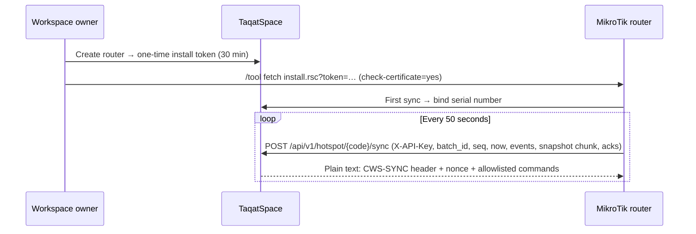
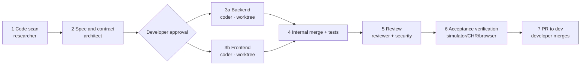

# Development Plan — TaqatSpace: From a Workspace Marketplace to a Full Operations Platform (per the CoWorkSpaces SRS)

**Version:** 1.0 — 29 October 2026  
**Companion documents:** `TaqatSpace-Milestone-Sheet.md` (tasks, effort, and schedule) · `TaqatSpace-Milestone-Sheet.xlsx` (tracking copy)  
**References:** `SRS — الوثيقة الرئيسية.md` · `CoWorkSpaces-Milestone-Sheet.md` · TaqatSpace code scan of the `dev` branch (PR #185)

---

## 1. Goal and Scope

**Goal:** Evolve TaqatSpace to cover the **entire** coworking-space operations system described in the SRS (an Arabic-language source document), building on what already exists, so that the TAQAT GAZA workspace moves fully from CoWorkSpaces to TaqatSpace, after which the platform is opened to other workspaces.

**Scope (end to end):**

| # | Domain | Includes |
| --- | --- | --- |
| 1 | Foundation | Tenants (slug/code/plan), branches, staff with permission groups, 2FA, audit log, approvals, the five settings areas |
| 2 | Network | MikroTik integration (installer, sync, commands, locking, updates, diagnostics) |
| 3 | Data engine | Devices, sessions, attendance in four modes, statistics, gaps, loyalty and segments, alerts, safety tools |
| 4 | Operations | Executive dashboard, live monitor, members hub, contracts, Roster, booking hub, stations and rooms, subscription requests |
| 5 | Finance | Catalog, plans, invoices, receipts and vouchers, credit notes, wallet, POS, collections, expenses, cash box, tax, import, organizations, after-hours, activity log |
| 6 | GSG program | Parameters, holidays, UR formula, Tracker, month close, UTR review, utilization, programs, claims |
| 7 | Analytics | Analytics tabs, 19 reports, report builder, PDF/Word/Excel/CSV/JSON export |
| 8 | Super admin | Workspaces and plans, UTR approval, agreements and funded seats, claims, approvals, router monitoring, consolidated reports |
| 9 | Freelancer | My status, attendance, invoices and wallet, requests, disputes, devices, profile, notifications |
| 10 | Public | The `/s/{slug}` site, site builder, forms, hotspot guest registration, custom domain |
| 11 | Existing | Discovery, booking, chat, CMS, reviews, announcements, broadcast, Academy API, notifications — retained and integrated (§8) |
| 12 | Quality and migration | E2E, hardening, localization, data migration, UAT, cutover from CoWorkSpaces |

**Out of scope (by decision):** online payment gateway, OTP login, self-serve purchase of platform plans.

---

## 2. Approved Decisions (2026-10-29)

| # | Area | Decision | Rationale |
| --- | --- | --- | --- |
| D1 | Direction | Integrate on top of the existing platform | The current platform already covers identity, booking, basic billing, and POS; rebuilding would be wasteful |
| D2 | Finance | Full finance for the workspace owner **with no payment gateway** | Payments in Gaza are cash/transfer/cheque; the platform records and tracks them |
| D3 | Login | Taqat SSO + MikroTik username linking; self-service guest registration from the hotspot | SSO is built and approved; the hotspot covers guests without an account |
| D4 | Team | One developer + Claude with multiple agents | Parallelism within a milestone, not across milestones |
| D5 | Hosting | VPS (2vCPU/4GB + Redis + Supervisor) before the first real router | Shared cPanel has no persistent worker and no Redis, and its PHP process limits drop the request burst when power is restored |
| D6 | Data | Parallel run on the TAQAT GAZA router after M2 + migration via CSV/Excel export | Real data to validate accuracy before cutover |
| D7 | Router integration | **PUSH** (the router sends) instead of the PULL approach in `DOCS/mikrotik-integration-plan.md` | Routers sit behind NAT/CGNAT and are unreachable from the server |
| D8 | Contract | Extend `Subscription` into a Contract | Booking, invoices, POS, and the tests depend on it |
| D9 | Finance v2 | Additional changes behind the `finance_v2` flag, with legacy statuses kept in sync | No breakage of existing invoices or the ≈607 tests |
| D10 | UR | Pure calculator `UrCalculator` + versioned parameters + frozen results | Provable accuracy towards the donor |
| D11 | Shared components | Custom `audit_logs` and `approval_requests`, TOTP, `phpoffice/phpspreadsheet` and `phpoffice/phpword` | Simpler than generic packages and fits the workspace scope |
| D12 | Deliverables | Markdown + Excel in `DOCS/new plan/` | Readable reference + tracking copy |

---

## 3. Current System State

### 3.1 Repository and Releases

| Item | Status |
| --- | --- |
| `dev` | PR #185 (2026-07-07) — latest work: POS/cashier |
| `origin/main` (production) | PR #162 (2026-06-30) — **32 commits (all of POS) not yet deployed** |
| Last activity | 2026-07-07 (project idle for ≈ 16 weeks) |
| Deployment | GitHub Actions: `dev` → staging, `main` → production (`.github/workflows/deploy-*.yml`) on cPanel |
| Outdated documents | `README.md` (06-11), `DOCS/presentation/FEATURES.md` (06-09), `DOCS/taqat_space_dev_plan.xlsx` (all Todo) |

### 3.2 Technology

| Layer | Details |
| --- | --- |
| Backend | Laravel 13, PHP 8.3, MySQL 8 (sqlite for tests); Controllers → Services → Eloquent (only two repositories: `WorkspaceRepository`, `UserRepository`); 74 FormRequests, 27 Resources, 23 Enums, `ApiResponse`; UUIDs; modular routes in `backend/routes/api/*.php` |
| Size | 40 migrations, 27 models, 66 controllers, ≈50 services, 23 notifications, 5 scheduled commands, ≈607 Feature tests |
| Packages | Sanctum, spatie/laravel-permission, mPDF, firebase/php-jwt, S3, Scramble (OpenAPI) — no Excel, no 2FA, no activity log |
| Frontend | Next 16 App Router, React 19, next-intl (ar/en), custom UI components (`frontend/src/components/ui/`), recharts, MapLibre; reads via `serverFetch` and writes via Server Actions; 65 pages, 171 components, Vitest (17) and Playwright (1) |
| Real-time | Firestore (chat) + FCM (notifications) — optional via env |
| Hosting | Shared cPanel; Next.js standalone behind mod_proxy; the `database` queue is drained by cron every minute |

### 3.3 Inventory by Role

| Role | Pages | Key existing features |
| --- | --- | --- |
| Public visitor | 7 | Home (CMS), explore with map and filters, workspace page with BookingPanel, About, FAQ, Contact |
| Authentication | 9 | Taqat SSO (OIDC + PKCE), role selection on first login, cashier invitation acceptance, local admin login |
| Workspace owner | 26 | KPI dashboard, members, subscriptions, seat board, booking requests, internet packages, resources, POS (terminal/products/reports), cashiers, invoices, expenses, chat, broadcast, announcements, reports (aging, P&L, packages) + CSV export, settings (7 tabs) |
| Cashier | 4 | Point of sale, products (permission-gated), reports, profile |
| Freelancer | 8 | Home with internet login credentials, subscription (cancel/rate), invoices and receipt upload, café ordering, chat, notifications, profile |
| Super admin | 19 | KPI dashboard, workspaces (approve/suspend/publish), users, admins with seven **enforced** permissions (`can.permission` in 12 route files), subscriptions and invoices (mark paid + receipt), reports and analytics (city/gender), CMS (home, content, branding, about, cities), messaging (SMS/SMTP, broadcast, usage, contact inbox), chat |
| Integration | — | Partner API for Academy with hashed `X-Api-Key` + signed webhooks (`backend/app/Services/Partner/`) |

### 3.4 Existing Issues to Address

| Issue | Impact | Remediation |
| --- | --- | --- |
| Unprotected route `ops/clear-cache-9f3a2c` in `backend/routes/web.php` | Anyone can clear the cache | M0.2 |
| Nothing transitions a subscription to `expired` | Expired subscriptions stay active | M0.4, M4.7 |
| `InvoiceService::delete` hard-deletes any invoice | Violates BR-FIN-01 | M5.5 |
| Expiry reminder sent 3 days ahead instead of 14 | Violates FR-MEM-03 | M4.7 |
| `PaymentMethod` = cash/transfer only, `PlanType` = monthly/daily/custom | No card or cheque, and no weekly/hourly/visitor/staff types | M4.8, M5.7 |
| `SeatService::assign` does not validate the plan type | Violates BR-FIN-04 | M5.17 |
| Previously exposed secrets (DB, AWS, Firebase, SSO) | Security risk | M0.3 |
| No per-workspace currency or time zone | Violates §3.7 (General) | M1.7 |

---

## 4. Glossary (SRS → TaqatSpace)

| SRS term | TaqatSpace equivalent | Note |
| --- | --- | --- |
| Workspace | `Workspace` | Add slug, code, platform plan, and platform status |
| Workspace owner | `User` with role `workspace_owner` | Currently one workspace per owner |
| Workspace staff | `User` with role `cashier` → generalized to "Staff" | Groups: cash desk, hospitality, finance supervisor |
| Subscriber / freelancer | `User` with role `freelancer` + `Subscription` | Adds: donor fields, MikroTik username, devices; also allows a subscriber **without an SSO account** (from import/discovery/guest) who is merged on first login (M1.13) |
| Contract / financial subscription | `Subscription` after extension | Draft, grace period, auto-renewal, plan, hours |
| Subscription request | `BookingRequest` | Opened to visitors without an account |
| Station | `Seat` after extension | Zone, branch, capacity, privacy, parent |
| Meeting room | `workspace_resources` (meeting_room) | Becomes bookable |
| Plan | New `plans` table | `seat_type_prices` remains for public display |
| Item / category | `catalog_items` / `catalog_categories` | POS products are linked to them |
| Receipt | `receipts` + `receipt_allocations` | `invoice_payments` are migrated into them |
| Internet package | `InternetPackage` | Translated into a hotspot profile (speed and data cap) |
| Internet login credentials | `hotspot_accounts` | Replaces `subscriptions.internet_username` |
| Router API key | `routers.api_key_hash` + `AuthenticateRouter` | Modeled on `AuthenticatePartner` |
| Super admin | `User` with role `admin` + Spatie `super_admin`/`admin` | Permissions are added for the new modules |

---

## 5. Detailed Gap Matrix

Every SRS requirement mapped against the current code, with verified file paths. Status: ✅ Existing · 🟨 Partial · ⬜ New. The link from each item to a task is in the "SRS ref" column of the sheet.

**Total:** 136 items — ✅ existing 3 · 🟨 partial 59 · ⬜ new 74.

Status key: ✅ Existing / 🟨 Partial / ⬜ New

Verified general notes:
- No mention of MikroTik/RADIUS/devices/attendance anywhere in `backend/` or `frontend/src/` (InternetAccessService only generates a username/password and sends it; provisioning on the router is a "later phase" per the file's comment).
- Not present: 2FA, VAT/tax, wallet, workspace slug/code, activity/audit log, XLSX import, organizations, branches/zones.
- `PaymentMethod` = cash/transfer only. `PlanType` = monthly/daily/custom only. `InvoiceStatus` = pending/under_review/payment_rejected/partially_paid/paid/overdue/cancelled (no draft).
- Invoice deletion (`InvoiceService::delete`) is a hard delete, not a soft cancellation.
- `BookingRequest` = a membership request from a registered freelancer (`role.freelancer`), not a meeting-room booking by a public visitor. Its statuses are pending/approved/rejected only.
- Keyboard shortcuts: only `Escape` in `DashShell.tsx` — no F2 and no Alt+x.

### §2.3 Subscription types

| ID | Requirement | Status | Existing today (verified paths) | Missing |
|---|---|---|---|---|
| SUBTYPE | Subscription types: monthly, weekly, daily, hourly, visitor, staff + plan pricing methods (fixed, by hours, by GB, package with a cap and validity) | 🟨 | `backend/app/Enums/PlanType.php` (monthly/daily/custom), `backend/app/Models/Subscription.php`, `backend/app/Models/InternetPackage.php` | Add weekly, hourly, visitor, and staff to PlanType; financial plan model with 6 pricing methods (hours/GB/package with validity); link the subscription to the plan and the overage price |

### §2.2 / §6 Workspace staff

| ID | Requirement | Status | Existing today (verified paths) | Missing |
|---|---|---|---|---|
| STAFF-01 | Invite staff by email + preset groups (cash desk/hospitality/finance supervisor) or individual permissions | 🟨 | `backend/app/Services/Pos/CashierManagementService.php`, `backend/app/Enums/PosPermission.php` (4 POS permissions only), `frontend/src/components/features/owner/CashiersManager.tsx` | Broaden the role from "POS cashier" to general workspace staff with financial permissions (invoices, expenses, items, import, reports); preset groups; `/settings/staff` page |
| SEC-2FA | Two-factor authentication (2FA) for issuing/cancelling invoices (for staff) | ⬜ | None (no TOTP/OTP in `backend/app`) | TOTP or OTP via email/SMS, device registration, middleware enforcing it on invoice issue/cancel |
| UX-KBD | Keyboard shortcuts (F2 select subscriber, Alt+S/A/R/L) | ⬜ | `frontend/src/components/layout/DashShell.tsx` (Escape only) | Global shortcuts hook, F2 in `PosTerminal.tsx`, dashboard shortcuts, shortcuts help |

### §3.1 Home

| ID | Requirement | Status | Existing today (verified paths) | Missing |
|---|---|---|---|---|
| FR-DSH-01 | Workspace health score /100 from four components + recommendations | ⬜ | `backend/app/Services/OwnerDashboardService.php` (occupancy, revenue only) | Score algorithm (usage/retention/activity/connectivity) and text recommendations; connectivity and activity depend on attendance data that does not exist |
| FR-DSH-02 | KPI cards: active, connected now, today's attendance, UR, download/upload, DAU/WAU/MAU, devices | 🟨 | `backend/app/Services/OwnerDashboardService.php`, `frontend/src/app/[locale]/(dashboard)/owner/page.tsx` | Existing: active, occupancy, available seats, pending requests, overdue invoices. Missing: all network, attendance, and UR cards |
| FR-DSH-03 | Charts: 30-day activity, type distribution, internet consumption, peak hours, days of the week | 🟨 | `backend/app/Services/OwnerDashboardService.php` (revenue_chart 6 months, members_by_status, members_by_gender), `frontend/src/app/[locale]/(dashboard)/owner/page.tsx` | Activity, consumption, peak-hour, and weekday charts (require attendance/network); subscription-type distribution instead of status |
| FR-DSH-04 | Growth and engagement: new, retention, at risk of dropping off (14+ days), DAU/MAU | ⬜ | None (OwnerDashboardService does not compute them) | Compute new members and retention; the drop-off indicator requires activity data |
| FR-DSH-05 | Expected revenue, ARPU, seat occupancy rate (as an estimate) | 🟨 | `backend/app/Services/OwnerDashboardService.php` (occupancy_pct, revenue_this_month/last_month) | Expected revenue and ARPU, and labeling it as an estimate |
| FR-DSH-06 | Subscriber segments: champions, at risk, churned, new, dormant, regulars | ⬜ | None | Segmentation engine based on the attendance/usage log |
| FR-DSH-07 | Next-month forecast via OLS regression with R² and confidence | ⬜ | None | Forecasting service (OLS) on revenue/attendance and R² display |
| FR-DSH-08 | "Needs follow-up" list and loyalty table + Alt+S/A/R/L shortcuts | ⬜ | None (see UX-KBD) | Loyalty indicator, follow-up list, and shortcuts |
| FR-DSH-09 | Last sync and 24-hour snapshot count + manual refresh button | ⬜ | None (no network sync) | Follows building the MikroTik integration and the snapshots table |
| FR-NET-01 | Connected devices table (user, type, MAC, IP, uptime, download/upload) | ⬜ | None; closest is `backend/app/Services/InternetAccessService.php` (credentials only) | Device model linked to the subscriber, MikroTik sync, `/live-monitor` page |
| FR-NET-02 | Auto-refresh every 30 seconds | ⬜ | None | Polling or WebSocket on the monitor page |
| FR-NET-03 | Tabs: connected now, gaps, usage, trends | ⬜ | None | Session storage and analysis of disconnections and trends |
| FR-ALR-01 | Automatic alert generation: high consumption, new device, churn risk, inactive | ⬜ | None (a general notifications system exists at `owner/notifications/page.tsx`, but it is not an alerts engine) | Alert model + scheduled jobs with thresholds; depends on network/attendance data |
| FR-ALR-02 | Severity classification, counters, and pagination of 30 | ⬜ | None | `/alerts` page and counters (total/unread/today/critical) |

### §3.2 Commercial

| ID | Requirement | Status | Existing today (verified paths) | Missing |
|---|---|---|---|---|
| FR-SUB-01 | Monthly table: days, attendance rate, hours, GB, plan, unbilled, balance | 🟨 | `backend/app/Services/OwnerSubscriptionService.php`, `frontend/src/components/features/owner/SubscriptionsTable.tsx`, `frontend/src/app/[locale]/(dashboard)/owner/subscriptions/page.tsx` | Existing: subscriptions list with status/price. Missing: days, attendance, hours, and GB (attendance/network), "unbilled" and balance (wallet/subscriber account ledger) |
| FR-SUB-02 | Search (name/phone/username) and sort by 6 criteria | 🟨 | `backend/app/Services/OwnerSubscriptionService.php` (applySearch/applySort), `backend/app/Services/MemberService.php` | Review the search fields (internet username) and the six sort criteria |
| FR-SUB-03 | Cards: present, owing amounts, total due, wallet balances, active subscriptions | 🟨 | `backend/app/Services/InvoiceService.php` (workspaceSummary), `backend/app/Services/OwnerDashboardService.php` | Existing: invoice summary and active count. Missing: present members and wallet balances (the wallet does not exist) |
| FR-RMB-01 | Receive meeting-room bookings from the public site and review them (pending/approved/rejected/cancelled/upcoming) | 🟨 | `backend/app/Services/BookingService.php`, `frontend/src/app/[locale]/(dashboard)/owner/bookings/page.tsx`, `backend/app/Models/Resource.php` (ResourceType::MeetingRoom as inventory only) | Existing: membership requests (pending/approved/rejected) from a registered user. Missing: room booking by date/time from a public visitor without an account, cancelled/upcoming statuses, conflict prevention, linking to Resource |
| FR-RMB-02 | Search by guest name/email and filter by date | ⬜ | None (membership requests have no guest/booking-date fields) | guest_name/email/date fields and search filters |

### §3.3 Finance

| ID | Requirement | Status | Existing today (verified paths) | Missing |
|---|---|---|---|---|
| FR-FIN-01 | "Needs your attention" section (e.g. active subscribers without a financial subscription) | ⬜ | `frontend/src/components/features/invoices/OwnerInvoiceAlert.tsx` (invoice alert only) | `/finance` dashboard, attention rules, and their links |
| FR-FIN-02 | Four figures: received, spent, operating result, billed unpaid; each card opens its records | 🟨 | `backend/app/Services/OwnerReportsService.php` (profit_loss), `backend/app/Services/ExpenseService.php` (summaryForWorkspace), `backend/app/Services/InvoiceService.php` (workspaceSummary) | Not aggregated into a single finance dashboard with drill-down; merge POS receipts with invoices |
| FR-FIN-03 | Receivables aging and top balances + option to show billing and tax details | 🟨 | `backend/app/Services/OwnerReportsService.php` (aging), `frontend/src/components/features/owner/OwnerReportsSections.tsx` | Top balances by subscriber; tax display toggle (no tax exists) |
| FIN-POS | POS: F2 subscriber selection, catalog or manual line, discount with reason, "Add to account" or "Collect" (cash/card/transfer/check), numeric keypad, seat usage | 🟨 | `backend/app/Services/Pos/PosOrderService.php`, `frontend/src/components/features/cashier/PosTerminal.tsx`, `frontend/src/app/[locale]/(dashboard)/owner/pos/terminal/page.tsx` | Existing: POS orders with catalog, stock, discount, two payment methods cash/transfer, statuses, and refunds. Missing: card/check, manual line, discount reason, "Add to account" (subscriber ledger), F2, numeric keypad, selling seat usage |
| FIN-INV | Manual invoice, bulk monthly preparation with preview, draft→issue, statuses and payment, overdue filter | 🟨 | `backend/app/Services/InvoiceService.php`, `backend/app/Services/InvoicePdfService.php`, `frontend/src/components/features/invoices/IssueInvoiceModal.tsx` | Existing: manual invoice (single amount), automatic monthly generation (scheduled command), partial payments, PDF, overdue, reminder. Missing: multiple line items, draft/issue, bulk-preparation preview, tax, immutability |
| FIN-COL | Collections: debt aging 0–90+, log a follow-up with a note, "Can't reach" filter | 🟨 | `backend/app/Services/OwnerReportsService.php` (aging), `backend/app/Services/InvoiceService.php` (sendReminder/remindOverdue), `frontend/src/components/features/owner/OwnerReportsSections.tsx` | `/finance/collections` screen, follow-up model (note, contact outcome), and non-response filter |
| FIN-RCP | Receipts: payment allocated across invoices, check statuses, sort by collection/receipt date | 🟨 | `backend/app/Models/InvoicePayment.php`, `backend/app/Services/InvoiceService.php` (recordPayment, approveReceipt), `frontend/src/components/features/invoices/RecordPaymentButton.tsx` | Existing: payments against a single invoice with an uploaded receipt and review. Missing: standalone numbered receipt, allocating one payment across multiple invoices, check statuses, collection date vs. receipt date |
| FIN-EXP | Expenses: category, payment method, reference, cancellation | 🟨 | `backend/app/Services/ExpenseService.php`, `backend/app/Models/Expense.php`, `frontend/src/components/features/owner/ExpensesTable.tsx` | Existing: CRUD + grouping by category and month + export + chart. Missing: payment method, reference, cancellation (instead of deletion), and dynamic categories |
| FIN-CN | Credit notes linked to an issued invoice, with a reason | ⬜ | None (`InvoiceStatus::Cancelled` exists but deletion is a hard delete) | credit_notes table, numbering, link to the invoice, reason, effect on receivables |
| FIN-PV | Refunds: payment voucher from the subscriber's account when refunding a wallet balance | ⬜ | None (POS refunds only: `backend/app/Services/Pos/PosOrderService.php`) | Payment voucher, wallet/balance, numbering and auditing |
| FIN-CASH | Cash-up: today's movements by method and a cash-count calculator | 🟨 | `backend/app/Services/Pos/PosReportService.php` (byMethod), `frontend/src/components/features/pos/PosReports.tsx` | Today's movements by method cover POS only. Missing: merging invoice payments and expenses (in/out/net), the cash-count calculator, and the `/finance/cash-up` screen |
| FIN-IMP | XLSX import for catalog/withdrawals with preview and atomic commit | ⬜ | None (export only: `backend/app/Services/Owner/OwnerExportService.php`) | Upload and validation (≤2000 rows/5MB/no formulas), preview, transaction, duplicate prevention |
| FIN-VAT | VAT report on an accrual basis | ⬜ | None | Tax rate in settings, frozen at issuance, tax fields on the invoice, report and download |
| FIN-PLN | Plans: 6 pricing methods, overage price, dedicated seat, special offer, archiving | 🟨 | `backend/app/Services/PackageService.php`, `backend/app/Models/InternetPackage.php`, `backend/app/Services/SeatTypePricingService.php` | Existing: internet packages (speed, price, GB cap, active) and seat-type prices. Missing: a unified financial plan with the six pricing methods, overage price, special offer, and archiving |
| FIN-ITM | Items: fixed code, Arabic/English name, category, unit, price | 🟨 | `backend/app/Services/Pos/PosProductService.php`, `backend/app/Models/PosProduct.php`, `frontend/src/components/features/owner/PosManager.tsx` | Existing: product (name, sku, free-text category, price, stock). Missing: separate Arabic/English names, unit, link to a category, use in invoices |
| FIN-CAT | Sales and expense categories with a fixed code, ordering, and archiving | 🟨 | `backend/app/Enums/ExpenseCategory.php` (7 fixed values), `backend/app/Models/PosProduct.php` (free-text category) | Dynamic categories table (sales/expenses) with code, ordering, and archiving |
| FIN-AH | Extra hours: charging rules for time after working hours, and preview (currently disabled) | ⬜ | None (`working_hours` in `backend/app/Models/Workspace.php` is display-only) | Charging rules and monthly preview; requires attendance data; disabled in the reference, so it can be deferred |
| FIN-SEAT | Seats: today's occupancy, dedicated-seat revenue, statuses (available/dedicated/reserved for later/out of service), releasing expired ones | 🟨 | `backend/app/Services/SeatService.php`, `backend/app/Enums/SeatStatus.php`, `frontend/src/components/features/owner/SeatBoard.tsx` | Existing: seat map, assign/unassign, statuses available/occupied/reserved/maintenance. Missing: dedicated-seat revenue, date-based "reserved for later", automatic release of expired seats |
| FIN-ORG | Organizations: a company pays for its members with a consolidated invoice and a tax number | ⬜ | None | organizations table, member linking, coverage rules, consolidated invoice, and tax value |
| FIN-ACT | Financial activity log (17 actions: who/when/why) | ⬜ | None | Audit table for financial actions, an observer/service, and a viewing screen with filters |
| BR-FIN-01 | An issued invoice is never edited; corrections go through a credit note or cancellation | 🟨 | `backend/app/Services/InvoiceService.php` (delete is a hard delete), `backend/app/Http/Controllers/InvoiceController.php` | Hard delete is currently allowed (violates the rule). Required: soft cancellation + edit lock after issuance + credit note |
| BR-FIN-02 | Only cash enters the cash drawer; other methods are for reconciliation only | ⬜ | `backend/app/Enums/PaymentMethod.php` (cash/transfer) with no cash-drawer concept | Distinguish cash payments in cash-up and add card/check methods |
| BR-FIN-03 | No tax unless a rate is set in Settings → Operations | ⬜ | None (no tax in the system) | Tax-rate field in the operations settings, applied only at issuance |
| BR-FIN-04 | A dedicated seat requires a monthly or weekly plan or a package | 🟨 | `backend/app/Services/SeatService.php` (assign only requires an active subscription) | Validate the plan type (monthly/weekly/package) on assignment |

### §3.6 Locations

| ID | Requirement | Status | Existing today (verified paths) | Missing |
|---|---|---|---|---|
| FR-STN-01 | Stations: add single or bulk (start, count, prefix), type, zone, capacity, privacy, affiliation; meeting rooms for public booking | 🟨 | `backend/app/Services/SeatService.php`, `backend/app/Services/ResourceService.php`, `frontend/src/components/features/owner/SeatBoard.tsx` | Existing: seats with fixed/flexible/private_office types and resources (meeting_room…) with quantity. Missing: bulk add with a start number and prefix, zone, per-station capacity/privacy, affiliation, listing rooms for public booking |
| FR-STN-02 | Tabs: inventory, now, month, branches (multi-branch) | ⬜ | None (one `Workspace` per owner, no branches/zones) | branches/zones model, view tabs, and branch-scoped queries |

### §3.7 Settings

| ID | Requirement | Status | Existing today (verified paths) | Missing |
|---|---|---|---|---|
| SET-GEN | General: name, description, fixed slug, contact, bank and frozen IBAN, timezone and currency, Wi-Fi details | 🟨 | `backend/app/Services/WorkspaceService.php` (updateSettings), `backend/app/Http/Requests/Workspace/UpdateWorkspaceRequest.php`, `frontend/src/components/features/owner/SettingsTabs.tsx` | Existing: name, description, address, city, phone, location, logo/images, amenities. Missing: slug, bank/IBAN details, timezone and currency, Wi-Fi details, email/contact |
| SET-OPS | Operations: capacity, seating mode, working hours and days, type prices, tax; saving is "sent for approval" | 🟨 | `backend/app/Services/SeatTypePricingService.php`, `backend/app/Services/WorkspaceService.php` (updateSeatTypes), `frontend/src/components/features/owner/SettingsTabs.tsx` (seatTypes and hours tabs) | Existing: seat-type prices and capacity, and working hours (saved directly). Missing: fixed/flexible seating mode, tax, super admin approval workflow for changes, holidays |
| SET-DNS | Domain and DNS: dashboard and public-site links, custom domain request | ⬜ | None | Domain fields, custom domain request, and admin approval |
| SET-API | API and integration: MikroTik status, workspace code, endpoint, regenerate API key, plan status, check and diagnostics | ⬜ | None for the owner; closest is `backend/app/Models/PartnerClient.php` (UR partner keys, not per workspace) | Per-workspace API key and code with regeneration, sync status, diagnostics center |
| SET-DNG | Danger zone: workspace reset (delete subscribers/devices/contracts/statistics…) | ⬜ | None | Reset operation with confirmation and a transaction, keeping the identity and owner and generating a new API key |

Methodology note: the code has no concept of MikroTik/Router/Device/Attendance/Contract/Roster/UR/Program/Claim/Holiday/Parameter/AuditLog/2FA/OTP (verified with Grep). Closest equivalents: `Subscription` (a single subscription with a seat), `Seat`, `BookingRequest`, `Invoice`/`InvoicePayment`, `PosOrder`, `Expense`, `Resource`, `Workspace`. Current roles: `freelancer`, `workspace_owner`, `admin`, `cashier` (`backend/app/Enums/UserRole.php`).

### §3.4 — Members hub (FR-MEM)

| ID | Requirement | Status | Existing today (verified paths) | Missing |
| --- | --- | --- | --- | --- |
| FR-MEM-01 | Members hub tabs (today, subscribers, weekly, monthly, calendar, contracts, visitors, alerts, profiles, bulk management) | 🟨 | `frontend/src/app/[locale]/(dashboard)/owner/members/page.tsx`, `frontend/src/components/features/owner/MembersTable.tsx` | Only a single members list page; all remaining tabs are new |
| FR-MEM-02 | "Today" tab: capacity of 640 hours/day, contracted vs. actual, hourly load with 70%/90% thresholds | ⬜ | `backend/app/Services/OwnerDashboardService.php` (seat occupancy rate only) | No hours, no actual attendance, no hour-based capacity; requires session data |
| FR-MEM-03 | Contracts with a state machine (draft/active/suspended/expired/cancelled), bulk extension and renewal, 14-day alert | 🟨 | `backend/app/Enums/SubscriptionStatus.php`, `backend/app/Services/OwnerSubscriptionService.php`, `backend/app/Console/Commands/NotifyExpiringSubscriptions.php` | Current statuses: pending/active/suspended/expired/cancelled with no draft and no governed transitions; individual renewal only (no bulk); 3-day alert instead of 14; no grace days, no auto-renewal, and no Contract entity |
| FR-MEM-04 | Live visitors without a subscription + revenue gap and type suggestion | ⬜ | — | Requires router device/attendance snapshots |
| FR-MEM-05 | Specialized alerts (expiring contracts, inactive 30+, loyalty drop, overtime, repeat visitors, full capacity) | 🟨 | `backend/app/Notifications/SubscriptionExpiringNotification.php`, `backend/app/Console/Commands/NotifyExpiringSubscriptions.php`, `backend/app/Notifications/InvoiceOverdueNotification.php` | Only subscription-expiry and overdue-invoice notifications; no rules engine (Alert Rule), no thresholds, no cooldown, and none of the other types |
| FR-MEM-06 | Profile wizard: gender, education (10), specialization (35), employment status, MikroTik username | 🟨 | `backend/app/Models/User.php` (gender, specialty, bio), `backend/app/Enums/Gender.php`, `backend/app/Http/Controllers/ProfileController.php` | Gender and specialization (free text) only; no education level, no employment status, no constrained lists, and no MikroTik username (closest is `internet_username` on `Subscription`) |
| FR-MEM-07 | Bulk management + smart automatic detection of subscription type + CSV export | 🟨 | `backend/app/Services/Owner/OwnerExportService.php`, `backend/routes/api/owner-members.php` | Members CSV export exists; no bulk operations and no smart detection |
| FR-MEM-08 | Subscriber profile: overview, subscription, scores, activity, peer comparison, loyalty/strength, activity calendar, devices | 🟨 | `backend/app/Services/MemberService.php` (memberDetail), `frontend/src/components/features/owner/MemberDrawer.tsx`, `frontend/src/components/features/owner/MemberAnalytics.tsx` | User/subscription/seat/invoice details exist; no loyalty/strength scores, no peers, no activity calendar, and no devices |
| FR-MEM-09 | Monthly roster: fill/copy last month and compute booked hours against capacity | ⬜ | — | The Roster Entry entity and the copy and compute functions are all new |

### §3.4 — Subscription requests (FR-REQ)

| ID | Requirement | Status | Existing today (verified paths) | Missing |
| --- | --- | --- | --- | --- |
| FR-REQ-01 | Review membership requests from the public site with statuses pending/approved/rejected/available/cancelled | 🟨 | `backend/app/Services/BookingService.php`, `backend/app/Http/Controllers/BookingRequestController.php`, `frontend/src/components/features/owner/BookingsManager.tsx` | Statuses: pending/approved/rejected only (`BookingStatus`); the applicant must be a logged-in freelancer (no public form for visitors); no "available" and no "cancelled"; approval creates a subscription + invoice and notifies the Webhook |

### §3.4 — Booking hub (FR-BKG)

| ID | Requirement | Status | Existing today (verified paths) | Missing |
| --- | --- | --- | --- | --- |
| FR-BKG-01 | Views: timeline, calendar, contracts, attendance | ⬜ | `frontend/src/components/features/owner/SeatBoard.tsx` (seat board only) | No Booking Hub, no timeline, and no calendar |
| FR-BKG-02 | New booking with subscriber/type/station/period and hours 08:00–15:00 | ⬜ | `backend/app/Services/SeatService.php` (assigns a seat to a member) | No booking by periods/daily hours; only seat assignment to a subscription |
| FR-BKG-03 | Attendance confirmation (confirmed/absent/partial/pending), manual or automatic, with undo | ⬜ | — | No attendance at all |
| FR-BKG-04 | New contract (duration in months, grace, auto-renewal) + create the current month's booking | 🟨 | `backend/app/Services/BookingService.php` (approve creates a subscription), `backend/app/Models/Subscription.php` | Subscription has start/end only; no duration in months, no grace, no auto-renewal, and no monthly booking |
| FR-BKG-05 | Exceeding approved hours requires a mandatory reason | ⬜ | — | No concept of approved hours |
| FR-BKG-06 | Monthly attendance summary + AUTO sync with the router | ⬜ | `backend/app/Services/InternetAccessService.php` (only generates internet login credentials, with no router connection) | No MikroTik integration and no session reading |

### §3.4 — GSG UR Tracker (FR-TRK)

| ID | Requirement | Status | Existing today (verified paths) | Missing |
| --- | --- | --- | --- | --- |
| FR-TRK-01 | Four-step UR audit calculator | ⬜ | — | Entirely new |
| FR-TRK-02 | Attendance modes (Active Actual, Day Span, Hour Bucket, Half-Hour) | ⬜ | — | New; depends on session data |
| FR-TRK-03 | AR→C→max→TypeW→ΣH/Tmax chain and RAW/UTD/EXPECTED/FINAL readings | ⬜ | — | New formula and parameters engine (32) |

### §3.4 — Programs (FR-PRG)

| ID | Requirement | Status | Existing today (verified paths) | Missing |
| --- | --- | --- | --- | --- |
| FR-PRG-01 | Portfolio of agreements and seats, seat price, and governance log | ⬜ | — | New Program/Agreement/Seat-assignment/Governance log entities (the current `Seat` is physical, not funding-related) |
| FR-PRG-02 | Frozen monthly claims + PDF/Word/TXT letter + withdrawal | ⬜ | `backend/app/Services/InvoicePdfService.php` (mPDF for invoices only) | The Claim entity, amount freezing, and the letter generator are new |
| FR-PRG-03 | Workspace report in PDF/Word/Excel/CSV | ⬜ | `backend/app/Services/Owner/OwnerExportService.php` (CSV) | No programs report and no Word/Excel |
| FR-PRG-04 | "Live": which funded-seat holders are present right now | ⬜ | — | Requires router readings |
| FR-PRG-05 | Seat board per agreement; assignment from the operator dashboard | ⬜ | — | New |

### §3.4 — Month close (FR-MCL)

| ID | Requirement | Status | Existing today (verified paths) | Missing |
| --- | --- | --- | --- | --- |
| FR-MCL-01 | 4-step month-close wizard | ⬜ | — | New |
| FR-MCL-02 | 22 quality checks in 7 categories + automatic/smart fix | ⬜ | — | New |
| FR-MCL-03 | Closing sends the month to UTR review | ⬜ | — | New (requires an approvals queue on the admin side) |

### §3.4 — Utilization and UTR review (FR-UR)

| ID | Requirement | Status | Existing today (verified paths) | Missing |
| --- | --- | --- | --- | --- |
| FR-UR-01 | Official UR figure (SSOT) + three readings + Qualified-C | ⬜ | — | New (the current occupancy in `OwnerDashboardService.php` is a seat ratio, not UR) |
| FR-UR-02 | Difference between the current UR and the expected UR after approval | ⬜ | — | New |
| FR-UR-03 | Hours distribution/C factor/12-month trend/recommendations/refresh now | ⬜ | — | New |
| FR-UR-04 | Per-subscriber review screen + justification note + smart type suggestions + behavioral analysis | ⬜ | — | New (UTR Record) |

### §3.5 — Analytics and reports

| ID | Requirement | Status | Existing today (verified paths) | Missing |
| --- | --- | --- | --- | --- |
| FR-ANL-01 | Analytics with 8 tabs (overview, advanced, monthly, retention, comparison, ratings, KPI, devices) | 🟨 | `backend/app/Services/OwnerDashboardService.php`, `backend/app/Services/Admin/AnalyticsService.php`, `frontend/src/components/features/admin/AnalyticsDashboard.tsx` | Only the owner dashboard (6-month revenue, gender, status) and the admin dashboard (city/gender); no `/analytics` page for the owner and no retention/comparison/devices/KPI tabs; workspace ratings exist separately (`backend/app/Services/ReviewService.php`) |
| FR-RPT-01 | 19 report types + year/month + quick generate | 🟨 | `backend/app/Services/OwnerReportsService.php`, `backend/app/Services/Pos/PosReportService.php`, `frontend/src/components/features/owner/OwnerReportsSections.tsx` | Exists in some form: (1) subscribers list (CSV), (2) monthly financial summary/profit and loss, (3) debt aging (collections) — partial approximation, (4) package usage (package uptake), (5) POS sales report. Missing: executive summary, capacity, subscriber health, retention, occupancy in its three variants, loyalty, network consumption, demand forecast, potential revenue, period comparison, data quality, time analysis, unified dashboard, GSG monthly report. Export is CSV only (PDF for invoices only) |

### §4 — Freelancer (FR-FL + touchpoints)

| ID | Requirement | Status | Existing today (verified paths) | Missing |
| --- | --- | --- | --- | --- |
| FR-FL-01 | Phone OTP login portal | ⬜ | `backend/app/Services/Auth/TaqatSsoService.php`, `backend/app/Http/Controllers/Auth/TaqatSsoController.php` | Login is currently email/password + SSO; no OTP (`Sms/` exists only as a sending driver in `backend/app/Services/Sms/SmsService.php`) |
| FR-FL-02 | View subscription, hours, attendance, balance, and invoices, and download them | 🟨 | `backend/app/Http/Controllers/Member/DashboardController.php`, `backend/app/Http/Controllers/Member/InvoiceController.php`, `frontend/src/app/[locale]/(dashboard)/freelancer/invoices/page.tsx` | Subscription, invoices, and PDF download (`/invoices/{invoice}/pdf`) exist; no hours/attendance and no wallet/balance |
| FR-FL-03 | Request renewal/plan change and book a room | 🟨 | `backend/app/Http/Controllers/BookingRequestController.php`, `backend/app/Http/Controllers/SubscriptionController.php` | New subscription request and cancellation exist; no renewal/plan-change request and no room booking |
| FR-FL-04 | Dispute incorrect hours/charges | ⬜ | `backend/app/Http/Controllers/Member/InvoiceController.php` (receipt upload only) | No dispute mechanism (could be built on top of messaging/chat `backend/app/Http/Controllers/ChatController.php`) |
| FR-FL-05 | Manage their linked devices | ⬜ | `backend/app/Models/DeviceToken.php` (Push tokens only, not network devices) | New Device entity (MAC/IP) |
| FL-TP-GUEST | Guest self-registration via Hotspot | ⬜ | `backend/app/Services/InternetAccessService.php` | No Hotspot/MikroTik; what exists is manual issuance of internet credentials by the owner |
| FL-TP-STATUS | Public "My status" page | 🟨 | `frontend/src/app/[locale]/(dashboard)/freelancer/subscription/page.tsx`, `backend/app/Http/Controllers/Partner/MembershipController.php` | Subscription status inside the logged-in dashboard + partner API; no public phone-based page |
| FL-TP-FORMS | Public subscription-request and room-booking forms with duration limits | 🟨 | `frontend/src/app/[locale]/(public)/workspaces/[id]/page.tsx`, `backend/app/Http/Controllers/BookingRequestController.php` | The request requires a freelancer account; no visitor form, no room booking, and no duration/advance-booking limits |
| FL-TP-POS | Hospitality/POS purchases are added to the account or collected immediately | ✅ | `backend/app/Services/Pos/PosOrderService.php`, `backend/routes/api/freelancer-pos.php`, `frontend/src/app/[locale]/(dashboard)/freelancer/pos/page.tsx` | The freelancer orders and the cashier collects; no adding to an account/invoice and no wallet (per the current model: pay at the counter) |
| FL-TP-HOLIDAY | Approved holidays remove days from working days | ⬜ | — | New Holiday entity (closest is the `working_hours` JSON in `Workspace`) |
| FL-TP-TOOLS | Split/merge/block tools | ⬜ | — | New |

### §5 — Super admin (FR-SA)

| ID | Requirement | Status | Existing today (verified paths) | Missing |
| --- | --- | --- | --- | --- |
| FR-SA-01 | Workspace management: create, activate/suspend, assign a plan | 🟨 | `backend/app/Services/Admin/AdminWorkspaceService.php`, `backend/routes/api/workspaces.php`, `frontend/src/components/features/admin/WorkspacesTable.tsx` | Activate/suspend/publish/unpublish exists; admin-side creation and assigning a "plan" to a workspace do not exist (no SaaS plans per the business model) |
| FR-SA-02 | UTR approvals queue across all workspaces | ⬜ | — | New |
| FR-SA-03 | Manage programs, agreements, and seat boards | ⬜ | — | New |
| FR-SA-04 | Receive claims and track their disbursement | ⬜ | — | New |
| FR-SA-05 | Approve sensitive settings changes and domains | 🟨 | `backend/app/Services/Admin/AdminWorkspaceService.php` (workspace publish/approval cycle) | Workspace publish approval only; no settings-change or custom-domain requests |
| FR-SA-06 | Manage the global UR formula parameters | ⬜ | `backend/app/Models/SiteSetting.php` (general site settings unrelated to the formula) | New Parameter Set |
| FR-SA-07 | Sync health monitoring and router-down alert | ⬜ | `backend/app/Http/Controllers/HealthController.php` (API health only) | No routers and no sync |
| SA-RPT | Aggregate workspace reports for the donor | 🟨 | `backend/app/Services/Admin/ReportsService.php`, `backend/app/Services/Admin/AnalyticsService.php`, `backend/app/Services/Admin/ExportService.php` | Platform-wide aggregation of revenue/subscriptions/workspaces/cities/gender + CSV; no GSG report and no donor/program data |

### §6 — Permissions matrix and flows

| ID | Requirement | Status | Existing today (verified paths) | Missing |
| --- | --- | --- | --- | --- |
| PERM-ROLES | 4 roles: owner, staff, freelancer, super admin | ✅ | `backend/app/Enums/UserRole.php`, `backend/app/Enums/PosPermission.php`, `backend/app/Enums/AdminPermission.php` | "Workspace staff" = `cashier` with POS permissions only (sell/refund/manage_products/view_reports); no finance-supervisor/hospitality staff and no separate invoice/expense/import permissions |
| PERM-2FA | Permission-gated invoices + two-factor authentication for staff | ⬜ | `backend/app/Http/Middleware/EnsureHasAdminPermission.php` | No 2FA; invoices are owner-only (`role.owner`) with no staff permissions on them |
| PERM-ADMIN | Fine-grained admin permissions | ✅ | `backend/app/Services/Admin/AdminManagementService.php`, `frontend/src/lib/admin-guard.ts`, `backend/database/seeders/AdminPermissionSeeder.php` | 7 permissions (`can.permission:`); no UR/claims approval permission |
| PERM-RESET | Workspace reset (data deletion) | ⬜ | — | Does not exist (only seat/resource deletion exists) |
| FLOW-UR | Main flow: connection → attendance → justification → close → approval → claim | ⬜ | — | The entire chain is new |
| FLOW-1 | Membership request → approval → subscriber, contract, and plan | 🟨 | `backend/app/Services/BookingService.php`, `backend/app/Http/Controllers/BookingRequestController.php` | Approval creates a subscription + invoice + seat assignment + notification + Webhook; the applicant must be registered; no contract |
| FLOW-2 | Convert a live visitor into a subscriber | ⬜ | — | Requires Live visitors |
| FLOW-3 | Billing cycle: unbilled charges → drafts → issue → receipt → credit note | 🟨 | `backend/app/Services/InvoiceService.php`, `backend/app/Console/Commands/GenerateMonthlyInvoices.php`, `backend/app/Models/InvoicePayment.php` | Automatic monthly invoices + partial payments + uploaded-receipt review + reminder/overdue; no unbilled charges, no separate draft/issue, no standalone receipt, and no credit note (refunds in POS only: `backend/app/Services/Pos/PosOrderService.php`) |
| FLOW-4 | Contract lifecycle draft→active→suspended↔active→expired/cancelled + 14-day alert | 🟨 | `backend/app/Enums/SubscriptionStatus.php`, `backend/app/Services/MemberService.php` (updateStatus) | Similar subscription statuses without draft and without strict transitions; 3-day alert |
| FLOW-5 | Parameter change: request → admin approval → recompute Tmax/UR | ⬜ | — | New (change-request workflow) |

### §7.1 — Non-functional requirements

| ID | Requirement | Status | Existing today (verified paths) | Missing |
| --- | --- | --- | --- | --- |
| NFR-SEC | 2FA, secure API key, fine-grained permissions | 🟨 | `backend/app/Http/Middleware/AuthenticatePartner.php`, `backend/app/Models/PartnerClient.php`, `backend/app/Http/Middleware/EnsureHasAdminPermission.php` | API key is hashed (`api_key_hash`) and sent in `X-Api-Key`; Sanctum + Spatie permissions; throttling on routes; no 2FA; the internet password is stored encrypted (`internet_password_enc`) |
| NFR-INTEG | Atomic import without duplicates; freezing of invoice/claim/tax; fixed codes | 🟨 | `backend/app/Services/OwnerSubscriptionService.php` (DB::transaction), `backend/app/Models/Invoice.php` (`invoice_number` unique), `backend/app/Models/PosProduct.php` (`sku`) | DB transactions, unique invoice numbering, and product SKUs; no XLSX import, no tax and no explicit freeze after issuance, no claims |
| NFR-AUDIT | Financial log with 17 actions, governance log, renewal log, reason for every override | ⬜ | `backend/app/Models/PosStockMovement.php` (stock movements log only) | No general Audit Log, no renewal log, and no governance log |
| NFR-PERF | Live monitor refresh every 30s, router snapshots, manual recompute | 🟨 | `backend/routes/console.php` (scheduling of invoices/notifications/queue every minute) | No live monitor and no snapshots; scheduled tasks and the DB queue exist |
| NFR-I18N | Arabic RTL interface, bilingual public site, 16 timezones and 8 currencies | 🟨 | `frontend/src/messages/ar.json`, `frontend/src/messages/en.json`, `backend/app/Http/Middleware/SetLocale.php` | Arabic/English RTL exists; no per-workspace timezone or currency setting (no currency/timezone fields on `Workspace`) |
| NFR-UX | Keyboard shortcuts, empty states, confirmation before deletion | 🟨 | `frontend/src/components/features/owner/SeatBoard.tsx`, `frontend/src/components/layout/DashShell.tsx` | Confirmations and empty states exist in the components; no global keyboard shortcuts (Alt+S, etc.) |
| NFR-INT | MikroTik, PDF/Word/Excel/CSV/JSON export, XLSX import | 🟨 | `backend/app/Services/Admin/ExportService.php`, `backend/app/Services/InvoicePdfService.php`, `backend/app/Services/Partner/WebhookDispatcher.php` | CSV (invoices/members/expenses + admin), invoice PDF (mPDF), and partner Webhook; no MikroTik, no Word/Excel/JSON, and no XLSX import (no PhpSpreadsheet in `backend/composer.json`) |

### §7.2 — Data model

| ID | Requirement | Status | Existing today (verified paths) | Missing |
| --- | --- | --- | --- | --- |
| ENT-Workspace | Slug, code, plan, status, capacity, working hours/days, currency, bank | 🟨 | `backend/app/Models/Workspace.php`, `backend/database/migrations/2026_06_02_110001_create_core_business_tables.php` | Existing: status, total_seats, working_hours JSON, city, logo; missing: slug, plan, currency, timezone, bank, capacity in hours |
| ENT-Subscriber | Phone, MikroTik username, type, status, gender, education, specialization, occupation, loyalty, strength | 🟨 | `backend/app/Models/User.php`, `backend/app/Models/Subscription.php` | Subscriber = `User` (role freelancer) + `Subscription` (no separate table); missing: education, employment status, loyalty/strength scores, MikroTik username on the user |
| ENT-Device | MAC, IP, sessions, download/upload, last seen (snapshot) | ⬜ | `backend/app/Models/DeviceToken.php` (Push token, not a network device) | New |
| ENT-Contract | Type, start, duration, grace, renewal, station, hours, attendance status | 🟨 | `backend/app/Models/Subscription.php`, `backend/app/Models/BookingRequest.php` | `Subscription` covers type/start/end/seat; missing: grace, auto-renewal, hours, attendance; no bookings table (Booking) |
| ENT-RosterEntry | Month, type, units, hours, Gift Hours | ⬜ | — | New |
| ENT-UTRRecord | Contracted, actual, AR%, C, Locked Hours, justification, approval | ⬜ | — | New |
| ENT-PlanItemCategory | Pricing method, price, unit, fixed code | 🟨 | `backend/app/Models/InternetPackage.php`, `backend/app/Models/SeatTypePrice.php`, `backend/app/Models/PosProduct.php` | Internet packages, seat-type prices, and POS products (sku + free-text category); no unified plan/item/category entity with a fixed code and no unit/pricing method |
| ENT-Billing | Invoice, receipt, credit note, payment voucher, expense | 🟨 | `backend/app/Models/Invoice.php`, `backend/app/Models/InvoicePayment.php`, `backend/app/Models/Expense.php` | Invoice + payments (≈ receipt) + expense + `PosPayment` (`backend/app/Models/PosPayment.php`) for refunds; missing: credit note, payment voucher, organization linkage |
| ENT-Organization | Name, tax number, contact | ⬜ | — | New (no companies paying a consolidated invoice) |
| ENT-StationLocation | Number, type, zone, capacity, privacy, branch | 🟨 | `backend/app/Models/Seat.php`, `backend/app/Models/Resource.php`, `backend/app/Enums/SeatType.php` | `Seat` (number, type fixed/flexible/private_office, status) and `Resource`; missing: zone, capacity, privacy, branch |
| ENT-ProgramAgreementClaim | Donor, seats, price, period, funding type, governance | ⬜ | — | New |
| ENT-AlertRule | Type, severity, threshold, cooldown, channels | 🟨 | `backend/app/Notifications/SubscriptionExpiringNotification.php`, `backend/app/Services/Messaging/BroadcastService.php`, `backend/app/Services/NavActionCountService.php` | Hard-coded notifications (DB/Push/Email/SMS) with no rules table; no thresholds/cooldown/severity |
| ENT-ParameterHoliday | The 32 parameters, dates, request status | ⬜ | `backend/app/Models/SiteSetting.php` (generic key/value) | New |

---

## 6. Target Architecture

### 6.1 Infrastructure

- **VPS** (Ubuntu 24.04): Nginx + PHP 8.3-FPM, MySQL 8 (buffer pool ≈ 1.5GB), Redis 7, Supervisor, Certbot, Next.js under systemd, nightly backups to the existing S3.
- **Queues:** `ingest` (1–2 processes) for processing router data, `default` for notifications, `heavy` (900 s timeout) for recalculation, imports, and PDFs.
- **Invariant:** the `/sync` request never depends on the queue — it writes the data inside a transaction and responds immediately; heavy processing happens afterwards. The same code runs on cPanel (via cron) and on the VPS (via workers).
- **The fixed hostname `sync.taqat.space`** is written into `install.rsc` from day one, so moving the infrastructure later does not require reinstalling routers.

### 6.2 Router Integration Protocol (PUSH)

| Mechanism | Design |
| --- | --- |
| Authentication | `AuthenticateRouter`: `{code}` → workspace, `hash_equals(sha256(key))` against the current key or the previous key within the grace period, serial-number lock, diagnostic log in `terminate()` |
| Deduplication | Persistent `seq` on flash, `event_uid = boot_id-seq`, `UNIQUE(router_id, event_uid)` + `insertOrIgnore`; the response for `(router, batch_id)` is cached for 10 minutes |
| Clock | The router sends `now`; the server corrects event timestamps by the offset (routers without a clock battery after power outages) |
| Commands | `router_commands`: requested → delivered → acknowledged (+ failed/expired); resent after 3 cycles without acknowledgment; every action is idempotent |
| Allowlist | `upsert-user`, `disable-user`, `remove-active`, `block-mac`, `set-key`, `update-script` — the script never executes the response text verbatim |
| Response format | Plain text ≤ 4KB (RouterOS 7.12 cannot parse JSON) |
| Parallel run | "Poll-only" mode that reads `/ip hotspot active` without touching the CoWorkSpaces hooks |
| Limits | `RateLimiter::for('router')` ≈ 12 requests/minute per router |

### 6.3 Data Engine

`hotspot_events` (raw) → `hotspot_sessions` (real-time, with a per-router Redis lock) → `attendance_daily` (affected days rebuilt every 5 minutes + a nightly pass) → `stats_monthly_subscriber` / `stats_daily_workspace`.

- `attendance_daily` stores a **48-slot bitmap** (half-hour slots), so the four modes (Active Actual, Day Span, Hour Bucket, Half-Hour) are derived from a single row per subscriber per day.
- Active time = the union of intervals across all of the subscriber's devices (no double counting).
- "Recalculate" deterministically deletes and rebuilds a historical range.
- High-volume tables use BIGINT keys (an exception to UUIDs), and computations run in PHP rather than MySQL-specific SQL (sqlite compatibility in tests).

### 6.4 Tenancy

- `workspaces`: `slug` (immutable once set), `code` (8 base32 characters), `platform_plan`, `platform_status`.
- New `branches` table, and `seats` is extended (zone, branch_id, kind, capacity, is_private, parent_id).
- `CurrentWorkspace` is resolved from the owner, from `users.workspace_id` for staff, or from the router; the `BelongsToWorkspace` trait auto-fills `workspace_id` and applies the scope **to new models only**, with `withoutWorkspaceScope()` for admins and scheduled jobs.

### 6.5 Finance v2

| Legacy status | `doc_status` | `payment_status` |
| --- | --- | --- |
| pending, overdue, under_review, payment_rejected | issued | unpaid |
| partially_paid | issued | partial |
| paid | issued | paid |
| cancelled | void | — |

- Invoice: `workspace_id`, `customer_id`, `subscription_id` becomes optional, `invoice_lines` line items (backfill one line per legacy invoice), tax rate frozen at issuance, `document_sequences` numbering with a `lockForUpdate` lock, and an observer that blocks edits to financial fields after issuance.
- POS "Add to account" → `unbilled_charges`; "Collect" → receipt.
- `invoice_payments` are migrated to `receipts` + `receipt_allocations`, and `PaymentMethod` is extended (card, cheque).
- Cash-up and tax are reports over existing data (no new tables).

### 6.6 UR and GSG Engine

- `app/Domain/Utilization/UrCalculator`: pure PHP with no Eloquent; takes `UrParameters`, `Capacity`, and subscriber inputs, and returns AR, C, approved hours, TypeW, and the RAW/UTD/EXPECTED/FINAL readings, along with `CALCULATOR_VERSION`.
- `ur_parameter_sets`, `capacity_versions`, and `holidays`: versioned, immutable once approved, and routed through `approval_requests`.
- `ur_month_runs` (open → closed → approved/reopened) store the parameter and calculator versions, `input_hash`, and the frozen results; only the super admin can reopen a month.
- The 22 month-close checks: one class per check implementing `MonthCloseCheck` (+ an optional `fix()`).
- `programs`, `agreements`, `funded_seat_assignments`, `agreement_governance_events` (append-only), `program_claims` (amount and IBAN frozen on submission).

### 6.7 Shared Components

| Component | Design |
| --- | --- |
| Audit log | `audit_logs` (BIGINT, workspace, actor and actor type: user/system/router, action such as `finance.invoice.issued`, subject, reason, changes, IP, request_id), written explicitly via `AuditLogger`; the finance activity log = a `finance.*` filter |
| 2FA | TOTP (`pragmarx/google2fa`) with an encrypted secret and recovery codes; for the local admin: password → challenge → token; for SSO users: a local challenge after OIDC (unless Taqat confirms MFA); `RequireRecentTwoFactor` (10 minutes) for issuing and voiding invoices; for owners, staff, and admins only |
| Approvals | `approval_requests` (types: UR parameters, capacity, working hours, holiday, custom domain) + `ApprovalHandler` with validate/apply/describe; UTR and claims have their own lifecycles |
| Excel/Word | `phpoffice/phpspreadsheet` for import and export (formulas rejected via `isFormula()`), `phpoffice/phpword` for letters; CSV stays on the existing streaming in `OwnerExportService` |

### 6.8 Frontend

- Reuse: `DataTable`, `StatTile`, `Modal`/`Drawer`/`ConfirmDialog`, `Tabs`, charts (`LineChart`, `BarChart`, recharts), `SeatMap` — from `frontend/src/components/ui/`.
- Same data pattern: reads via `serverFetch` (`frontend/src/lib/api.ts`), writes via Server Actions (`frontend/src/lib/actions/`), URL filters via `useUrlFilters`.
- The new navigation menu, organized into the SRS groups in `nav-config.ts`, hides modules according to flags and permissions.
- Live updates (live monitor, diagnostics) via polling every 30 s, with a 15 s server-side Redis cache.
- All text in Arabic and English in namespace files (each key wrapped in its namespace name).

---

## 7. New Data Model

| Domain | New tables | Changes to existing tables |
| --- | --- | --- |
| Foundation | `branches`, `audit_logs`, `approval_requests`, `workspace_features` (flags) | `workspaces` (+slug, code, platform_plan, platform_status, currency, timezone, bank/IBAN, wifi), `users` (+2FA) |
| Network | `routers`, `router_install_tokens`, `router_commands`, `router_api_logs`, `hotspot_accounts` | `subscriptions.internet_*` → migrated to `hotspot_accounts` |
| Data | `devices`, `hotspot_events`, `router_snapshots`, `router_snapshot_chunks`, `device_presence`, `hotspot_sessions`, `router_gaps`, `attendance_daily`, `stats_daily_workspace`, `stats_monthly_subscriber`, `alert_rules`, `alerts` | — |
| Operations | `subscription_status_history`, `roster_entries`, `bookings` (station/room, by the hour, with attendance status), `room_bookings` | `subscriptions` (+contract_type, billing_mode, plan_id, custom_price, contracted_hours, grace_days, auto_renew, renewed_from_id, organization_id, draft), `seats` (+zone, branch_id, kind, capacity, is_private, parent_id), `users` (+education, specialization, employment_status), `booking_requests` (+statuses, requests without an account) |
| Finance | `catalog_categories`, `catalog_items`, `plans`, `unbilled_charges`, `invoice_lines`, `document_sequences`, `receipts`, `receipt_allocations`, `credit_notes`, `wallet_entries`, `payment_vouchers`, `organizations`, `organization_members`, `invoice_runs`, `import_batches`, `after_hours_rules` | `invoices` (+workspace_id, customer_id, doc_status, payment_status, totals, tax, period), `pos_products` (+catalog_item_id), `workspace_expenses` (+method, reference, voided_at) |
| GSG | `ur_parameter_sets`, `capacity_versions`, `holidays`, `ur_month_runs`, `utr_records`, `programs`, `agreements`, `funded_seat_assignments`, `agreement_governance_events`, `program_claims` | — |
| Freelancer and public | `member_requests` (renewal/plan change/room booking), `disputes`, `site_sections` (site builder), `custom_domains` | — |

**Retention:** raw events for 90 days after month close, snapshot chunks for 7 days, API logs for 14 days, sessions for ≥ 24 months, daily attendance indefinitely.

---

## 8. Impact on Existing Modules

| Existing module | What happens to it |
| --- | --- |
| Discovery and search (`/explore`) | Retained; workspace links move to `/s/{slug}` |
| Workspace page + BookingPanel | Retained; prices are read from plans, and requests without an account become possible |
| Booking requests (`BookingRequest`) | Become "subscription requests" with a wider set of statuses; approval creates a contract + plan + hotspot account (a router command) |
| Subscriptions (`Subscription`) | Become contracts: state machine, grace period, auto-renewal, actual expiry |
| Seats and the seat board | Become "stations" with zones, branches, and bulk add; `SeatBoard` evolves into the Inventory/Now/Month views |
| Seat type prices | Retained for public display; actual pricing comes from `plans` |
| Internet packages | Translated into hotspot profiles on the router (speed and data cap) |
| Internet login credentials | Move to `hotspot_accounts` and are actually pushed to the router |
| Invoices and partial payments | Move to v2 (line items, draft/issue/void, receipts with allocations) with backward compatibility |
| Freelancer receipt upload | Retained; creates a pending receipt for review |
| Platform billing in the admin panel (mark paid + receipt) | Retained as is, to track workspaces' platform subscriptions |
| POS and cashier | Products are linked to the catalog, "Add to account" generates unbilled charges, and cashier becomes a permission group within "Staff" |
| Expenses | Categories from the catalog + payment method + reference + void |
| Resources | Rooms become bookable |
| Owner reports and export | Become part of the reporting engine, and export gains Excel/Word/PDF |
| Admin analytics (city/gender) | Retained and merged into the consolidated reports |
| Chat, broadcast, announcements, reviews | Retained unchanged |
| CMS, branding, and cities | Retained; the Landing CMS pattern is the basis of the workspace site builder |
| Academy Partner API and webhooks | Retained; `booking.approved` continues to fire on subscription-request approval |
| Notifications (23 + FCM) | Retained, with new types added: alerts, invoice issued, requests, disputes, approvals |
| Scheduled jobs | Added: `subscriptions:expire`, attendance rollups, alerts, invoice runs, cleanup; `invoices:generate-monthly` is replaced by `invoice_runs` behind a flag |

---

## 9. Multi-Agent Execution Model and Workflows

### 9.1 Principle

The developer is the decision-maker and final reviewer. Claude orchestrates specialized agents, each in an isolated context with a narrow task and a defined file scope, so execution runs in parallel within each milestone while the milestones themselves remain sequential.

### 9.2 Roles

| Agent | Role | When |
| --- | --- | --- |
| `researcher` / `Explore` | Scan the code and identify what can be reused before each milestone | Start of each milestone |
| `architect` | Milestone spec: tables and migrations, API contract (OpenAPI), states and transitions, acceptance test list | After the scan, before any code |
| `coder` (Backend) | Migrations, Services, FormRequests, Resources, tests first for calculators | Implementation — separate worktree |
| `coder` (Frontend) | Pages, components, Server Actions, and translation files against the contract | Implementation — separate worktree, in parallel with Backend |
| `reviewer` | Diff review: correctness, security, performance, N+1, permissions, localization | After the internal merge |
| `nested-reviewer` | Review with independent verification of each finding | For critical modules: `/sync`, finance v2, `UrCalculator` |
| `superpowers:code-reviewer` | Check the delivered work against the milestone plan and acceptance criteria | End of each milestone, before the PR |

### 9.3 Milestone Cycle

1. **Scan:** an agent identifies the reusable files and patterns.
2. **Spec and contract:** `architect` writes `DOCS/specs/Mx-<topic>.md` + an OpenAPI contract + TypeScript types; the developer approves before implementation.
3. **Parallel implementation:** Backend and Frontend in separate worktrees on sub-branches off the milestone branch; the frontend works against the contract with mock data until the API is ready.
4. **Merge and test:** `php artisan test` + `npm run test` + `npm run lint` + `next build` (type check).
5. **Review:** `reviewer` on the full diff, and `/security-review` for sensitive modules; findings go back to the coder.
6. **Verification:** real execution (simulator, CHR, browser) against the milestone's acceptance criteria.
7. **Delivery:** PR to `dev` with a detailed summary; the developer merges, which deploys to staging.

### 9.4 Parallelism Map per Milestone

| Milestone | Track A (Backend) | Track B (Frontend) | Track C | Review focus |
| --- | --- | --- | --- | --- |
| M1 | slug/code, Trait, audit, approvals, 2FA | Settings, staff, navigation menu | — | Permissions, 2FA |
| M2 | `/sync`, commands, keys | Integration and diagnostics pages | RouterOS scripts + simulator | **Security** (authentication, allowlist) |
| M3 | Sessions, attendance, statistics | — | Alerts + safety tools | Accuracy, performance |
| M4 | Contracts, Roster, bookings, stations | Dashboard, monitor, members hub | Subscriber profile + bookings (second FE) | N+1, UX |
| M5 | Invoices v2 + migration | Finance screens | Import + tax + wallet | **Money integrity**, backward compatibility |
| M6 | `UrCalculator` (test-first) + month close | Tracker, UTR, utilization | Importer + programs and claims | **Formula accuracy** |
| M7 | Reporting engine + export | Analytics | Report builder | Performance |
| M8 | UTR, agreements, claims | Admin dashboards | Router monitoring | Permissions |
| M9–M10 | Requests, guests, domain | Portal, public site | Site builder | Public-surface security |
| M11–M12 | E2E and load | Playwright | Localization | Regression |

### 9.5 When to Use a Workflow

- **Workflow** = a script that orchestrates multiple agents automatically in stages (design → parallel implementation → multi-dimensional review → verification).
- Used only **on the developer's explicit request** ("use workflow"), because it consumes more resources.
- Candidates are the large milestones: **M4, M5, and M6**, with fewer than 10 agents per run.
- The remaining milestones are well served by the §9.3 cycle, with agents launched manually from the session.

### 9.6 Conflict-Prevention Rules

- One worktree and sub-branch per implementation agent; merges go into the milestone branch only.
- **Contract first:** the frontend does not start before the OpenAPI contract is approved; types are generated from Scramble.
- Migrations are owned by the Backend track alone; `nav-config.ts` and shared translation files are edited by one agent at a time.
- Every agent receives the binding rules in its prompt: Controllers → Services → (Repositories for complex queries) → Models layering, FormRequest for validation, Resource for responses, Enum for statuses, `ApiResponse`, UUIDs (except for high-volume tables), `BelongsToWorkspace` for new models, audit logging for sensitive actions, ar/en translations, no queries inside loops.
- Relatively small PRs (finance v2 is split into 4–5 PRs).

---

## 10. Working Practices and Standards

**Branches:** `chore/m0-…`, `feat/mN-…`, `test/m11-…`, `release/m13-…` from `dev`; PR to `dev` with a detailed summary (what changed, why, the endpoints and files, how it was verified). The developer merges and deploys; no manual deploys.

### 10.1 GitHub Workflow (Issues + Milestones + Project)

Every task in the sheet = an **Issue** on `ahmaddev27/TAQATSPACE`, whose body is the **task spec** (goal, scope, out of scope, technical design, acceptance criteria, tests, dependencies) + its metadata + the Definition of Done.

| GitHub element | Usage |
| --- | --- |
| **Milestones** | M0 … M13 with the same names; each milestone's description = its goal and acceptance criterion |
| **Labels** | Type: `type:backend`, `type:frontend`, `type:fullstack`, `type:qa`, `type:ops`, `type:pm` · Code state: `code:new`, `code:extension`, `code:existing` · Release: `release:R0` … `release:R5` · `deferrable` (outside the minimum switch-over path) |
| **Issue title** | `[M2.4] …` — the sheet task number is fixed and is used in branches and commits |
| **[Project "TaqatSpace Roadmap"](https://github.com/users/ahmaddev27/projects/1)** | Board with a **Status** field: Todo → In Progress → In Review → Done, plus Milestone, Release, and Effort fields |
| **Linking** | The branch is created from the Issue, and the PR contains `Closes #<number>`, so the Issue closes on merge and the status moves to Done |

**Task lifecycle:**

1. **Start:** `gh issue develop <number> --base dev --name feat/m2-4-sync-endpoint --checkout` → a branch linked to the Issue (shown under Development) + status **In Progress**.
2. **Work:** commits in the form `feat(m2.4): …`; agents read the spec via `gh issue view <number>`.
3. **Review:** `gh pr create --base dev` with `Closes #<number>` in the body + an implementation and verification summary → status **In Review**.
4. **Close:** the developer merges → the Issue closes automatically → status **Done** (built-in board automation: Item closed / PR merged → Done).
5. **Scope change:** update the Issue body itself (it is the living spec), and record the change in a comment.

**Note:** the sheet (md/xlsx) remains the planning snapshot and effort allocation; the live status is on the GitHub Project.

### 10.2 Definition of Done (per task)

- Feature tests for the API (with the full existing suite passing) + unit tests for calculators.
- Input validation (FormRequest) and authorization (Policy/Gate/permission) for every endpoint.
- Audit logging for every sensitive or financial action.
- UI text in Arabic and English, with correct RTL.
- Regenerated OpenAPI documentation (`composer api:docs`) and an updated Postman collection.
- No N+1 and no queries in loops; indexes on new tables.
- The appropriate flag guards the module if it is incomplete.

---

## 11. Test Plan

| Level | Tool | Covers |
| --- | --- | --- |
| Unit | PHPUnit | `UrCalculator` (golden tests 3.8%/71.8%), attendance (bitmap and the four modes), tax, numbering, contract state machine |
| Feature | PHPUnit (sqlite) | Every new endpoint + permissions (403) + backward compatibility for invoices and POS |
| Simulation | `hotspot:simulate` + `FakeRouterTransport` | Outages, duplicates, clock drift, reboot bursts |
| Virtual/real router | MikroTik CHR + TAQAT GAZA router (parallel) | Scripts, installer, commands, 2,048 sessions |
| Reconciliation | Exported CoWorkSpaces data + parallel-run months | Hours (≤ 5%), UR, UTR |
| UI | Vitest + Playwright | Critical components + the eight flows (M11) |
| Load and security | k6 + security review | `/sync` ≤ 300ms at 50 workspaces, roles and API |
| Acceptance | UAT | Owner, staff, super admin, a sample of freelancers |

---

## 12. Releases and Deployment

| Release | Content | Release condition |
| --- | --- | --- |
| R0 | M0 + POS | Staging check |
| R1 | M1–M3 | Required for production to receive parallel-run data; `network` flag for the TAQAT GAZA workspace only |
| R2 | M4–M5 | `finance_v2` off by default, enabled for the test workspace first |
| R3 | M6–M8 | `gsg` for the TAQAT GAZA workspace; full-month reconciliation |
| R4 | M9–M10 | — |
| R5 | M11–M13 | E2E green, no critical vulnerabilities, UAT signed off |

**Migration safety:** additive only (nullable columns, then backfill, then constraints), no column drops before a later release, and a backup before every release to `main`.

---

## 13. Infrastructure and Migration from cPanel

1. Provision the VPS (M0.5) and run staging on it first.
2. Switch the deployment workflows (M0.6) while keeping cPanel as a fallback.
3. Move production once staging has been stable for a week (M2.14, before the M2.13 parallel run): copy the database, switch DNS for `api.taqat.space`, `taqat.space`, and `sync.taqat.space`, and monitor for 48 hours.
4. Shut down the cPanel services after two weeks without issues.

**Minimum VPS requirements:** 2vCPU / 4GB RAM / 80GB, Ubuntu 24.04, MySQL 8, Redis 7, Supervisor, Certbot; to be scaled up beyond 10 workspaces.

---

## 14. Parallel Run, Data Migration, and Cutover

| Phase | Timing | What happens |
| --- | --- | --- |
| A. Parallel installation | End of M2 | TaqatSpace script in "poll-only" mode alongside the CoWorkSpaces script |
| B. Monthly comparison | From M3 (M3.12) | Monthly report: hours per subscriber and UR vs. CoWorkSpaces, with every difference > 5% documented |
| C. Trial import | M6.1 | Import the export into staging + reconciliation report |
| D. Cutover | M13 | Freeze date, export → final import, enable the full TaqatSpace hooks and remove the CoWorkSpaces script, verification |
| E. Fallback | Rehearsal before cutover (M13.8) + one month after | CoWorkSpaces kept read-only as a reference; rollback plan: reinstate their script if the first month close fails |

---

## 15. Risks and Open Questions

The risk register (R1–R12) and the open questions are in `TaqatSpace-Milestone-Sheet.md` §7 and §8, and in the Risks and Open Questions sheets of the Excel file.

---

## 16. Immediate Next Steps (M0)

1. Merge the POS release PR into `main` (developer).
2. Remove the ops route and rotate the secrets.
3. Provision and set up the VPS, and create `sync.taqat.space`.
4. Request annexes A and B, the CoWorkSpaces data export, and the full UR formula specification (M0.7, M0.8, M0.11).
5. Hold a scope-confirmation session for the super admin and freelancer areas (M0.10) and answer the seven open questions.
6. Start M1 with the agent cycle (§9.3).
