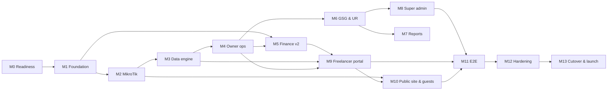

# Milestone Sheet — TaqatSpace: evolving into a full coworking operations platform

**Sources:** the CoWorkSpaces SRS (`SRS — الوثيقة الرئيسية.md`, Arabic) + the original milestone sheet (`CoWorkSpaces-Milestone-Sheet.md`, Arabic) + the development plan (`TaqatSpace-Dev-Plan.md`)  
**Scope:** the whole system, A to Z — workspace owner dashboard, staff, MikroTik integration, attendance engine, finance, GSG/UR program, analytics and reports, super admin, freelancer portal, public site, and the existing TaqatSpace modules.  
**Version:** 1.0 — 29 October 2026  
**Tracking copy:** `TaqatSpace-Milestone-Sheet.xlsx` (same data + status/branch/PR columns)

> **How this differs from the original sheet:** the original assumes building CoWorkSpaces from scratch (≈ 610 person-days for a team of 5). This sheet starts from TaqatSpace as it exists today: every task carries a **Code state** column saying whether it is **New**, an **Extension** of existing code, or **Existing** (wire-up/review only), with the file path.

---

## 1. Assumptions

| Item | Value |
| --- | --- |
| Team | One developer + Claude (multiple agents for design, implementation and review) |
| Duration unit | Working weeks (5 days). Week 1 = start of implementation |
| Effort | Developer working days with Claude; initial estimate ±20%, recalibrated after M2 based on actual velocity |
| Starting point | Current TaqatSpace on `dev` (PR #185): Laravel 13 + Next.js 16 + MySQL |
| Scope | The entire system end to end: every SRS requirement (73 IDs + non-functional + entities + flows) + the existing modules |
| Finance | Complete finance for the workspace owner with no payment gateway; payments happen outside the platform and are recorded in it |
| Sign-in | Taqat SSO for all roles + linking the freelancer to a MikroTik username; no OTP |
| Hosting | VPS before the first real router, and a fixed domain `sync.taqat.space` |
| Real data | Parallel run on the TAQAT GAZA router after M2 + CSV/Excel export from CoWorkSpaces |
| Delivery | One branch per milestone → PR to `dev` → the user merges and deploys (no manual deploys) |

**Live status:** every task has a GitHub issue holding its full spec (the **Issue** column), and its status lives on the [TaqatSpace Roadmap project board](https://github.com/users/ahmaddev27/projects/1) — see the development plan §10.1.  
**Task status key:** ⬜ Todo · 🟨 In progress · ✅ Done · ⛔ Blocked  
**Code state key:** **New** = nothing exists · **Extension** = builds on existing code (path given) · **Existing** = exists, wire-up/review only  
**Work types:** BE = backend (Laravel) · FE = frontend (Next.js) · QA = testing · Ops = infrastructure & deploy · PM = analysis & coordination

---

## 2. Milestone summary

| # | Milestone | Tasks | Effort (days) | Duration (weeks) | Week from → to | Depends on | Release |
| --- | --- | --- | --- | --- | --- | --- | --- |
| [M0](https://github.com/ahmaddev27/TAQATSPACE/milestone/1) | Stabilization, readiness and discovery | 11 | 6 | 1.2 | 1 → 2 | — | R0 |
| [M1](https://github.com/ahmaddev27/TAQATSPACE/milestone/2) | Foundation: tenants, identity, roles and settings | 14 | 9.75 | 1.95 | 2 → 4 | M0 | R1 |
| [M2](https://github.com/ahmaddev27/TAQATSPACE/milestone/3) | MikroTik integration (PUSH model) | 14 | 14.5 | 2.9 | 4 → 7 | M1 + VPS | R1 |
| [M3](https://github.com/ahmaddev27/TAQATSPACE/milestone/4) | Data engine: attendance, statistics and alerts | 12 | 12.5 | 2.5 | 7 → 9 | M2 | R1 |
| [M4](https://github.com/ahmaddev27/TAQATSPACE/milestone/5) | Workspace owner dashboard: operations and subscribers | 17 | 16.25 | 3.25 | 9 → 12 | M3 | R2 |
| [M5](https://github.com/ahmaddev27/TAQATSPACE/milestone/6) | Finance v2: billing, collections and point of sale (no payment gateway) | 23 | 19 | 3.8 | 12 → 16 | M1, M4 | R2 |
| [M6](https://github.com/ahmaddev27/TAQATSPACE/milestone/7) | GSG program, UR and month close | 14 | 14.75 | 2.95 | 16 → 19 | M3, M4 | R3 |
| [M7](https://github.com/ahmaddev27/TAQATSPACE/milestone/8) | Analytics, reports and report builder | 5 | 7.5 | 1.5 | 19 → 21 | M3, M6 | R3 |
| [M8](https://github.com/ahmaddev27/TAQATSPACE/milestone/9) | Super admin dashboard extension | 10 | 7.5 | 1.5 | 21 → 22 | M6 | R3 |
| [M9](https://github.com/ahmaddev27/TAQATSPACE/milestone/10) | Freelancer portal extension | 10 | 6 | 1.2 | 22 → 23 | M3, M4, M5 | R4 |
| [M10](https://github.com/ahmaddev27/TAQATSPACE/milestone/11) | Public site, site builder and guest registration | 8 | 5.5 | 1.1 | 23 → 24 | M2, M9 | R4 |
| [M11](https://github.com/ahmaddev27/TAQATSPACE/milestone/12) | Cross-dashboard integration (End-to-End) | 10 | 5 | 1 | 24 → 25 | M8, M9, M10 | R5 |
| [M12](https://github.com/ahmaddev27/TAQATSPACE/milestone/13) | Hardening: security, performance and localization | 8 | 5.5 | 1.1 | 25 → 26 | M11 | R5 |
| [M13](https://github.com/ahmaddev27/TAQATSPACE/milestone/14) | Migration, UAT and full switch-over from CoWorkSpaces | 8 | 8.25 | 1.65 | 26 → 28 | M12 | R5 |
|  | **Total** | **164** | **138** | **≈ 27.6 weeks** |  |  |  |

- Execution is **sequential** (one developer); parallelism happens inside each milestone through agents (backend and frontend in separate worktrees) — see §9 of the development plan.
- **Minimum switch-over path** (defer 9 deferrable tasks): ≈ 129.25 days ≈ 25.9 weeks — see §5.
- **Re-estimation:** after M2 closes, actual days are compared with estimates and the sheet is updated (the project's historical velocity with Claude was higher than estimated).

### Critical path

Critical path: **M0 → M1 → M2 → M3 → M4 → M6 → M8 → M11 → M12 → M13**. Any delay in the MikroTik integration (M2) or the data engine (M3) delays everything after it, because the dashboards and UR depend on attendance data.

### Parallel run on the TAQAT GAZA router

Starts after M2 (end of week 7) with the TaqatSpace script in poll-only mode next to the CoWorkSpaces script. By the start of M6 (week 16) about 2 months of real data will have accumulated to validate attendance accuracy (M3.11) and UR parity (M6.13). Final cutover from CoWorkSpaces happens in M13.6.

### Release plan

| Release | Milestones | Content | End of week |
| --- | --- | --- | --- |
| R0 | M0 | Ship POS/cashier + security fixes | 2 |
| R1 | M1, M2, M3 | Foundation + MikroTik + data engine (required so production can receive the parallel-run data) | 9 |
| R2 | M4, M5 | Owner operations dashboard + Finance v2 (behind a flag) | 16 |
| R3 | M6, M7, M8 | GSG/UR + reports + super admin | 22 |
| R4 | M9, M10 | Freelancer portal + public site and guests | 24 |
| R5 | M11, M12, M13 | E2E + hardening + cutover and launch | 28 |

---

## 3. Milestone details

### M0 — Stabilization, readiness and discovery (weeks 1–2 · 6 days)

**Goal:** Clean up the current state before building: ship what is ready, close security gaps, prepare the infrastructure, and collect the missing inputs.  
**Depends on:** — · **Branch:** `chore/m0-stabilize` · **Release:** R0 · **GitHub:** [milestone #1](https://github.com/ahmaddev27/TAQATSPACE/milestone/1)

| # | Task | SRS ref | Code state | Type | Days | Issue |
| --- | --- | --- | --- | --- | --- | --- |
| 0.1 | Release R0: PR from `dev` to `main` to ship POS/cashier (32 commits) + staging check | — | Extension: 32 unreleased commits on `dev` | Ops | 0.5 | [#186](https://github.com/ahmaddev27/TAQATSPACE/issues/186) |
| 0.2 | Remove the unprotected `ops/clear-cache-9f3a2c` route | NFR-SEC | Extension: `backend/routes/web.php` | BE | 0.25 | [#187](https://github.com/ahmaddev27/TAQATSPACE/issues/187) |
| 0.3 | Rotate the exposed secrets (DB, AWS, Firebase, SSO) and move them to GitHub Secrets and the server `.env` only | NFR-SEC | New | Ops | 0.5 | [#188](https://github.com/ahmaddev27/TAQATSPACE/issues/188) |
| 0.4 | Scheduled command `subscriptions:expire` (nothing moves a subscription to `expired` today) based on the end date only — grace days are added in 4.7 + test | FR-MEM-03 | Extension: `backend/routes/console.php` | BE | 0.5 | [#189](https://github.com/ahmaddev27/TAQATSPACE/issues/189) |
| 0.5 | Provision the VPS: Nginx, PHP 8.3-FPM, MySQL 8, Redis 7, Supervisor (ingest/default/heavy queues), Certbot, nightly backup to S3 | NFR-PERF | New (current host is shared cPanel with no persistent worker) | Ops | 1.5 | [#190](https://github.com/ahmaddev27/TAQATSPACE/issues/190) |
| 0.6 | Fixed domain `sync.taqat.space` + switch GitHub Actions to deploy to the VPS (staging, then production) + systemd for Next.js | NFR-PERF | Extension: `.github/workflows/deploy-staging.yml` | Ops | 0.75 | [#191](https://github.com/ahmaddev27/TAQATSPACE/issues/191) |
| 0.7 | Obtain Appendix A (80-screen inventory) and Appendix B (current MikroTik script from the TAQAT GAZA router) and update the sheet to v1.1 | — | New | PM | 0.5 | [#192](https://github.com/ahmaddev27/TAQATSPACE/issues/192) |
| 0.8 | Export CoWorkSpaces data (subscribers, devices, contracts, Roster, UTR/UR October 2026, reports) and document the file formats | §7.3 | New | PM | 0.25 | [#193](https://github.com/ahmaddev27/TAQATSPACE/issues/193) |
| 0.9 | Update `README.md`, archive the old `DOCS/taqat_space_dev_plan.xlsx`, and adopt these documents as the reference | — | Extension: `README.md` | PM | 0.25 | [#194](https://github.com/ahmaddev27/TAQATSPACE/issues/194) |
| 0.10 | Session with the platform operator (super admin) and an actual freelancer to confirm the M8/M9 scope inferred in the SRS | §5, FR-SA-01..07, FR-FL-01..05 | New | PM | 0.5 | [#195](https://github.com/ahmaddev27/TAQATSPACE/issues/195) |
| 0.11 | Obtain the full UR formula specification: the 32 parameters, C levels, TypeW weights, attendance mode, the 22 checks (prerequisite for 6.4 test-first) | FR-TRK-03, FR-MCL-02 | New | PM | 0.5 | [#196](https://github.com/ahmaddev27/TAQATSPACE/issues/196) |
|  | **Total** |  |  |  | **6** |  |

**Deliverables:** POS shipped to production, ops gap closed, secrets rotated, VPS ready with staging, CoWorkSpaces export files and both appendices.

**Acceptance criteria:**
- Production runs the latest `dev`, and the ops route returns 404.
- Staging runs on the VPS with Redis and Supervisor, and deploys go through GitHub Actions.
- The export files and both appendices are stored in `DOCS/new plan/`.

---

### M1 — Foundation: tenants, identity, roles and settings (weeks 2–4 · 9.75 days)

**Goal:** Build the layer every new module depends on: tenant identity, staff, 2FA, auditing, approvals, and settings.  
**Depends on:** M0 · **Branch:** `feat/m1-foundation` · **Release:** R1 · **GitHub:** [milestone #2](https://github.com/ahmaddev27/TAQATSPACE/milestone/2)

| # | Task | SRS ref | Code state | Type | Days | Issue |
| --- | --- | --- | --- | --- | --- | --- |
| 1.1 | Tenant identity: stable `slug`, unique `code` (base32), `platform_plan`, `platform_status` + backfill for existing workspaces | §1.3, FR-SA-01, ENT-Workspace | Extension: `backend/app/Models/Workspace.php` | BE | 0.5 | [#197](https://github.com/ahmaddev27/TAQATSPACE/issues/197) |
| 1.2 | `CurrentWorkspace` middleware + `BelongsToWorkspace` trait (for new models) + `branches` table | FR-STN-02, §7.2 | New | BE | 0.75 | [#198](https://github.com/ahmaddev27/TAQATSPACE/issues/198) |
| 1.3 | Workspace staff: generalize the cashier into preset groups (cash desk, hospitality, finance supervisor) with a group → permissions map extended in 5.21 + per-user permissions + invitation via SSO + `/settings/staff` page | §2.2, §6, STAFF-01 | Extension: `backend/app/Services/Pos/CashierManagementService.php` | BE+FE | 1.25 | [#199](https://github.com/ahmaddev27/TAQATSPACE/issues/199) |
| 1.4 | TOTP two-factor authentication (2FA): enrollment, recovery codes, post-login challenge (SSO and local admin login), step-up for issuing/voiding invoices | SEC-2FA, NFR-SEC | New | BE+FE | 1.25 | [#200](https://github.com/ahmaddev27/TAQATSPACE/issues/200) |
| 1.5 | Global audit log `audit_logs` + `AuditLogger` + filterable viewer screen (who, what, when, why) | NFR-AUDIT | New | BE+FE | 0.75 | [#201](https://github.com/ahmaddev27/TAQATSPACE/issues/201) |
| 1.6 | Approvals framework `approval_requests` + an `ApprovalHandler` per type + notifications to both parties + a simple approve/reject screen for the super admin (unified in 8.6) | FR-SA-05, FLOW-5 | New | BE+FE | 1 | [#202](https://github.com/ahmaddev27/TAQATSPACE/issues/202) |
| 1.7 | Settings — General: description, contact, bank/IBAN, time zone (16), currency (8), Wi-Fi details | SET-GEN, NFR-I18N | Extension: existing owner settings tabs | BE+FE | 0.5 | [#203](https://github.com/ahmaddev27/TAQATSPACE/issues/203) |
| 1.8 | Settings — Operations: capacity (seats/flex/private/rooms), seating mode, working hours and days, per-type prices, tax; saving = "Submit for approval" | SET-OPS, FLOW-5 | Extension: `backend/app/Services/SeatTypePricingService.php` | BE+FE | 1 | [#204](https://github.com/ahmaddev27/TAQATSPACE/issues/204) |
| 1.9 | Settings — Danger zone: workspace reset through a `WorkspaceResetter` registry that each later module extends (network, finance, GSG) — deletes operational data and keeps identity, configuration and owner + double confirmation and 2FA | SET-DNG | New | BE+FE | 0.5 | [#205](https://github.com/ahmaddev27/TAQATSPACE/issues/205) |
| 1.10 | Per-workspace feature flags (`network`, `finance_v2`, `gsg`) and hiding of menus that are not enabled | — | New | BE+FE | 0.25 | [#206](https://github.com/ahmaddev27/TAQATSPACE/issues/206) |
| 1.11 | New menu structure: Home, Commercial, Finance, GSG Program, Analytics, Places, Settings + guided empty states | §2.1, NFR-UX | Extension: `frontend/src/components/layout/nav-config.ts` | FE | 0.5 | [#207](https://github.com/ahmaddev27/TAQATSPACE/issues/207) |
| 1.12 | Keyboard shortcuts (Alt+S/A/R/L, F2, T/C/D, R, ⌘S) + help dialog *(deferrable)* | UX-KBD, NFR-UX | Extension: `frontend/src/components/layout/DashShell.tsx` (Escape only) | FE | 0.5 | [#208](https://github.com/ahmaddev27/TAQATSPACE/issues/208) |
| 1.13 | Subscriber without an SSO account: a `User` record without `sso_sub`, created from import, device discovery or guest registration, and merged/claimed on first SSO login | §2.2, ENT-Subscriber | Extension: `backend/app/Services/Auth/TaqatSsoService.php` | BE | 0.75 | [#209](https://github.com/ahmaddev27/TAQATSPACE/issues/209) |
| 1.14 | "Domain & DNS" tab: show the dashboard URL and the public site + redirect `/w/{slug}` to the owner dashboard | SET-DNS, §1.3 | New | FE | 0.25 | [#210](https://github.com/ahmaddev27/TAQATSPACE/issues/210) |
|  | **Total** |  |  |  | **9.75** |  |

**Deliverables:** Workspaces with a slug and code, staff with permissions, 2FA, audit log, approvals queue, complete settings tabs.

**Acceptance criteria:**
- A workspace owner signs in with 2FA and invites a staff member with limited permissions that the staff member cannot exceed (Feature tests).
- Any change to capacity or working hours goes to the approvals queue and is not applied directly.
- Every sensitive change appears in the audit log with the actor and the reason.

---

### M2 — MikroTik integration (PUSH model) (weeks 4–7 · 14.5 days)

**Goal:** Connect each workspace's router to the platform securely and reliably despite NAT and power outages, and manage hotspot users from the platform.  
**Depends on:** M1 + VPS · **Branch:** `feat/m2-mikrotik-sync` · **Release:** R1 · **GitHub:** [milestone #3](https://github.com/ahmaddev27/TAQATSPACE/milestone/3)

| # | Task | SRS ref | Code state | Type | Days | Issue |
| --- | --- | --- | --- | --- | --- | --- |
| 2.1 | Router model `routers` (code, hashed key + previous key with a grace period, serial number, versions, status) + `router_api_logs` | Appendix B | New | BE | 0.5 | [#211](https://github.com/ahmaddev27/TAQATSPACE/issues/211) |
| 2.2 | Per-router `install.rsc` installer generator with a one-time install token (30 minutes) and `check-certificate=yes` | Appendix B §B.2, §B.5 | New | BE | 0.75 | [#212](https://github.com/ahmaddev27/TAQATSPACE/issues/212) |
| 2.3 | RouterOS 7.12+ scripts: pre-flight checks, on-login/on-logout hooks, RAM buffers, 50 s scheduler, chunked 30 min snapshot, persistent `seq` on flash, allowlisted command interpreter, `shared-users=1` and `visitor` profile, "poll-only" mode for the parallel run | Appendix B §B.2–B.3 | New | BE | 3 | [#213](https://github.com/ahmaddev27/TAQATSPACE/issues/213) |
| 2.4 | `POST /api/v1/hotspot/{code}/sync` + `AuthenticateRouter` + rate limit + raw storage in `hotspot_events` (dedup by `event_uid`) and `router_snapshots` with its chunks + `batch_id` + clock-skew correction + plain-text response | Appendix B §B.3, NFR-SEC | Extension: pattern of `backend/app/Http/Middleware/AuthenticatePartner.php` | BE | 2 | [#214](https://github.com/ahmaddev27/TAQATSPACE/issues/214) |
| 2.5 | Command queue `router_commands` (requested→delivered→acknowledged, resend, expiry) with actions: upsert-user, upsert-profile, disable-user, remove-active, block-mac, set-key, update-script | Appendix B §B.3 | New | BE | 1.25 | [#215](https://github.com/ahmaddev27/TAQATSPACE/issues/215) |
| 2.6 | `hotspot_accounts` (unique per workspace) + migrate `subscriptions.internet_username` + wire `InternetAccessService` to upsert/disable commands on approval, suspension and expiry + map packages/plans to hotspot profiles (rate-limit, limit-bytes-total, shared-users=1, validity) | §4, FR-FL-01, §2.3 | Extension: `backend/app/Services/InternetAccessService.php` | BE | 1.25 | [#216](https://github.com/ahmaddev27/TAQATSPACE/issues/216) |
| 2.7 | Lock the router to its serial number + "Unlock router" + regenerate/rotate the API key without reinstalling (`set-key`) | Appendix B §B.5 | New | BE | 0.5 | [#217](https://github.com/ahmaddev27/TAQATSPACE/issues/217) |
| 2.8 | Automatic script updates (version + sha + owner confirmation) + "Push full update" | Appendix B §B.5 | New | BE | 0.5 | [#218](https://github.com/ahmaddev27/TAQATSPACE/issues/218) |
| 2.9 | "API & integration" page: sync status, router card, workspace code, endpoint, installer, commands, key regeneration | SET-API | New | FE | 0.75 | [#219](https://github.com/ahmaddev27/TAQATSPACE/issues/219) |
| 2.10 | "API diagnostics" page: request log, filters, refresh every 30 s, diagnostics center and deep check | SET-API | New | BE+FE | 0.5 | [#220](https://github.com/ahmaddev27/TAQATSPACE/issues/220) |
| 2.11 | Router simulator `hotspot:simulate` (461 subscribers, 1,149 devices, outages, duplicates, clock skew, reboot burst) + `FakeRouterTransport` | — | New | BE | 1 | [#221](https://github.com/ahmaddev27/TAQATSPACE/issues/221) |
| 2.12 | Test on MikroTik CHR, then on a real router: one-hour outage, reboot, 2,048 sessions, rejection of a key from another router | — | New | QA | 1.5 | [#222](https://github.com/ahmaddev27/TAQATSPACE/issues/222) |
| 2.14 | Move production from cPanel to the VPS: copy the database, switch DNS for `api`/`taqat`/`sync`, 48-hour monitoring, shut down cPanel after two weeks — before 2.13 | NFR-PERF | New | Ops | 0.75 | [#223](https://github.com/ahmaddev27/TAQATSPACE/issues/223) |
| 2.13 | Launch the parallel run on the TAQAT GAZA router (alongside the CoWorkSpaces script) and monitor it | — | New | Ops | 0.25 | [#224](https://github.com/ahmaddev27/TAQATSPACE/issues/224) |
|  | **Total** |  |  |  | **14.5** |  |

**Deliverables:** A router installs with a single command and sends its data, the platform creates and disables hotspot users remotely, and the parallel run has started.

**Acceptance criteria:**
- The one-command install succeeds on a clean router, and re-running it duplicates nothing.
- A one-hour internet outage loses no events once connectivity returns (contiguous seq).
- Another router using the same key is rejected (403) and logged.
- 100 consecutive requests with ≥ 99% success, and an upsert-user command is delivered and acknowledged within 3 cycles.

---

### M3 — Data engine: attendance, statistics and alerts (weeks 7–9 · 12.5 days)

**Goal:** Turn events and snapshots into accurate, recomputable sessions, attendance, hours, scores and alerts.  
**Depends on:** M2 · **Branch:** `feat/m3-data-engine` · **Release:** R1 · **GitHub:** [milestone #4](https://github.com/ahmaddev27/TAQATSPACE/milestone/4)

| # | Task | SRS ref | Code state | Type | Days | Issue |
| --- | --- | --- | --- | --- | --- | --- |
| 3.1 | Reassemble chunked snapshots (stored in 2.4) + `device_presence` (online now) + processing of stored events | Appendix B §B.3, ENT-Device | New | BE | 1 | [#225](https://github.com/ahmaddev27/TAQATSPACE/issues/225) |
| 3.2 | Linking: hotspot username → subscriber, MAC → device (`devices`), auto-creation of discovered devices | Appendix B §B.4, §2.4 | New | BE | 1 | [#226](https://github.com/ahmaddev27/TAQATSPACE/issues/226) |
| 3.3 | Build sessions `hotspot_sessions` (event/snapshot/timeout/reboot) under a per-router Redis lock | FR-NET-03 | New | BE | 1.5 | [#227](https://github.com/ahmaddev27/TAQATSPACE/issues/227) |
| 3.4 | Daily attendance `attendance_daily` (48-slot bitmap, union of device intervals) in the four modes Active Actual / Day Span / Hour Bucket / Half-Hour, with day boundaries in the workspace time zone (1.7) | FR-TRK-02 | New | BE | 2 | [#228](https://github.com/ahmaddev27/TAQATSPACE/issues/228) |
| 3.5 | Daily, weekly and monthly statistics per workspace and per subscriber + "Recalculate" for a historical range (command + button under "Tools" for the owner) | §7.1 performance | New | BE+FE | 1.25 | [#229](https://github.com/ahmaddev27/TAQATSPACE/issues/229) |
| 3.6 | Gap detection `router_gaps` and missing-data days, flagged in attendance | FR-NET-03, R3 | New | BE | 0.5 | [#230](https://github.com/ahmaddev27/TAQATSPACE/issues/230) |
| 3.7 | Loyalty and strength scores and segments (champions, regulars, at risk of stopping, about to churn, new, dormant) with configurable weights | FR-DSH-06, FR-MEM-08 | New | BE | 1 | [#231](https://github.com/ahmaddev27/TAQATSPACE/issues/231) |
| 3.8 | Alerts engine `alert_rules`/`alerts`: high usage (10GB/7 days), new device, churn risk, inactive, expiring contracts, overtime, repeat visitors, occupancy ≥90%, loyalty drop; severity, cooldown, quiet hours, channels (dashboard/email/FCM) | FR-ALR-01, FR-MEM-05 | Extension: channels in `backend/app/Notifications/` | BE | 1.5 | [#232](https://github.com/ahmaddev27/TAQATSPACE/issues/232) |
| 3.9 | Data-integrity tools: split a shared username by MAC, merge accounts, block a device on the router — reason required | FL-TP-TOOLS | New | BE+FE | 0.75 | [#233](https://github.com/ahmaddev27/TAQATSPACE/issues/233) |
| 3.10 | Retention policy and scheduled cleanup (raw data 90 days after close, chunks 7 days, logs 14 days) | NFR-PERF | New | BE | 0.25 | [#234](https://github.com/ahmaddev27/TAQATSPACE/issues/234) |
| 3.11 | Accuracy tests on parallel-run data: hours difference ≤ 5% versus CoWorkSpaces | — | New | QA | 1.25 | [#235](https://github.com/ahmaddev27/TAQATSPACE/issues/235) |
| 3.12 | Monthly comparison report against CoWorkSpaces (hours per subscriber and UR), run every month until cutover | §7.3 | New | BE | 0.5 | [#236](https://github.com/ahmaddev27/TAQATSPACE/issues/236) |
|  | **Total** |  |  |  | **12.5** |  |

**Deliverables:** Attendance, hours, scores and alerts computed automatically from the router, with recalculation and cleanup tools.

**Acceptance criteria:**
- Any subscriber's hours in a test month match the manual calculation and the CoWorkSpaces figures within ≤ 5%.
- An alert fires only once within the cooldown period.
- Recalculating a historical range yields the same result (deterministic).

---

### M4 — Workspace owner dashboard: operations and subscribers (weeks 9–12 · 16.25 days)

**Goal:** Turn the owner dashboard from member and seat management into a full operations center built on attendance data.  
**Depends on:** M3 · **Branch:** `feat/m4-owner-ops` · **Release:** R2 · **GitHub:** [milestone #5](https://github.com/ahmaddev27/TAQATSPACE/milestone/5)

| # | Task | SRS ref | Code state | Type | Days | Issue |
| --- | --- | --- | --- | --- | --- | --- |
| 4.1 | Executive performance dashboard: workspace health (4 components + recommendations), KPI cards, the five charts, growth and engagement, expected revenue, ARPU and occupancy, segments, "Need follow-up" and top loyalty, last sync and refresh button | FR-DSH-01..06, FR-DSH-08..09 | Extension: `backend/app/Services/OwnerDashboardService.php` | BE+FE | 1.75 | [#237](https://github.com/ahmaddev27/TAQATSPACE/issues/237) |
| 4.2 | Next-month forecast via OLS linear regression with R² and a confidence score *(deferrable)* | FR-DSH-07 | New | BE | 0.5 | [#238](https://github.com/ahmaddev27/TAQATSPACE/issues/238) |
| 4.3 | Live monitor: online now, gaps, usage, trends; refresh every 30 s | FR-NET-01..03 | New | BE+FE | 1 | [#239](https://github.com/ahmaddev27/TAQATSPACE/issues/239) |
| 4.4 | Alerts center and its settings: counters, severity filter, pagination of 30, mark as read, rule configuration | FR-ALR-01..02 | Extension: notification bell only | BE+FE | 0.75 | [#240](https://github.com/ahmaddev27/TAQATSPACE/issues/240) |
| 4.5 | Donor fields for the subscriber: gender, education level (10), specialization (35), employment status, MikroTik username + profile completion wizard | FR-MEM-06, ENT-Subscriber | Extension: only `gender` exists | BE+FE | 0.75 | [#241](https://github.com/ahmaddev27/TAQATSPACE/issues/241) |
| 4.6 | Members hub — Today/Subscribers/Weekly/This month/Calendar: daily capacity, contracted vs actual, hourly load with 70% and 90% thresholds | FR-MEM-01..02 | Extension: `frontend/src/components/features/owner/MembersTable.tsx` | BE+FE | 1.25 | [#242](https://github.com/ahmaddev27/TAQATSPACE/issues/242) |
| 4.7 | Contracts: `ContractStateMachine` (draft→active↔suspended→expired/cancelled), grace days, auto-renewal, extension, bulk renewal of eligible contracts, 14-day alert (instead of 3), state history | FR-MEM-03, FLOW-4 | Extension: `backend/app/Services/OwnerSubscriptionService.php` | BE+FE | 1.5 | [#243](https://github.com/ahmaddev27/TAQATSPACE/issues/243) |
| 4.8 | The six subscription types (monthly, weekly, daily, hourly, visitor, staff) + contracted hours | §2.3, SUBTYPE | Extension: `backend/app/Enums/PlanType.php` (monthly/daily/custom) | BE | 0.5 | [#244](https://github.com/ahmaddev27/TAQATSPACE/issues/244) |
| 4.9 | Live visitors: devices without an active subscription, "revenue gap" in hours, suggested subscription type (from the 4.8 types), "Subscribe" button | FR-MEM-04, FLOW-2 | New | BE+FE | 0.75 | [#245](https://github.com/ahmaddev27/TAQATSPACE/issues/245) |
| 4.10 | Bulk management + "Smart auto-detection" of the subscription type + CSV export | FR-MEM-07 | New | BE+FE | 0.75 | [#246](https://github.com/ahmaddev27/TAQATSPACE/issues/246) |
| 4.11 | Subscriber profile `/subscribers/{id}`: overview, subscription, scores, activity, peer comparison, loyalty and strength, activity calendar, devices; the "UTR analysis" tab is enabled in M6 and the finance tab in 5.23 | FR-MEM-08 | Extension: `frontend/src/components/features/owner/MemberDrawer.tsx` | BE+FE | 1.25 | [#247](https://github.com/ahmaddev27/TAQATSPACE/issues/247) |
| 4.12 | Subscribers — monthly financial accounts: days, attendance %, hours, GB, plan; search and sort by six criteria; cards — the "Unbilled" and "Balance" columns and the wallets card appear with `finance_v2` (M5) | FR-SUB-01..03 | New | BE+FE | 0.75 | [#248](https://github.com/ahmaddev27/TAQATSPACE/issues/248) |
| 4.13 | Monthly roster: populate from subscribers, copy last month, Gift Hours, hours reserved from capacity | FR-MEM-09, ENT-Roster | New | BE+FE | 1 | [#249](https://github.com/ahmaddev27/TAQATSPACE/issues/249) |
| 4.14 | Booking hub: timeline/calendar/contracts/attendance; new booking (subscriber, type, station, period, hours); attendance confirmation, manual or automatic via the network, with undo; new contract with the month's booking; reason required for exceeding hours; monthly summary and AUTO sync | FR-BKG-01..06 | New | BE+FE | 1.5 | [#250](https://github.com/ahmaddev27/TAQATSPACE/issues/250) |
| 4.15 | Stations: extend `Seat` (type, zone, capacity, privacy, affiliation, branch), bulk add (start/count/prefix), Inventory/Now/Month/Branches tabs | FR-STN-01..02, ENT-Station | Extension: `backend/app/Services/SeatService.php` | BE+FE | 1 | [#251](https://github.com/ahmaddev27/TAQATSPACE/issues/251) |
| 4.16 | Meeting room bookings: make meeting_room resources bookable, statuses (pending/approved/rejected/cancelled/upcoming), conflict and overlap prevention, search and date filtering | FR-RMB-01..02 | Extension: `backend/app/Services/ResourceService.php` | BE+FE | 0.75 | [#252](https://github.com/ahmaddev27/TAQATSPACE/issues/252) |
| 4.17 | Subscription requests: statuses (pending, approved, rejected, available, cancelled) and backend preparation for requests without an account (the public form is in 10.3) | FR-REQ-01, FLOW-1 | Extension: `backend/app/Services/BookingService.php` | BE+FE | 0.5 | [#253](https://github.com/ahmaddev27/TAQATSPACE/issues/253) |
|  | **Total** |  |  |  | **16.25** |  |

**Deliverables:** Executive dashboard, live monitor, members hub with ten tabs, contracts, roster, booking hub, and stations with branches.

**Acceptance criteria:**
- All Home, Commercial and Places screens run on real data from M3 (parallel run); financial fields appear after M5 and UTR analysis after M6.
- The full contract lifecycle uses only the allowed transitions, and the alert fires 14 days ahead.
- 80 stations are added via bulk add in a single operation.

---

### M5 — Finance v2: billing, collections and point of sale (no payment gateway) (weeks 12–16 · 19 days)

**Goal:** Complete finance for the workspace owner that records payments made outside the platform, added non-destructively behind a flag and fully compatible with the existing invoices and POS.  
**Depends on:** M1, M4 · **Branch:** `feat/m5-finance-v2 (several PRs)` · **Release:** R2 · **GitHub:** [milestone #6](https://github.com/ahmaddev27/TAQATSPACE/milestone/6)

| # | Task | SRS ref | Code state | Type | Days | Issue |
| --- | --- | --- | --- | --- | --- | --- |
| 5.1 | Catalog: `catalog_categories` (sales/expenses, immutable code, sort order, archiving) and `catalog_items` (code, Arabic/English name, unit piece/hour/day/month/GB, price) + link `pos_products` | FIN-ITM, FIN-CAT | Extension: POS products in `backend/app/Services/Pos/` | BE+FE | 1 | [#254](https://github.com/ahmaddev27/TAQATSPACE/issues/254) |
| 5.2 | Plans: 6 pricing methods (fixed monthly/weekly/daily, by hours, by GB, package with a cap and validity), overage price, dedicated seat, special offer until a date, archive/delete | FIN-PLN, BR-FIN-04 | Extension: `backend/app/Services/SeatTypePricingService.php` | BE+FE | 1 | [#255](https://github.com/ahmaddev27/TAQATSPACE/issues/255) |
| 5.3 | Financial subscription of the contract: prepaid/postpaid, special price, contracted hours, seat | §3.3, FR-FIN-01 | Extension: `backend/app/Models/Subscription.php` | BE | 0.75 | [#256](https://github.com/ahmaddev27/TAQATSPACE/issues/256) |
| 5.4 | Unbilled charges `unbilled_charges` (POS "Add to account", import, extra hours, overage) | FLOW-3 | New | BE | 0.5 | [#257](https://github.com/ahmaddev27/TAQATSPACE/issues/257) |
| 5.5 | Invoices v2: `invoice_lines` line items, draft→issued→voided, `payment_status`, `document_sequences` numbering, no editing or deletion after issue (hard delete replaced by voiding), 2FA step-up, legacy status sync + migration of existing invoices | FIN-INV, BR-FIN-01 | Extension: `backend/app/Services/InvoiceService.php` | BE | 1.75 | [#258](https://github.com/ahmaddev27/TAQATSPACE/issues/258) |
| 5.6 | Monthly bulk invoice run `invoice_runs` (preview → drafts → issue) replacing `invoices:generate-monthly` + manual invoice + overdue filter + invoices UI | FIN-INV | Extension: `backend/app/Console/Commands/GenerateMonthlyInvoices.php` | BE+FE | 1.25 | [#259](https://github.com/ahmaddev27/TAQATSPACE/issues/259) |
| 5.7 | Receipts `receipts` + `receipt_allocations` (allocation across invoices), methods cash/card/transfer/cheque, cheque lifecycle, sorting by collection/receipt date + migration of `invoice_payments` | FIN-RCP | Extension: existing partial payments and receipt review | BE+FE | 1.5 | [#260](https://github.com/ahmaddev27/TAQATSPACE/issues/260) |
| 5.8 | Credit notes (linked to the invoice + reason) | FIN-CN, BR-FIN-01 | New | BE+FE | 0.5 | [#261](https://github.com/ahmaddev27/TAQATSPACE/issues/261) |
| 5.9 | Wallet and deposit `wallet_entries` (receive, refund, settle, forfeit) + payment vouchers `payment_vouchers` | FIN-PV | New | BE+FE | 1 | [#262](https://github.com/ahmaddev27/TAQATSPACE/issues/262) |
| 5.10 | Point of sale v2: subscriber selection (F2), items from the catalog or manual with a discount and its reason, "Add to account" or "Collect" with the four methods, numeric keypad, seat usage | FIN-POS | Extension: `backend/app/Services/Pos/PosOrderService.php` | BE+FE | 1 | [#263](https://github.com/ahmaddev27/TAQATSPACE/issues/263) |
| 5.11 | Collections: debt aging (0–90+), follow-ups with a note, "Cannot reach them" filter, reminders | FIN-COL | Extension: `backend/app/Services/OwnerReportsService.php` | BE+FE | 0.75 | [#264](https://github.com/ahmaddev27/TAQATSPACE/issues/264) |
| 5.12 | Expenses v2: category from the catalog, payment method, reference, cancellation | FIN-EXP | Extension: `backend/app/Services/ExpenseService.php` | BE+FE | 0.25 | [#265](https://github.com/ahmaddev27/TAQATSPACE/issues/265) |
| 5.13 | Cash-up: the day's movement per method (in/out/net) + cash-count calculator (not saved) | FIN-CASH, BR-FIN-02 | New | BE+FE | 0.5 | [#266](https://github.com/ahmaddev27/TAQATSPACE/issues/266) |
| 5.14 | Value-added tax (VAT): rate in settings, frozen at issue, accrual-basis period report, voided documents excluded, detail download | FIN-VAT, BR-FIN-03 | New | BE+FE | 0.75 | [#267](https://github.com/ahmaddev27/TAQATSPACE/issues/267) |
| 5.15 | Atomic XLSX import (single sheet, ≤ 2,000 rows, ≤ 5MB, no formulas) for the catalog and on-account charges: preview, then all-or-nothing commit with no duplicates (`import_batches`) | FIN-IMP | New | BE+FE | 1 | [#268](https://github.com/ahmaddev27/TAQATSPACE/issues/268) |
| 5.16 | Organizations: a company that pays for its members, coverage terms, consolidated monthly invoice, tax number *(deferrable)* | FIN-ORG, ENT-Organization | New | BE+FE | 0.75 | [#269](https://github.com/ahmaddev27/TAQATSPACE/issues/269) |
| 5.17 | Finance seats: today's occupancy, dedicated-seat revenue, statuses (available/dedicated/reserved for later/out of service), release of expired assignments, enforcement of BR-FIN-04 | FIN-SEAT, BR-FIN-04 | Extension: `backend/app/Services/SeatService.php` | BE+FE | 0.5 | [#270](https://github.com/ahmaddev27/TAQATSPACE/issues/270) |
| 5.18 | Extra hours: after-hours charging rules, one-month preview before activation, generation of unbilled charges, independent of UR *(deferrable)* | FIN-AH | New | BE+FE | 0.75 | [#271](https://github.com/ahmaddev27/TAQATSPACE/issues/271) |
| 5.19 | Finance dashboard: "Needs your attention", received/spent/cash result/billed unpaid (each card opens its records), receivables aging, tax details | FR-FIN-01..03 | Extension: P&L in `backend/app/Services/OwnerReportsService.php` | BE+FE | 0.75 | [#272](https://github.com/ahmaddev27/TAQATSPACE/issues/272) |
| 5.20 | Financial activity log (17 action types, including deposit forfeiture and sending a reminder) on top of `audit_logs` | FIN-ACT, NFR-AUDIT | New | BE+FE | 0.5 | [#273](https://github.com/ahmaddev27/TAQATSPACE/issues/273) |
| 5.21 | Staff finance permissions: view POS, on-account charges, collections, issue/void with 2FA, expenses, items, import, financial reports — extends the group map from 1.3 | §6 | Extension: `backend/app/Enums/PosPermission.php` | BE | 0.5 | [#274](https://github.com/ahmaddev27/TAQATSPACE/issues/274) |
| 5.22 | Full-cycle test: subscription → charges → invoice → partial payment → credit note → refund + compatibility with legacy invoices and tests | — | New | QA | 1 | [#275](https://github.com/ahmaddev27/TAQATSPACE/issues/275) |
| 5.23 | Subscriber financial profile: a wallet, deposit, unbilled charges, invoices, receipts and credit notes tab inside the subscriber profile (4.11) | FR-MEM-08, §3.3 | New | BE+FE | 0.75 | [#276](https://github.com/ahmaddev27/TAQATSPACE/issues/276) |
|  | **Total** |  |  |  | **19** |  |

**Deliverables:** Complete finance behind `finance_v2`: catalog, plans, itemized invoices, vouchers, credit notes, wallet, tax, import, finance dashboard and activity log.

**Acceptance criteria:**
- Full cycle for a subscriber: subscription → charges → invoice → partial payment → credit note → refund, with every step in the activity log.
- Finance dashboard figures match the records, and an issued invoice can be neither edited nor deleted.
- All existing tests (≈607) stay green with the flag both off and on.

---

### M6 — GSG program, UR and month close (weeks 16–19 · 14.75 days)

**Goal:** Compute the official UR with accuracy matching the current system, close the month, run UTR review, and show programs and claims to the workspace owner.  
**Depends on:** M3, M4 · **Branch:** `feat/m6-gsg-ur` · **Release:** R3 · **GitHub:** [milestone #7](https://github.com/ahmaddev27/TAQATSPACE/milestone/7)

| # | Task | SRS ref | Code state | Type | Days | Issue |
| --- | --- | --- | --- | --- | --- | --- |
| 6.1 | CoWorkSpaces data importer (subscribers, devices, contracts, Roster, UTR) as a re-runnable artisan command with a reconciliation report | §7.3 | New | BE | 1 | [#277](https://github.com/ahmaddev27/TAQATSPACE/issues/277) |
| 6.2 | Parameter set (32 fields) and immutable capacity versions `capacity_versions` (Tmax) + change requests via approvals and Tmax/UR recalculation after approval | ENT-ParameterSet, FR-SA-06, FLOW-5 | New | BE+FE | 1 | [#278](https://github.com/ahmaddev27/TAQATSPACE/issues/278) |
| 6.3 | Approved holidays and their approval requests (their days are excluded from working days) | FL-TP-HOLIDAY, ENT-Holiday | New | BE+FE | 0.5 | [#279](https://github.com/ahmaddev27/TAQATSPACE/issues/279) |
| 6.4 | `UrCalculator` (pure calculator with a pinned version): AR → C → max(Actual, Contract × C) → TypeW → ΣH / Tmax, RAW/UTD/EXPECTED/FINAL readings, Qualified-C, capacity 80×8×21 — test-first with golden tests (3.8% / 71.8%) | FR-TRK-03, FR-UR-01 | New | BE | 2 | [#280](https://github.com/ahmaddev27/TAQATSPACE/issues/280) |
| 6.5 | GSG UR Tracker: 4-step wizard (settings, summary, by type, subscribers), attendance modes, calculation chain, "Final funding decision" | FR-TRK-01..03 | New | BE+FE | 1 | [#281](https://github.com/ahmaddev27/TAQATSPACE/issues/281) |
| 6.6 | Month runs `ur_month_runs` (open → closed → approved/reopened; frozen on close) + `utr_records` (contracted, actual, AR%, C, locked, justification, approval status) | ENT-UTR | New | BE | 0.75 | [#282](https://github.com/ahmaddev27/TAQATSPACE/issues/282) |
| 6.7 | Month-close wizard: 4 steps, 22 checks in 7 categories (one class per check), auto-fix and "Smart fix", recalculation, submission to UTR review | FR-MCL-01..03 | New | BE+FE | 2 | [#283](https://github.com/ahmaddev27/TAQATSPACE/issues/283) |
| 6.8 | Owner UTR review: per subscriber contracted/actual/AR%/C/locked/type fit, "Justification note", "Smart type suggestions", behavioral analysis | FR-UR-04 | New | BE+FE | 1 | [#284](https://github.com/ahmaddev27/TAQATSPACE/issues/284) |
| 6.9 | Utilization page: official UR (SSOT) and three readings, current vs expected after approval, distribution of hours and C, 12-month trend, recommendations, "Update now", anomalies, simulation and contribution | FR-UR-01..03 | New | BE+FE | 1 | [#285](https://github.com/ahmaddev27/TAQATSPACE/issues/285) |
| 6.14 | Programs schema: `programs`, `agreements`, `funded_seat_assignments`, the append-only governance log and `program_claims` + demo seeder — before 6.10 and 6.11 | ENT-Program, FR-PRG-01..05 | New | BE | 1 | [#286](https://github.com/ahmaddev27/TAQATSPACE/issues/286) |
| 6.10 | Programs (owner view): portfolio, seat board per agreement, "Live" view of funded-seat holders, day-by-day workspace report with PDF/CSV export (and Word/Excel via 7.4) | FR-PRG-01, FR-PRG-03..05 | New | BE+FE | 1.25 | [#287](https://github.com/ahmaddev27/TAQATSPACE/issues/287) |
| 6.11 | Monthly claims: the amount from the governance log is frozen on submission together with the IBAN, PDF/Word/TXT letter, claim withdrawal | FR-PRG-02, FLOW-UR | New | BE+FE | 0.75 | [#288](https://github.com/ahmaddev27/TAQATSPACE/issues/288) |
| 6.12 | Subscriber diagnostics `/debug` and repair center (activity without a roster entry, incomplete profiles, duplicates) | FR-MCL-02 | New | BE+FE | 0.5 | [#289](https://github.com/ahmaddev27/TAQATSPACE/issues/289) |
| 6.13 | Reconciliation test: recompute October 2026 from the imported data (or from the imported UTR/AR% values if raw sessions are missing — open question 5) + one month of parallel run | — | New | QA | 1 | [#290](https://github.com/ahmaddev27/TAQATSPACE/issues/290) |
|  | **Total** |  |  |  | **14.75** |  |

**Deliverables:** Official UR computed and frozen monthly, month close with checks, UTR review with justifications, programs and claims with letters.

**Acceptance criteria:**
- For October 2026 the calculator yields 3.8% now and 71.8% when locked hours are treated as approved (actual approval comes from 8.2).
- The claim amount is frozen at the moment of submission and does not change when the log changes later.
- A parallel-run month matches CoWorkSpaces within the documented differences.

---

### M7 — Analytics, reports and report builder (weeks 19–21 · 7.5 days)

**Goal:** In-depth analytics, standard reports, and export in every required format.  
**Depends on:** M3, M6 · **Branch:** `feat/m7-reports` · **Release:** R3 · **GitHub:** [milestone #8](https://github.com/ahmaddev27/TAQATSPACE/milestone/8)

| # | Task | SRS ref | Code state | Type | Days | Issue |
| --- | --- | --- | --- | --- | --- | --- |
| 7.1 | Analytics: overview, advanced, monthly, retention, comparison, evaluation, performance indicators, devices, heatmap | FR-ANL-01 | Extension: `frontend/src/components/features/owner/MemberAnalytics.tsx` | BE+FE | 1.5 | [#291](https://github.com/ahmaddev27/TAQATSPACE/issues/291) |
| 7.2 | Report engine + 6 core reports: executive summary, monthly, capacity, subscriber list, occupancy, GSG monthly UR report — with year/month and "Quick generate" | FR-RPT-01 | Extension: `backend/app/Services/OwnerReportsService.php` | BE+FE | 1.5 | [#292](https://github.com/ahmaddev27/TAQATSPACE/issues/292) |
| 7.3 | The remaining 12 named reports: subscriber health, retention, in-depth occupancy analysis, occupancy diagnostics, loyalty, network usage, demand forecast, potential revenue, period comparison, data quality, time analysis, unified dashboard + the 19th report after reviewing Appendix A *(deferrable)* | FR-RPT-01 | New | BE+FE | 1.5 | [#293](https://github.com/ahmaddev27/TAQATSPACE/issues/293) |
| 7.4 | Unified export: PDF (mPDF) / Word (phpword) / Excel (phpspreadsheet) / CSV / JSON / print | NFR-INT | Extension: `backend/app/Services/Owner/OwnerExportService.php` (CSV only) | BE | 1 | [#294](https://github.com/ahmaddev27/TAQATSPACE/issues/294) |
| 7.5 | Report builder: 21 components, drag and drop, save, JSON import/export *(deferrable)* | Appendix A §A.4 | New | FE | 2 | [#295](https://github.com/ahmaddev27/TAQATSPACE/issues/295) |
|  | **Total** |  |  |  | **7.5** |  |

**Deliverables:** Complete analytics tabs, 19 reports, export in every format, and a report builder.

**Acceptance criteria:**
- The "GSG — Monthly UR Report" produces a file matching the M6 figures.
- Every report exports to PDF, Excel and CSV without Arabic encoding errors.

---

### M8 — Super admin dashboard extension (weeks 21–22 · 7.5 days)

**Goal:** Make the super admin the final approval point: UTR, programs and funded seats, claims, approvals, and network monitoring.  
**Depends on:** M6 · **Branch:** `feat/m8-super-admin` · **Release:** R3 · **GitHub:** [milestone #9](https://github.com/ahmaddev27/TAQATSPACE/milestone/9)

| # | Task | SRS ref | Code state | Type | Days | Issue |
| --- | --- | --- | --- | --- | --- | --- |
| 8.1 | Workspace management: creation by the admin, platform plan and feature limits, status, domain | FR-SA-01 | Extension: `backend/app/Http/Controllers/WorkspaceController.php` | BE+FE | 0.75 | [#296](https://github.com/ahmaddev27/TAQATSPACE/issues/296) |
| 8.2 | UTR approval queue across all workspaces by month: read the justification, approve/reject per subscriber and in bulk, immediate effect on the official UR, reopen a closed month | FR-SA-02, FLOW-UR | New | BE+FE | 1.5 | [#297](https://github.com/ahmaddev27/TAQATSPACE/issues/297) |
| 8.3 | Programs and agreements UI (on top of the 6.14 schema): donor, seats (donated/paid), price, period, funding type | FR-SA-03, ENT-Program | New | BE+FE | 0.75 | [#298](https://github.com/ahmaddev27/TAQATSPACE/issues/298) |
| 8.4 | Funded-seat assignment and removal board + governance log view (reason, effective date, performed by) | FR-SA-03 | New | BE+FE | 0.5 | [#299](https://github.com/ahmaddev27/TAQATSPACE/issues/299) |
| 8.5 | Claims: receipt, disbursement tracking and its statuses, letters | FR-SA-04 | New | BE+FE | 0.75 | [#300](https://github.com/ahmaddev27/TAQATSPACE/issues/300) |
| 8.6 | Unified approvals queue (on top of the simple screen from 1.6): parameters, capacity, working hours, holidays, domains | FR-SA-05 | New | FE | 0.75 | [#301](https://github.com/ahmaddev27/TAQATSPACE/issues/301) |
| 8.7 | Global UR formula parameters (C levels, type weights, attendance mode) and "Final funding decision" | FR-SA-06 | New | BE+FE | 0.5 | [#302](https://github.com/ahmaddev27/TAQATSPACE/issues/302) |
| 8.8 | Cross-workspace router monitoring (last sync, version, errors) + alert when a router stops | FR-SA-07 | New | BE+FE | 0.75 | [#303](https://github.com/ahmaddev27/TAQATSPACE/issues/303) |
| 8.9 | Aggregated cross-workspace reports for the donor + aggregated dashboard view | SA-RPT, §6 | Extension: `backend/app/Services/Admin/ReportsService.php` | BE+FE | 1 | [#304](https://github.com/ahmaddev27/TAQATSPACE/issues/304) |
| 8.10 | New admin permissions (`manage_programs`, `approve_utr`, `approve_requests`, `monitor_network`) within the existing system | §6 | Extension: `backend/app/Enums/AdminPermission.php` | BE+FE | 0.25 | [#305](https://github.com/ahmaddev27/TAQATSPACE/issues/305) |
|  | **Total** |  |  |  | **7.5** |  |

**Deliverables:** An admin dashboard that approves UTR, manages programs, seats, claims and approvals, and monitors routers.

**Acceptance criteria:**
- Approving a subscriber's hours raises the official UR on the workspace dashboard immediately.
- Assigning a funded seat shows up on the owner's "Seat board" (its appearance in "My status" is tested in 11.8).
- Every new page is guarded by its permission (403 test for an admin without the permission).

---

### M9 — Freelancer portal extension (weeks 22–23 · 6 days)

**Goal:** A real entry point for the freelancer to see their status, hours and finances and to submit requests.  
**Depends on:** M3, M4, M5 · **Branch:** `feat/m9-freelancer-portal` · **Release:** R4 · **GitHub:** [milestone #10](https://github.com/ahmaddev27/TAQATSPACE/milestone/10)

| # | Task | SRS ref | Code state | Type | Days | Issue |
| --- | --- | --- | --- | --- | --- | --- |
| 9.1 | Link the SSO account to the MikroTik username and the discovered devices + match confirmation | FR-FL-01 | Extension: `backend/app/Services/Auth/TaqatSsoService.php` | BE+FE | 0.5 | [#306](https://github.com/ahmaddev27/TAQATSPACE/issues/306) |
| 9.2 | "My status": subscription, status, end date, seat, funded seat if any | FR-FL-02, FL-TP-STATUS | Extension: `backend/app/Services/MemberDashboardService.php` | BE+FE | 0.5 | [#307](https://github.com/ahmaddev27/TAQATSPACE/issues/307) |
| 9.3 | My attendance and hours: days and hours this month, AR%, activity calendar | FR-FL-02 | New | BE+FE | 1 | [#308](https://github.com/ahmaddev27/TAQATSPACE/issues/308) |
| 9.4 | My invoices, wallet balance and receipts + PDF download | FR-FL-02 | Extension: `freelancer/invoices` page | BE+FE | 0.5 | [#309](https://github.com/ahmaddev27/TAQATSPACE/issues/309) |
| 9.5 | Requests: renewal, plan change, room booking → sent to the owner for approval | FR-FL-03 | Extension: cancellation only in `backend/routes/api/subscriptions.php` | BE+FE | 1 | [#310](https://github.com/ahmaddev27/TAQATSPACE/issues/310) |
| 9.6 | Dispute hours or charges (request with a reason and an attachment, answered by the owner) *(deferrable)* | FR-FL-04 | New | BE+FE | 0.75 | [#311](https://github.com/ahmaddev27/TAQATSPACE/issues/311) |
| 9.7 | My devices: linked devices, naming, removal request | FR-FL-05 | New | BE+FE | 0.5 | [#312](https://github.com/ahmaddev27/TAQATSPACE/issues/312) |
| 9.8 | My profile: donor-field completion wizard (education, specialization, employment status) | FR-MEM-06 | Extension: `freelancer/profile` page | FE | 0.25 | [#313](https://github.com/ahmaddev27/TAQATSPACE/issues/313) |
| 9.9 | New notifications: contract expiring (14 days), invoice issued, request approved/rejected, dispute reply, hours alert | — | Extension: `backend/app/Notifications/` | BE | 0.5 | [#314](https://github.com/ahmaddev27/TAQATSPACE/issues/314) |
| 9.10 | Freelancer POS reads from the unified catalog + "Add to my account" option | FL-TP-POS | Existing: `freelancer/pos` page | BE+FE | 0.5 | [#315](https://github.com/ahmaddev27/TAQATSPACE/issues/315) |
|  | **Total** |  |  |  | **6** |  |

**Deliverables:** A complete freelancer portal: status, attendance, finances, requests, disputes, devices, profile.

**Acceptance criteria:**
- A freelancer signs in with SSO and sees hours matching those on the workspace dashboard.
- A renewal request appears for the owner, and the approval arrives as a notification.

---

### M10 — Public site, site builder and guest registration (weeks 23–24 · 5.5 days)

**Goal:** A public site for each workspace under its own name, request and booking forms that need no account, and guest self-registration from the hotspot page.  
**Depends on:** M2, M9 · **Branch:** `feat/m10-public-site` · **Release:** R4 · **GitHub:** [milestone #11](https://github.com/ahmaddev27/TAQATSPACE/milestone/11)

| # | Task | SRS ref | Code state | Type | Days | Issue |
| --- | --- | --- | --- | --- | --- | --- |
| 10.1 | Public site `/s/{slug}` (Arabic/English) that works without the site builder using the sections of the current workspace page, with a redirect from that page | §2.1 | Extension: `(public)/workspaces/[id]` page | BE+FE | 0.75 | [#316](https://github.com/ahmaddev27/TAQATSPACE/issues/316) |
| 10.2 | Site builder: 14 sortable, toggleable sections per workspace (modeled on the Landing CMS) *(deferrable)* | Appendix A §A.5 | Extension: `frontend/src/components/features/admin/LandingEditor.tsx` | BE+FE | 1.5 | [#317](https://github.com/ahmaddev27/TAQATSPACE/issues/317) |
| 10.3 | Subscription request form without an account → "Subscription requests" | FR-REQ-01, FL-TP-FORMS | Extension: the current booking request requires sign-in | BE+FE | 0.5 | [#318](https://github.com/ahmaddev27/TAQATSPACE/issues/318) |
| 10.4 | Room booking form with duration limits and advance booking → "Room bookings" | FR-RMB-01, FL-TP-FORMS | New | BE+FE | 0.5 | [#319](https://github.com/ahmaddev27/TAQATSPACE/issues/319) |
| 10.5 | "My status page" on the public site (enabled from settings, merged into the site builder once it is built) | FL-TP-STATUS | New | FE | 0.25 | [#320](https://github.com/ahmaddev27/TAQATSPACE/issues/320) |
| 10.6 | Guest self-registration `/hotspot/{code}/register` from the hotspot login page: phone-number or generated username, `visitor` profile and `shared-users=1`, Walled Garden, account ready within a minute | FL-TP-GUEST | New | BE+FE | 1.25 | [#321](https://github.com/ahmaddev27/TAQATSPACE/issues/321) |
| 10.7 | Custom domain: request → super admin approval → DNS/SSL activation *(deferrable)* | SET-DNS | New | BE+Ops | 0.5 | [#322](https://github.com/ahmaddev27/TAQATSPACE/issues/322) |
| 10.8 | Existing discovery and marketplace: keep explore, reviews and ads, and link them to the slug and the new plans | — | Existing: `(public)/explore` page | FE | 0.25 | [#323](https://github.com/ahmaddev27/TAQATSPACE/issues/323) |
|  | **Total** |  |  |  | **5.5** |  |

**Deliverables:** A public site per workspace, request and booking forms, guest registration from the hotspot, and custom domains.

**Acceptance criteria:**
- A visitor connects to the Wi-Fi and taps "Register new visitor"; their account is created on the router within a minute and they get internet access.
- A request from the public site reaches "Subscription requests" without creating any record before approval.

---

### M11 — Cross-dashboard integration (End-to-End) (weeks 24–25 · 5 days)

**Goal:** Ensure that every flow crossing the four dashboards (owner, staff, freelancer, super admin) works end to end.  
**Depends on:** M8, M9, M10 · **Branch:** `test/m11-e2e` · **Release:** R5 · **GitHub:** [milestone #12](https://github.com/ahmaddev27/TAQATSPACE/milestone/12)

| # | Task | SRS ref | Code state | Type | Days | Issue |
| --- | --- | --- | --- | --- | --- | --- |
| 11.1 | Monthly UR cycle: freelancer connects → weighting → close → justification → approval → official UR → GSG report | FLOW-UR | New | QA | 1 | [#324](https://github.com/ahmaddev27/TAQATSPACE/issues/324) |
| 11.2 | Claim cycle: governance log → frozen claim → receipt and disbursement | FR-PRG-02 | New | QA | 0.25 | [#325](https://github.com/ahmaddev27/TAQATSPACE/issues/325) |
| 11.3 | From request to subscriber: public site → approval → contract + plan → freelancer portal | FLOW-1 | New | QA | 0.5 | [#326](https://github.com/ahmaddev27/TAQATSPACE/issues/326) |
| 11.4 | Live visitor conversion: device without a subscription → "Live visitors" → "Subscribe" → billing | FLOW-2 | New | QA | 0.25 | [#327](https://github.com/ahmaddev27/TAQATSPACE/issues/327) |
| 11.5 | Billing cycle: POS charges → invoice → seen by the freelancer → payment → balance | FLOW-3 | New | QA | 0.5 | [#328](https://github.com/ahmaddev27/TAQATSPACE/issues/328) |
| 11.6 | Contract cycle: draft → active → suspended → active → expired + individual and bulk renewal | FLOW-4 | New | QA | 0.25 | [#329](https://github.com/ahmaddev27/TAQATSPACE/issues/329) |
| 11.7 | Parameter change: request → approval → Tmax and UR recalculation | FLOW-5 | New | QA | 0.25 | [#330](https://github.com/ahmaddev27/TAQATSPACE/issues/330) |
| 11.8 | Funded seat assignment: super admin → seat board → live → program report → "My status" | FR-PRG-05 | New | QA | 0.25 | [#331](https://github.com/ahmaddev27/TAQATSPACE/issues/331) |
| 11.9 | Automate the flows with Playwright on staging with a CHR router | — | Extension: `frontend/tests-e2e/smoke.spec.ts` (single test) | QA | 1 | [#332](https://github.com/ahmaddev27/TAQATSPACE/issues/332) |
| 11.10 | Regression tests for existing modules: discovery, booking, chat, CMS, partner API (Academy), notifications, POS | — | Existing: ≈607 Feature tests | QA | 0.75 | [#333](https://github.com/ahmaddev27/TAQATSPACE/issues/333) |
|  | **Total** |  |  |  | **5** |  |

**Deliverables:** An automated E2E test suite covering all flows, and a regression suite for the existing modules.

**Acceptance criteria:**
- The eight flows pass automatically on staging with a test router.
- No regression in any existing module.

---

### M12 — Hardening: security, performance and localization (weeks 25–26 · 5.5 days)

**Goal:** Bring the system up to multi-workspace production quality.  
**Depends on:** M11 · **Branch:** `chore/m12-hardening` · **Release:** R5 · **GitHub:** [milestone #13](https://github.com/ahmaddev27/TAQATSPACE/milestone/13)

| # | Task | SRS ref | Code state | Type | Days | Issue |
| --- | --- | --- | --- | --- | --- | --- |
| 12.1 | Backup buffer on flash for pre-reboot events + option for a 10-minute snapshot during working hours | Appendix B §B.5, R3 | New | BE | 0.75 | [#334](https://github.com/ahmaddev27/TAQATSPACE/issues/334) |
| 12.2 | Fix the WAN IP in the snapshot and separate the "50 s exchange" from the "30 min snapshot" in the UI | Appendix B §B.5 | New | BE+FE | 0.25 | [#335](https://github.com/ahmaddev27/TAQATSPACE/issues/335) |
| 12.3 | k6 load test: 2,048 sessions, 50 concurrent workspaces, power-restoration burst, `/sync` ≤ 300ms | NFR-PERF | New | QA | 1 | [#336](https://github.com/ahmaddev27/TAQATSPACE/issues/336) |
| 12.4 | Basic penetration test of the API and role permissions + security code review | NFR-SEC | New | QA | 1 | [#337](https://github.com/ahmaddev27/TAQATSPACE/issues/337) |
| 12.5 | Monitoring: Sentry (BE/FE), uptime monitoring, alert when queues or routers stop | NFR-PERF | New | Ops | 0.5 | [#338](https://github.com/ahmaddev27/TAQATSPACE/issues/338) |
| 12.6 | Localization review and terminology unification (no machine-translated text and no leftover English) + glossary | NFR-I18N, §7.3 | Extension: frontend `messages` files | FE+PM | 1 | [#339](https://github.com/ahmaddev27/TAQATSPACE/issues/339) |
| 12.7 | Performance: indexes, Redis cache for the live monitor, slow queries, N+1 prevention | NFR-PERF | New | BE | 0.75 | [#340](https://github.com/ahmaddev27/TAQATSPACE/issues/340) |
| 12.8 | Data retention and privacy policy (MAC, sessions) and its enforcement | open question 4 | New | BE | 0.25 | [#341](https://github.com/ahmaddev27/TAQATSPACE/issues/341) |
|  | **Total** |  |  |  | **5.5** |  |

**Deliverables:** A load-tested, security-tested, monitored and fully localized system.

**Acceptance criteria:**
- No critical or high-severity vulnerabilities.
- `/sync` latency ≤ 300ms under load, and no event loss during a power-restoration burst.

---

### M13 — Migration, UAT and full switch-over from CoWorkSpaces (weeks 26–28 · 8.25 days)

**Goal:** Move TAQAT GAZA entirely to TaqatSpace and close the first operating month without manual intervention.  
**Depends on:** M12 · **Branch:** `release/m13-launch` · **Release:** R5 · **GitHub:** [milestone #14](https://github.com/ahmaddev27/TAQATSPACE/milestone/14)

| # | Task | SRS ref | Code state | Type | Days | Issue |
| --- | --- | --- | --- | --- | --- | --- |
| 13.1 | Final migration of TAQAT GAZA data (461 subscribers, 1,149 devices, contracts, statistics) + reconciliation report | §7.3 | New | BE | 1.5 | [#342](https://github.com/ahmaddev27/TAQATSPACE/issues/342) |
| 13.2 | Data cleanup: merge duplicates, complete incomplete profiles (24), fix numeric names and "Guset" | §7.4 (5) | New | PM+BE | 0.75 | [#343](https://github.com/ahmaddev27/TAQATSPACE/issues/343) |
| 13.3 | Actual setup: 80 stations, plans, link 82 active subscribers to financial subscriptions, review the high-usage threshold | §7.4 (1, 2, 7) | New | PM | 0.75 | [#344](https://github.com/ahmaddev27/TAQATSPACE/issues/344) |
| 13.4 | UAT with the workspace owner, staff, super admin and a sample of freelancers | — | New | PM+QA | 1.5 | [#345](https://github.com/ahmaddev27/TAQATSPACE/issues/345) |
| 13.5 | Training and user guides for each role | — | New | PM | 0.75 | [#346](https://github.com/ahmaddev27/TAQATSPACE/issues/346) |
| 13.8 | Rollback-plan drill before cutover: re-enable the CoWorkSpaces script and verify, then remove it | — | New | Ops | 0.25 | [#347](https://github.com/ahmaddev27/TAQATSPACE/issues/347) |
| 13.6 | Cutover from CoWorkSpaces: remove their script and enable the full TaqatSpace hooks on the router | — | New | Ops | 0.25 | [#348](https://github.com/ahmaddev27/TAQATSPACE/issues/348) |
| 13.7 | Hypercare: first-week monitoring + close of the first full operating month (UR + claim) | — | New | All | 2.5 | [#349](https://github.com/ahmaddev27/TAQATSPACE/issues/349) |
|  | **Total** |  |  |  | **8.25** |  |

**Deliverables:** TAQAT GAZA runs on TaqatSpace alone, with the first month closed and a claim submitted.

**Acceptance criteria:**
- An operating month closes successfully, UR is approved, and the claim is submitted without manual intervention from the development team.

---

## 4. SRS coverage (A to Z)

Every requirement ID in the SRS (**73** FR/BR IDs) maps to at least one task. Non-functional requirements (NFR-*), settings tabs (SET-*), freelancer touchpoints (FL-TP-*), entities (ENT-*) and flows (FLOW-*) are also referenced in the **SRS ref** column.

| Group | IDs | Covering tasks |
| --- | --- | --- |
| BR-FIN | 4 | M5.2, M5.5, M5.8, M5.13, M5.14, M5.17 |
| FR-ALR | 2 | M3.8, M4.4 |
| FR-ANL | 1 | M7.1 |
| FR-BKG | 6 | M4.14 |
| FR-DSH | 9 | M3.7, M4.1, M4.2 |
| FR-FIN | 3 | M5.3, M5.19 |
| FR-FL | 5 | M0.10, M2.6, M9.1, M9.2, M9.3, M9.4, M9.5, M9.6, M9.7 |
| FR-MCL | 3 | M0.11, M6.7, M6.12 |
| FR-MEM | 9 | M0.4, M3.7, M3.8, M4.5, M4.6, M4.7, M4.9, M4.10, M4.11, M4.13, M5.23, M9.8 |
| FR-NET | 3 | M3.3, M3.6, M4.3 |
| FR-PRG | 5 | M6.10, M6.11, M6.14, M11.2, M11.8 |
| FR-REQ | 1 | M4.17, M10.3 |
| FR-RMB | 2 | M4.16, M10.4 |
| FR-RPT | 1 | M7.2, M7.3 |
| FR-SA | 7 | M0.10, M1.1, M1.6, M6.2, M8.1, M8.2, M8.3, M8.4, M8.5, M8.6, M8.7, M8.8 |
| FR-STN | 2 | M1.2, M4.15 |
| FR-SUB | 3 | M4.12 |
| FR-TRK | 3 | M0.11, M3.4, M6.4, M6.5 |
| FR-UR | 4 | M6.4, M6.8, M6.9 |

**Result:** no uncovered ID. ✅

**Gap summary** (from the detailed gap matrix in the development plan, 136 items): ✅ existing 3 · 🟨 partial 59 · ⬜ new 74.

---

## 5. Minimum switch-over path

These tasks do not block replacing CoWorkSpaces and can move to a second phase if time is short:

| Milestone | # | Task | Days | Issue |
| --- | --- | --- | --- | --- |
| M1 | 1.12 | Keyboard shortcuts (Alt+S/A/R/L, F2, T/C/D, R, ⌘S) + help dialog | 0.5 | [#208](https://github.com/ahmaddev27/TAQATSPACE/issues/208) |
| M4 | 4.2 | Next-month forecast via OLS linear regression with R² and a confidence score | 0.5 | [#238](https://github.com/ahmaddev27/TAQATSPACE/issues/238) |
| M5 | 5.16 | Organizations: a company that pays for its members, coverage terms, consolidated monthly invoice, tax number | 0.75 | [#269](https://github.com/ahmaddev27/TAQATSPACE/issues/269) |
| M5 | 5.18 | Extra hours: after-hours charging rules, one-month preview before activation, generation of unbilled charges, independent of UR | 0.75 | [#271](https://github.com/ahmaddev27/TAQATSPACE/issues/271) |
| M7 | 7.3 | The remaining 12 named reports: subscriber health, retention, in-depth occupancy analysis, occupancy diagnostics, loyalty, network usage, demand forecast, potential revenue, period comparison, data quality, time analysis, unified dashboard + the 19th report after reviewing Appendix A | 1.5 | [#293](https://github.com/ahmaddev27/TAQATSPACE/issues/293) |
| M7 | 7.5 | Report builder: 21 components, drag and drop, save, JSON import/export | 2 | [#295](https://github.com/ahmaddev27/TAQATSPACE/issues/295) |
| M9 | 9.6 | Dispute hours or charges (request with a reason and an attachment, answered by the owner) | 0.75 | [#311](https://github.com/ahmaddev27/TAQATSPACE/issues/311) |
| M10 | 10.2 | Site builder: 14 sortable, toggleable sections per workspace (modeled on the Landing CMS) | 1.5 | [#317](https://github.com/ahmaddev27/TAQATSPACE/issues/317) |
| M10 | 10.7 | Custom domain: request → super admin approval → DNS/SSL activation | 0.5 | [#322](https://github.com/ahmaddev27/TAQATSPACE/issues/322) |
|  |  | **Total** | **8.75** |  |

Full scope ≈ 138 days; minimum path ≈ 129.25 days (≈ 25.9 weeks).

---

## 6. Effort by work type

| Type | Days | Share |
| --- | --- | --- |
| BE+FE | 69 | 50% |
| BE | 36.75 | 27% |
| QA | 11.75 | 9% |
| FE | 5.5 | 4% |
| Ops | 5.25 | 4% |
| PM | 3.5 | 3% |
| All | 2.5 | 2% |
| PM+QA | 1.5 | 1% |
| FE+PM | 1 | 1% |
| PM+BE | 0.75 | 1% |
| BE+Ops | 0.5 | 0% |

One developer covers every type; agents shorten BE/FE time (parallel implementation) while field QA (router, parallel run, UAT) stays bound to calendar time.

---

## 7. Risks

| # | Risk | Impact | Likelihood | Mitigation |
| --- | --- | --- | --- | --- |
| R1 | Delay in provisioning the VPS and moving deployment | Delays M2 and everything after it | Medium | Starts in M0, and the `sync.taqat.space` domain is fixed from day one, so routers are never reinstalled |
| R2 | Differences in RouterOS versions and router capabilities | Install or capture failures | Medium | CHR + a test matrix for 7.12+ versions and the actual models |
| R3 | Power and internet outages in Gaza | Attendance gaps that affect UR | High | Persistent seq, flash buffer, clock-skew correction, flagging gap days in UTR |
| R4 | Usernames shared between people | Mixed attendance and incorrect funding | High | Guest self-registration + shared-users=1 + split-by-MAC tool |
| R5 | Router executing the response text | Server compromise = control over the routers | Low/Critical | Allowlisted command set interpreted by the script from M2 onward (not deferred to hardening) |
| R6 | UR formula accuracy versus the current system | Donor rejects the reports | Medium | Pure test-first calculator + golden tests + comparison of parallel-run months |
| R7 | Conflict between the two scripts during the parallel run (one on-login hook per profile) | Breaks the CoWorkSpaces script | Medium | "Poll-only" mode for our script without touching their hooks until cutover in M13 |
| R8 | Incomplete CoWorkSpaces export (no raw sessions) | Harder reconciliation testing | Medium | Reconciliation at the UTR and totals level + parallel-run data |
| R9 | Finance v2 breaks existing invoices/POS/tests | Regression in production | Medium | Additive changes only, per-workspace flag, legacy status sync, tested backfill |
| R10 | Single developer (capacity and key-person dependency) | Delays and review backlog | High | Parallel agents in worktrees, the minimum switch-over path, re-estimation after M2 |
| R11 | Personal data (MAC, sessions) | Privacy risks | Medium | Retention policy (M12.8), access permissions, auditing |
| R12 | Appendix A (80 screens) not yet available | Additional unestimated scope | Medium | Review it in M0 and update the sheet to v1.1 |

---

## 8. Open questions

Resolved on 2026-10-29: the freelancer portal exists and is extended; sign-in is SSO (no OTP); no online payments.

| # | Question | Affects |
| --- | --- | --- |
| 1 | Super admin tiers: is there more than one tier (operator, financial auditor, donor representative)? | M8 |
| 2 | Does the freelancer see their hours weighted by factor C, or only the actual hours? | M9.3 |
| 3 | Tax: is it enabled for specific workspaces? At what rate? | M5.14 |
| 4 | Data retention (MAC, sessions) and deletion policy | M12.8 |
| 5 | Does the CoWorkSpaces export contain per-subscriber UTR and raw sessions? | M6.1 |
| 6 | Does TAQAT GAZA currently have more than one branch/router? What is the router model and RouterOS version? | M1.2, M2.12 |
| 7 | Platform plans for workspaces (free/paid): manual status tracking as in the current business model? | M8.1 |

---

## 9. Version history

| Version | Date | Change |
| --- | --- | --- |
| 1.0 | 29 October 2026 | First version, based on the SRS, the original sheet, and an audit of the TaqatSpace code (`dev`, PR #185) |

