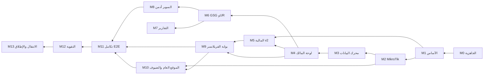

# Milestone Sheet — TaqatSpace: التحويل إلى منصة تشغيل مساحات العمل

**المرجع:** وثيقة SRS — منصة CoWorkSpaces (`SRS — الوثيقة الرئيسية.md`) + الشيت الأصلي (`CoWorkSpaces-Milestone-Sheet.md`) + خطة التطوير (`TaqatSpace-Dev-Plan.md`)  
**النطاق:** كامل النظام من الألف إلى الياء — لوحة صاحب المساحة، الموظفون، تكامل MikroTik، محرك الحضور، المالية، برنامج GSG وUR، التحليلات والتقارير، السوبر أدمن، بوابة الفريلانسر، الموقع العام، والوحدات القائمة في TaqatSpace.  
**الإصدار:** 1.0 — 29 أكتوبر 2026  
**النسخة القابلة للمتابعة:** `TaqatSpace-Milestone-Sheet.xlsx` (نفس البيانات + أعمدة الحالة والفرع والـ PR)

> **الفرق عن الشيت الأصلي:** الشيت الأصلي يفترض بناء CoWorkSpaces من الصفر (≈ 610 يوم-شخص لفريق من 5). هذا الشيت مبني على TaqatSpace كما هو اليوم: كل مهمة تحمل عمود «الوضع الحالي» الذي يبيّن هل هي **جديد** أو **توسعة** لكود قائم أو **موجود** (مراجعة وربط فقط)، مع مسار الملف.

---

## 1. الافتراضات

| البند | القيمة |
| --- | --- |
| الفريق | مطوّر واحد + Claude (وكلاء متعددون للتصميم والتنفيذ والمراجعة) |
| وحدة المدة | أسابيع عمل (5 أيام). الأسبوع 1 = بداية التنفيذ |
| الجهد | أيام عمل للمطوّر مع Claude، تقدير أولي ±20%، يُعاد ضبطه بعد M2 حسب السرعة الفعلية |
| نقطة البداية | TaqatSpace الحالي على `dev` (PR #185): Laravel 13 + Next.js 16 + MySQL |
| النطاق | كامل النظام من الألف إلى الياء: كل متطلبات SRS (73 معرّفًا + غير الوظيفية + الكيانات + التدفقات) + الوحدات القائمة |
| المالية | مالية كاملة لصاحب المساحة بلا بوابة دفع؛ الدفع خارج المنصة ويُسجَّل فيها |
| الدخول | Taqat SSO لكل الأدوار + ربط الفريلانسر باسم مستخدم MikroTik؛ لا OTP |
| الاستضافة | VPS قبل أول راوتر حقيقي، ونطاق ثابت `sync.taqat.space` |
| البيانات الحقيقية | تشغيل متوازٍ على راوتر TAQAT GAZA بعد M2 + تصدير CSV/Excel من CoWorkSpaces |
| التسليم | فرع لكل Milestone ← PR إلى `dev` ← المستخدم يدمج وينشر (لا نشر يدوي) |

**مفتاح حالة المهمة:** ⬜ لم يبدأ · 🟨 قيد التنفيذ · ✅ مكتمل · ⛔ متوقف  
**مفتاح الوضع الحالي في الكود:** **جديد** = لا شيء قائم · **توسعة** = يُبنى فوق كود قائم (المسار مذكور) · **موجود** = قائم ويحتاج ربطًا/مراجعة فقط  
**أنواع العمل:** BE = Backend (Laravel) · FE = Frontend (Next.js) · QA = اختبار · Ops = بنية تحتية ونشر · PM = تحليل وتنسيق

---

## 2. ملخص الـ Milestones

| # | Milestone | الجهد (أيام) | المدة (أسابيع) | من أسبوع → إلى | يعتمد على | الإصدار | الحالة |
| --- | --- | --- | --- | --- | --- | --- | --- |
| M0 | التثبيت والجاهزية والاكتشاف | 6 | 1.2 | 1 → 2 | — | R0 | ⬜ |
| M1 | الأساس: المستأجرون والهوية والأدوار والإعدادات | 9.75 | 1.95 | 2 → 4 | M0 | R1 | ⬜ |
| M2 | تكامل MikroTik (نموذج PUSH) | 14.5 | 2.9 | 4 → 7 | M1 + VPS | R1 | ⬜ |
| M3 | محرك البيانات: الحضور والإحصاءات والتنبيهات | 12.5 | 2.5 | 7 → 9 | M2 | R1 | ⬜ |
| M4 | لوحة صاحب المساحة: التشغيل والمشتركون | 16.25 | 3.25 | 9 → 12 | M3 | R2 | ⬜ |
| M5 | المالية v2: الفوترة والتحصيل ونقطة البيع (بلا بوابة دفع) | 19 | 3.8 | 12 → 16 | M1، M4 | R2 | ⬜ |
| M6 | برنامج GSG وUR وإقفال الشهر | 14.75 | 2.95 | 16 → 19 | M3، M4 | R3 | ⬜ |
| M7 | التحليلات والتقارير ومنشئ التقارير | 7.5 | 1.5 | 19 → 21 | M3، M6 | R3 | ⬜ |
| M8 | توسعة لوحة السوبر أدمن | 7.5 | 1.5 | 21 → 22 | M6 | R3 | ⬜ |
| M9 | توسعة بوابة الفريلانسر | 6 | 1.2 | 22 → 23 | M3، M4، M5 | R4 | ⬜ |
| M10 | الموقع العام ومنشئ الموقع وتسجيل الضيوف | 5.5 | 1.1 | 23 → 24 | M2، M9 | R4 | ⬜ |
| M11 | التكامل بين اللوحات (End-to-End) | 5 | 1 | 24 → 25 | M8، M9، M10 | R5 | ⬜ |
| M12 | التقوية: الأمان والأداء والتعريب | 5.5 | 1.1 | 25 → 26 | M11 | R5 | ⬜ |
| M13 | الترحيل وUAT والانتقال الكامل من CoWorkSpaces | 8.25 | 1.65 | 26 → 28 | M12 | R5 | ⬜ |
|  | **الإجمالي** | **138** | **≈ 27.6 أسبوعًا** |  |  |  |  |

- التنفيذ **تسلسلي** (مطوّر واحد)، والتوازي داخل كل Milestone عبر الوكلاء (Backend وFrontend في worktrees منفصلة) — انظر §9 في خطة التطوير.
- **المسار الأدنى للانتقال** (تأجيل 9 مهام قابلة للتأجيل): ≈ 129.25 يومًا ≈ 25.9 أسبوعًا — انظر §5.
- **إعادة التقدير:** بعد إغلاق M2 تُقارن الأيام الفعلية بالمقدّرة ويُحدَّث الشيت (السرعة التاريخية للمشروع مع Claude كانت أعلى من التقدير).

### المسار الحرج

المسار الحرج: **M0 → M1 → M2 → M3 → M4 → M6 → M8 → M11 → M12 → M13**. أي تأخير في تكامل MikroTik (M2) أو محرك البيانات (M3) يؤخر كل ما بعده، لأن اللوحات والـ UR تعتمد على بيانات الحضور.

### التشغيل المتوازي على راوتر TAQAT GAZA

يبدأ بعد M2 (نهاية الأسبوع 7) بسكربت TaqatSpace في وضع «استطلاع فقط» بجانب سكربت CoWorkSpaces. عند بدء M6 (الأسبوع 16) تكون قد تجمّعت ≈ 2 أشهر من البيانات الحقيقية لاختبار دقة الحضور (M3.11) ومطابقة UR (M6.13). القطع النهائي عن CoWorkSpaces في M13.6.

### خطة الإصدارات إلى الإنتاج

| الإصدار | الـ Milestones | المحتوى | نهاية الأسبوع |
| --- | --- | --- | --- |
| R0 | M0 | نشر POS/الكاشير وإصلاحات الأمان | 2 |
| R1 | M1، M2، M3 | الأساس + MikroTik + محرك البيانات (لازم ليستقبل الإنتاج بيانات التشغيل المتوازي) | 9 |
| R2 | M4، M5 | لوحة المالك التشغيلية + المالية v2 (خلف flag) | 16 |
| R3 | M6، M7، M8 | GSG وUR + التقارير + السوبر أدمن | 22 |
| R4 | M9، M10 | بوابة الفريلانسر + الموقع العام والضيوف | 24 |
| R5 | M11، M12، M13 | E2E + التقوية + الانتقال والإطلاق | 28 |

---

## 3. تفاصيل كل Milestone

### M0 — التثبيت والجاهزية والاكتشاف (أسابيع 1–2 · 6 يوم)

**الهدف:** تنظيف الوضع القائم قبل البناء: نشر ما هو جاهز، إغلاق الثغرات، تجهيز البنية التحتية، وجمع المدخلات الناقصة.  
**يعتمد على:** — · **الفرع:** `chore/m0-stabilize` · **الإصدار:** R0

| # | المهمة | مرجع SRS | الوضع الحالي | النوع | أيام | الحالة |
| --- | --- | --- | --- | --- | --- | --- |
| 0.1 | إصدار R0: PR من `dev` إلى `main` لنشر POS/الكاشير (32 commit) + فحص staging | — | توسعة: 32 commit على `dev` غير منشورة | Ops | 0.5 | ⬜ |
| 0.2 | إزالة مسار `ops/clear-cache-9f3a2c` غير المحمي | NFR-SEC | توسعة: `backend/routes/web.php` | BE | 0.25 | ⬜ |
| 0.3 | تدوير الأسرار المكشوفة (DB، AWS، Firebase، SSO) ونقلها إلى GitHub Secrets و`.env` الخادم فقط | NFR-SEC | جديد | Ops | 0.5 | ⬜ |
| 0.4 | أمر مجدول `subscriptions:expire` (لا شيء يحوّل الاشتراك إلى `expired` حاليًا) بتاريخ الانتهاء فقط — أيام السماح تُضاف في 4.7 + اختبار | FR-MEM-03 | توسعة: `backend/routes/console.php` | BE | 0.5 | ⬜ |
| 0.5 | تجهيز VPS: Nginx، PHP 8.3-FPM، MySQL 8، Redis 7، Supervisor (طوابير ingest/default/heavy)، Certbot، نسخ احتياطي ليلي إلى S3 | NFR-PERF | جديد (الحالي cPanel مشترك بلا worker دائم) | Ops | 1.5 | ⬜ |
| 0.6 | النطاق الثابت `sync.taqat.space` + تحويل GitHub Actions للنشر على الـ VPS (staging ثم production) + systemd لـ Next.js | NFR-PERF | توسعة: `.github/workflows/deploy-staging.yml` | Ops | 0.75 | ⬜ |
| 0.7 | جلب الملحق أ (جرد 80 شاشة) والملحق ب (سكربت MikroTik الحالي من راوتر TAQAT GAZA) وتحديث الشيت إلى v1.1 | — | جديد | PM | 0.5 | ⬜ |
| 0.8 | تصدير بيانات CoWorkSpaces (المشتركون، الأجهزة، العقود، Roster، UTR/UR أكتوبر 2026، التقارير) وتوثيق صيغ الملفات | §7.3 | جديد | PM | 0.25 | ⬜ |
| 0.9 | تحديث `README.md` وأرشفة `DOCS/taqat_space_dev_plan.xlsx` القديم واعتماد هذه الوثائق مرجعًا | — | توسعة: `README.md` | PM | 0.25 | ⬜ |
| 0.10 | جلسة مع مشغّل المنصة (السوبر أدمن) وفريلانسر فعلي لتأكيد نطاق M8/M9 المستنتج في الـ SRS | §5، FR-SA-01..07، FR-FL-01..05 | جديد | PM | 0.5 | ⬜ |
| 0.11 | الحصول على مواصفة صيغة UR الكاملة: المعلمات الـ 32، مستويات C، أوزان TypeW، نمط الحضور، الفحوص الـ 22 (شرط لـ 6.4 test-first) | FR-TRK-03، FR-MCL-02 | جديد | PM | 0.5 | ⬜ |
|  | **المجموع** |  |  |  | **6** |  |

**المخرجات:** POS منشور في الإنتاج، ثغرة ops مغلقة، أسرار مدوّرة، VPS جاهز بـ staging، ملفات تصدير CoWorkSpaces والملحقان.

**معيار القبول:**
- الإنتاج يعمل بآخر `dev`، ومسار ops يعيد 404.
- staging يعمل على الـ VPS مع Redis وSupervisor، والنشر عبر GitHub Actions.
- ملفات التصدير والملحقان محفوظة في `DOCS/new plan/`.

---

### M1 — الأساس: المستأجرون والهوية والأدوار والإعدادات (أسابيع 2–4 · 9.75 يوم)

**الهدف:** بناء الطبقة التي تعتمد عليها كل الوحدات الجديدة: هوية المستأجر، الموظفون، 2FA، التدقيق، الموافقات، والإعدادات.  
**يعتمد على:** M0 · **الفرع:** `feat/m1-foundation` · **الإصدار:** R1

| # | المهمة | مرجع SRS | الوضع الحالي | النوع | أيام | الحالة |
| --- | --- | --- | --- | --- | --- | --- |
| 1.1 | هوية المستأجر: `slug` ثابت، `code` فريد (base32)، `platform_plan`، `platform_status` + backfill للمساحات الحالية | §1.3، FR-SA-01، ENT-Workspace | توسعة: `backend/app/Models/Workspace.php` | BE | 0.5 | ⬜ |
| 1.2 | `CurrentWorkspace` middleware + Trait `BelongsToWorkspace` (للنماذج الجديدة) + جدول `branches` | FR-STN-02، §7.2 | جديد | BE | 0.75 | ⬜ |
| 1.3 | موظفو المساحة: تعميم الكاشير إلى مجموعات جاهزة (صندوق، ضيافة، مشرف مالي) بخريطة مجموعة← صلاحيات تُمدَّد في 5.21 + صلاحيات فردية + دعوة عبر SSO + صفحة `/settings/staff` | §2.2، §6، STAFF-01 | توسعة: `backend/app/Services/Pos/CashierManagementService.php` | BE+FE | 1.25 | ⬜ |
| 1.4 | المصادقة الثنائية TOTP: تفعيل، رموز استرداد، تحدٍّ بعد الدخول (SSO والدخول المحلي للأدمن)، step-up لإصدار/إلغاء الفواتير | SEC-2FA، NFR-SEC | جديد | BE+FE | 1.25 | ⬜ |
| 1.5 | سجل التدقيق العام `audit_logs` + `AuditLogger` + شاشة عرض بفلاتر (من، ماذا، متى، لماذا) | NFR-AUDIT | جديد | BE+FE | 0.75 | ⬜ |
| 1.6 | إطار الموافقات `approval_requests` + `ApprovalHandler` لكل نوع + إشعارات الطرفين + شاشة اعتماد/رفض بسيطة للسوبر أدمن (تُوحَّد في 8.6) | FR-SA-05، FLOW-5 | جديد | BE+FE | 1 | ⬜ |
| 1.7 | الإعدادات — عام: الوصف، التواصل، البنك/IBAN، المنطقة الزمنية (16)، العملة (8)، بيانات الواي فاي | SET-GEN، NFR-I18N | توسعة: تبويبات إعدادات المالك الحالية | BE+FE | 0.5 | ⬜ |
| 1.8 | الإعدادات — التشغيل: السعة (مقاعد/مرنة/خاصة/غرف)، وضع الجلوس، ساعات وأيام العمل، أسعار الأنواع، الضريبة؛ الحفظ = «أرسل للموافقة» | SET-OPS، FLOW-5 | توسعة: `backend/app/Services/SeatTypePricingService.php` | BE+FE | 1 | ⬜ |
| 1.9 | الإعدادات — منطقة الخطر: إعادة تعيين المساحة عبر سجل `WorkspaceResetter` تمدّده كل وحدة لاحقة (الشبكة، المالية، GSG) — تحذف التشغيل وتُبقي الهوية والتكوين والمالك + تأكيد مزدوج و2FA | SET-DNG | جديد | BE+FE | 0.5 | ⬜ |
| 1.10 | Feature flags لكل مساحة (`network`، `finance_v2`، `gsg`) وإخفاء القوائم غير المفعّلة | — | جديد | BE+FE | 0.25 | ⬜ |
| 1.11 | هيكل القائمة الجديد: الرئيسية، التجاري، المالية، برنامج GSG، التحليلات، الأماكن، الإعدادات + حالات فارغة موجّهة | §2.1، NFR-UX | توسعة: `frontend/src/components/layout/nav-config.ts` | FE | 0.5 | ⬜ |
| 1.12 | اختصارات لوحة المفاتيح (Alt+S/A/R/L، F2، T/C/D، R، ⌘S) + نافذة مساعدة *(قابلة للتأجيل)* | UX-KBD، NFR-UX | توسعة: `frontend/src/components/layout/DashShell.tsx` (Escape فقط) | FE | 0.5 | ⬜ |
| 1.13 | المشترك بلا حساب SSO: سجل `User` بلا `sso_sub` يُنشأ من الاستيراد أو اكتشاف الأجهزة أو تسجيل الضيف، ودمج/مطالبة عند أول دخول SSO | §2.2، ENT-Subscriber | توسعة: `backend/app/Services/Auth/TaqatSsoService.php` | BE | 0.75 | ⬜ |
| 1.14 | تبويب «النطاق وDNS»: عرض رابط اللوحة والموقع العام + تحويل `/w/{slug}` إلى لوحة المالك | SET-DNS، §1.3 | جديد | FE | 0.25 | ⬜ |
|  | **المجموع** |  |  |  | **9.75** |  |

**المخرجات:** مساحة لها slug وcode، موظفون بصلاحيات، 2FA، سجل تدقيق، طابور موافقات، تبويبات إعدادات كاملة.

**معيار القبول:**
- صاحب مساحة يدخل بـ 2FA، ويدعو موظفًا بصلاحيات محدودة لا يتجاوزها (اختبارات Feature).
- أي تغيير في السعة أو ساعات العمل يذهب لطابور الموافقة ولا يُطبَّق مباشرة.
- كل تغيير حساس يظهر في سجل التدقيق مع الفاعل والسبب.

---

### M2 — تكامل MikroTik (نموذج PUSH) (أسابيع 4–7 · 14.5 يوم)

**الهدف:** ربط راوتر كل مساحة بالمنصة بشكل آمن وموثوق رغم NAT وانقطاع الكهرباء، وإدارة مستخدمي الهوتسبوت من المنصة.  
**يعتمد على:** M1 + VPS · **الفرع:** `feat/m2-mikrotik-sync` · **الإصدار:** R1

| # | المهمة | مرجع SRS | الوضع الحالي | النوع | أيام | الحالة |
| --- | --- | --- | --- | --- | --- | --- |
| 2.1 | نموذج الراوتر `routers` (رمز، مفتاح مُجزّأ + سابق بفترة سماح، رقم تسلسلي، إصدارات، حالة) + `router_api_logs` | ملحق ب | جديد | BE | 0.5 | ⬜ |
| 2.2 | مولّد المثبّت `install.rsc` لكل راوتر برمز تثبيت لمرة واحدة (30 دقيقة) و`check-certificate=yes` | ملحق ب §ب.2، §ب.5 | جديد | BE | 0.75 | ⬜ |
| 2.3 | سكربتات RouterOS 7.12+: فحوص مسبقة، خطافات on-login/on-logout، مخازن RAM، مجدول 50 ث، لقطة 30 د مجزّأة، `seq` دائم على flash، مفسّر أوامر بقائمة مسموحة، `shared-users=1` وملف `visitor`، وضع «استطلاع فقط» للتشغيل المتوازي | ملحق ب §ب.2–ب.3 | جديد | BE | 3 | ⬜ |
| 2.4 | `POST /api/v1/hotspot/{code}/sync` + `AuthenticateRouter` + rate limit + التخزين الخام `hotspot_events` (منع التكرار `event_uid`) و`router_snapshots` وأجزاؤها + `batch_id` + تصحيح انحراف الساعة + رد نصي | ملحق ب §ب.3، NFR-SEC | توسعة: نمط `backend/app/Http/Middleware/AuthenticatePartner.php` | BE | 2 | ⬜ |
| 2.5 | طابور الأوامر `router_commands` (requested→delivered→acknowledged، إعادة الإرسال، الانتهاء) بأفعال: upsert-user، upsert-profile، disable-user، remove-active، block-mac، set-key، update-script | ملحق ب §ب.3 | جديد | BE | 1.25 | ⬜ |
| 2.6 | `hotspot_accounts` (فريد لكل مساحة) + ترحيل `subscriptions.internet_username` + ربط `InternetAccessService` بأوامر upsert/disable عند الموافقة والتعليق والانتهاء + ترجمة الباقات/الخطط إلى ملفات هوتسبوت (rate-limit، limit-bytes-total، shared-users=1، الصلاحية) | §4، FR-FL-01، §2.3 | توسعة: `backend/app/Services/InternetAccessService.php` | BE | 1.25 | ⬜ |
| 2.7 | قفل الراوتر بالرقم التسلسلي + «فتح جهاز التوجيه» + إعادة إنشاء/تدوير مفتاح API دون إعادة تثبيت (`set-key`) | ملحق ب §ب.5 | جديد | BE | 0.5 | ⬜ |
| 2.8 | التحديث التلقائي للسكربتات (إصدار + sha + تأكيد المالك) + «دفع التحديث الكامل» | ملحق ب §ب.5 | جديد | BE | 0.5 | ⬜ |
| 2.9 | صفحة «API والتكامل»: حالة المزامنة، بطاقة الراوتر، رمز المساحة، نقطة النهاية، المثبّت، الأوامر، إعادة إنشاء المفتاح | SET-API | جديد | FE | 0.75 | ⬜ |
| 2.10 | صفحة «تشخيصات API»: سجل الطلبات، فلاتر، تحديث كل 30 ث، مركز التشخيص والفحص العميق | SET-API | جديد | BE+FE | 0.5 | ⬜ |
| 2.11 | محاكي الراوتر `hotspot:simulate` (461 مشتركًا، 1,149 جهازًا، انقطاعات، تكرارات، انحراف ساعة، اندفاع إعادة الإقلاع) + `FakeRouterTransport` | — | جديد | BE | 1 | ⬜ |
| 2.12 | اختبار على MikroTik CHR ثم راوتر حقيقي: انقطاع ساعة، إعادة تشغيل، 2,048 جلسة، رفض مفتاح من راوتر آخر | — | جديد | QA | 1.5 | ⬜ |
| 2.14 | نقل الإنتاج من cPanel إلى الـ VPS: نسخ القاعدة، تبديل DNS لـ `api`/`taqat`/`sync`، مراقبة 48 ساعة، إيقاف cPanel بعد أسبوعين — قبل 2.13 | NFR-PERF | جديد | Ops | 0.75 | ⬜ |
| 2.13 | إطلاق التشغيل المتوازي على راوتر TAQAT GAZA (بجانب سكربت CoWorkSpaces) ومراقبته | — | جديد | Ops | 0.25 | ⬜ |
|  | **المجموع** |  |  |  | **14.5** |  |

**المخرجات:** راوتر يُثبَّت بأمر واحد ويرسل بياناته، والمنصة تنشئ وتعطّل مستخدمي الهوتسبوت عن بُعد، والتشغيل المتوازي بدأ.

**معيار القبول:**
- التثبيت بأمر واحد ينجح على راوتر نظيف، وإعادة تشغيله لا تكرر شيئًا.
- انقطاع الإنترنت ساعة لا يفقد أي حدث بعد عودته (seq متصل).
- راوتر آخر بنفس المفتاح يُرفض (403) ويُسجَّل.
- 100 طلب متتالٍ بنجاح ≥ 99%، والأمر upsert-user يصل ويُؤكَّد خلال 3 دورات.

---

### M3 — محرك البيانات: الحضور والإحصاءات والتنبيهات (أسابيع 7–9 · 12.5 يوم)

**الهدف:** تحويل الأحداث واللقطات إلى جلسات وحضور وساعات ودرجات وتنبيهات دقيقة وقابلة لإعادة الحساب.  
**يعتمد على:** M2 · **الفرع:** `feat/m3-data-engine` · **الإصدار:** R1

| # | المهمة | مرجع SRS | الوضع الحالي | النوع | أيام | الحالة |
| --- | --- | --- | --- | --- | --- | --- |
| 3.1 | تجميع اللقطات المجزّأة (المخزّنة في 2.4) + `device_presence` (متصلون الآن) + معالجة الأحداث المخزّنة | ملحق ب §ب.3، ENT-Device | جديد | BE | 1 | ⬜ |
| 3.2 | الربط: اسم مستخدم الهوتسبوت ← المشترك، MAC ← الجهاز (`devices`)، إنشاء تلقائي للمكتشف | ملحق ب §ب.4، §2.4 | جديد | BE | 1 | ⬜ |
| 3.3 | بناء الجلسات `hotspot_sessions` (حدث/لقطة/مهلة/إعادة إقلاع) تحت قفل Redis لكل راوتر | FR-NET-03 | جديد | BE | 1.5 | ⬜ |
| 3.4 | الحضور اليومي `attendance_daily` (bitmap 48 خانة، اتحاد فترات الأجهزة) بالأنماط الأربعة Active Actual / Day Span / Hour Bucket / Half-Hour، بحدود اليوم في المنطقة الزمنية للمساحة (1.7) | FR-TRK-02 | جديد | BE | 2 | ⬜ |
| 3.5 | الإحصاءات اليومية والأسبوعية والشهرية للمساحة والمشترك + «إعادة الحساب» لمدى تاريخي (أمر + زر في «الأدوات» للمالك) | §7.1 الأداء | جديد | BE+FE | 1.25 | ⬜ |
| 3.6 | كشف الفجوات `router_gaps` وأيام البيانات المفقودة ووسمها في الحضور | FR-NET-03، R3 | جديد | BE | 0.5 | ⬜ |
| 3.7 | درجات الولاء والقوة والشرائح (أبطال، منتظمون، معرّضون للتوقف، في طريقهم للانسحاب، جدد، خاملون) بأوزان قابلة للضبط | FR-DSH-06، FR-MEM-08 | جديد | BE | 1 | ⬜ |
| 3.8 | محرك التنبيهات `alert_rules`/`alerts`: استهلاك مرتفع (10GB/7 أيام)، جهاز جديد، خطر التسرب، غير نشط، عقود تنتهي، عمل إضافي، زوار متكررون، امتلاء ≥90%، انخفاض ولاء؛ الخطورة، التهدئة، الساعات الهادئة، القنوات (لوحة/بريد/FCM) | FR-ALR-01، FR-MEM-05 | توسعة: قنوات `backend/app/Notifications/` | BE | 1.5 | ⬜ |
| 3.9 | أدوات سلامة البيانات: تقسيم اسم مستخدم مشترك حسب MAC، دمج الحسابات، حظر جهاز على الراوتر — بسبب إلزامي | FL-TP-TOOLS | جديد | BE+FE | 0.75 | ⬜ |
| 3.10 | سياسة الاحتفاظ والتنظيف المجدول (الخام 90 يومًا بعد الإقفال، الأجزاء 7 أيام، السجلات 14 يومًا) | NFR-PERF | جديد | BE | 0.25 | ⬜ |
| 3.11 | اختبارات الدقة على بيانات التشغيل المتوازي: فرق الساعات ≤ 5% مقابل CoWorkSpaces | — | جديد | QA | 1.25 | ⬜ |
| 3.12 | تقرير مقارنة شهري مع CoWorkSpaces (الساعات لكل مشترك وUR) يُشغَّل كل شهر حتى القطع | §7.3 | جديد | BE | 0.5 | ⬜ |
|  | **المجموع** |  |  |  | **12.5** |  |

**المخرجات:** حضور وساعات ودرجات وتنبيهات تُحسب آليًا من الراوتر، مع إعادة حساب وأدوات تنظيف.

**معيار القبول:**
- ساعات أي مشترك في شهر اختباري تطابق الحساب اليدوي وأرقام CoWorkSpaces بفرق ≤ 5%.
- التنبيه يُطلق مرة واحدة ضمن فترة التهدئة.
- إعادة حساب مدى تاريخي تعطي نفس النتيجة (حتمية).

---

### M4 — لوحة صاحب المساحة: التشغيل والمشتركون (أسابيع 9–12 · 16.25 يوم)

**الهدف:** تحويل لوحة المالك من إدارة أعضاء ومقاعد إلى مركز تشغيل كامل مبني على بيانات الحضور.  
**يعتمد على:** M3 · **الفرع:** `feat/m4-owner-ops` · **الإصدار:** R2

| # | المهمة | مرجع SRS | الوضع الحالي | النوع | أيام | الحالة |
| --- | --- | --- | --- | --- | --- | --- |
| 4.1 | لوحة الأداء التنفيذية: صحة المساحة (4 مكونات + توصيات)، بطاقات KPI، الرسوم الخمسة، النمو والتفاعل، الإيراد المتوقع وARPU والإشغال، الشرائح، «يحتاجون متابعة» وأعلى ولاء، آخر مزامنة وزر تحديث | FR-DSH-01..06، FR-DSH-08..09 | توسعة: `backend/app/Services/OwnerDashboardService.php` | BE+FE | 1.75 | ⬜ |
| 4.2 | توقع الشهر القادم بالانحدار الخطي OLS مع R² ودرجة الموثوقية *(قابلة للتأجيل)* | FR-DSH-07 | جديد | BE | 0.5 | ⬜ |
| 4.3 | المراقب المباشر: متصلون الآن، الفجوات، الاستخدام، الاتجاهات؛ تحديث كل 30 ث | FR-NET-01..03 | جديد | BE+FE | 1 | ⬜ |
| 4.4 | مركز التنبيهات وإعداداته: عدادات، تصفية بالخطورة، ترقيم 30، تعليم كمقروء، ضبط القواعد | FR-ALR-01..02 | توسعة: جرس الإشعارات فقط | BE+FE | 0.75 | ⬜ |
| 4.5 | حقول المانح للمشترك: الجنس، المستوى التعليمي (10)، التخصص (35)، الحالة الوظيفية، اسم مستخدم MikroTik + معالج إكمال الملف | FR-MEM-06، ENT-Subscriber | توسعة: `gender` موجود فقط | BE+FE | 0.75 | ⬜ |
| 4.6 | مركز المشتركين — اليوم/المشتركون/أسبوعيًا/هذا الشهر/التقويم: السعة اليومية، المتعاقد مقابل الفعلي، التحميل بالساعة بعتبات 70% و90% | FR-MEM-01..02 | توسعة: `frontend/src/components/features/owner/MembersTable.tsx` | BE+FE | 1.25 | ⬜ |
| 4.7 | العقود: `ContractStateMachine` (مسودة→نشط↔معلق→منتهٍ/ملغى)، أيام سماح، تجديد تلقائي، تمديد، تجديد جماعي للمؤهلين، تنبيه 14 يومًا (بدل 3)، سجل الحالات | FR-MEM-03، FLOW-4 | توسعة: `backend/app/Services/OwnerSubscriptionService.php` | BE+FE | 1.5 | ⬜ |
| 4.8 | أنواع الاشتراك الستة (شهري، أسبوعي، يومي، بالساعة، زائر، موظف) + ساعات متعاقد عليها | §2.3، SUBTYPE | توسعة: `backend/app/Enums/PlanType.php` (monthly/daily/custom) | BE | 0.5 | ⬜ |
| 4.9 | الزوار المباشرون: أجهزة بلا اشتراك نشط، «فجوة الإيراد» بالساعات، نوع اشتراك مقترح (من أنواع 4.8)، زر «اشترك» | FR-MEM-04، FLOW-2 | جديد | BE+FE | 0.75 | ⬜ |
| 4.10 | الإدارة الجماعية + «الاكتشاف التلقائي الذكي» لنوع الاشتراك + تصدير CSV | FR-MEM-07 | جديد | BE+FE | 0.75 | ⬜ |
| 4.11 | ملف المشترك `/subscribers/{id}`: نظرة عامة، الاشتراك، الدرجات، النشاط، مقارنة الأقران، الولاء والقوة، تقويم النشاط، الأجهزة؛ تبويب «تحليل UTR» يُفعَّل في M6 والتبويب المالي في 5.23 | FR-MEM-08 | توسعة: `frontend/src/components/features/owner/MemberDrawer.tsx` | BE+FE | 1.25 | ⬜ |
| 4.12 | المشتركون — الحسابات المالية الشهرية: الأيام، الحضور%، الساعات، GB، الخطة؛ بحث وترتيب بستة معايير؛ البطاقات — أعمدة «غير المفوتر» و«الرصيد» وبطاقة المحافظ تظهر مع `finance_v2` (M5) | FR-SUB-01..03 | جديد | BE+FE | 0.75 | ⬜ |
| 4.13 | القائمة الشهرية Roster: تعبئة من المشتركين، نسخ الشهر الماضي، Gift Hours، الساعات المحجوزة من السعة | FR-MEM-09، ENT-Roster | جديد | BE+FE | 1 | ⬜ |
| 4.14 | مركز الحجوزات: خط زمني/تقويم/عقود/حضور؛ حجز جديد (مشترك، نوع، مكتب، فترة، ساعات)؛ تأكيد الحضور يدويًا أو تلقائيًا عبر الشبكة مع تراجع؛ عقد جديد مع حجز الشهر؛ سبب إلزامي لتجاوز الساعات؛ ملخص شهري ومزامنة AUTO | FR-BKG-01..06 | جديد | BE+FE | 1.5 | ⬜ |
| 4.15 | المكاتب: توسيع `Seat` (النوع، المنطقة، السعة، الخصوصية، التبعية، الفرع)، إضافة مجمّعة (بدء/عدد/بادئة)، تبويبات المخزون/الآن/الشهر/الفروع | FR-STN-01..02، ENT-Station | توسعة: `backend/app/Services/SeatService.php` | BE+FE | 1 | ⬜ |
| 4.16 | حجوزات غرف الاجتماعات: جعل الموارد من نوع meeting_room قابلة للحجز، الحالات (معلق/موافق/مرفوض/ملغى/قادم)، منع التعارض والتداخل، بحث وتصفية بالتاريخ | FR-RMB-01..02 | توسعة: `backend/app/Services/ResourceService.php` | BE+FE | 0.75 | ⬜ |
| 4.17 | طلبات الاشتراك: حالات (معلق، موافق، مرفوض، متوفر، ملغى) وتهيئة الخلفية لطلبات بلا حساب (النموذج العام في 10.3) | FR-REQ-01، FLOW-1 | توسعة: `backend/app/Services/BookingService.php` | BE+FE | 0.5 | ⬜ |
|  | **المجموع** |  |  |  | **16.25** |  |

**المخرجات:** لوحة تنفيذية ومراقب مباشر ومركز مشتركين بعشرة تبويبات وعقود وRoster ومركز حجوزات ومكاتب بفروع.

**معيار القبول:**
- كل شاشات الرئيسية والتجاري والأماكن تعمل ببيانات حقيقية من M3 (التشغيل المتوازي)؛ الحقول المالية تظهر بعد M5 وتحليل UTR بعد M6.
- دورة العقد كاملة بالانتقالات المسموحة فقط، والتنبيه قبل 14 يومًا.
- إضافة 80 مكتبًا بالإضافة المجمّعة في عملية واحدة.

---

### M5 — المالية v2: الفوترة والتحصيل ونقطة البيع (بلا بوابة دفع) (أسابيع 12–16 · 19 يوم)

**الهدف:** مالية كاملة لصاحب المساحة تُسجّل الدفع خارج المنصة، بإضافة غير هدّامة خلف flag وتوافق كامل مع الفواتير وPOS الحاليين.  
**يعتمد على:** M1، M4 · **الفرع:** `feat/m5-finance-v2 (عدة PRs)` · **الإصدار:** R2

| # | المهمة | مرجع SRS | الوضع الحالي | النوع | أيام | الحالة |
| --- | --- | --- | --- | --- | --- | --- |
| 5.1 | الكتالوج: `catalog_categories` (مبيعات/مصروفات، رمز ثابت، ترتيب، أرشفة) و`catalog_items` (رمز، اسم ع/إ، وحدة قطعة/ساعة/يوم/شهر/GB، سعر) + ربط `pos_products` | FIN-ITM، FIN-CAT | توسعة: منتجات POS في `backend/app/Services/Pos/` | BE+FE | 1 | ⬜ |
| 5.2 | الخطط: 6 طرق تسعير (ثابت شهري/أسبوعي/يومي، بالساعات، بالـ GB، باقة بحد وصلاحية)، سعر الزيادة، مقعد مخصص، عرض خاص حتى تاريخ، أرشفة/حذف | FIN-PLN، BR-FIN-04 | توسعة: `backend/app/Services/SeatTypePricingService.php` | BE+FE | 1 | ⬜ |
| 5.3 | الاشتراك المالي للعقد: مسبق/آجل، سعر خاص، ساعات متعاقدة، مقعد | §3.3، FR-FIN-01 | توسعة: `backend/app/Models/Subscription.php` | BE | 0.75 | ⬜ |
| 5.4 | الحركات غير المفوترة `unbilled_charges` (POS «إضافة إلى الحساب»، استيراد، ساعات إضافية، تجاوز) | FLOW-3 | جديد | BE | 0.5 | ⬜ |
| 5.5 | الفواتير v2: بنود `invoice_lines`، مسودة←صادرة←ملغاة، `payment_status`، ترقيم `document_sequences`، منع التعديل والحذف بعد الإصدار (يُستبدل الحذف الفعلي بالإلغاء)، step-up 2FA، مزامنة الحالة القديمة + ترحيل الفواتير الحالية | FIN-INV، BR-FIN-01 | توسعة: `backend/app/Services/InvoiceService.php` | BE | 1.75 | ⬜ |
| 5.6 | التجهيز الجماعي الشهري `invoice_runs` (معاينة → مسودات → إصدار) بديلًا لـ `invoices:generate-monthly` + فاتورة يدوية + فلتر المتأخر + واجهة الفواتير | FIN-INV | توسعة: `backend/app/Console/Commands/GenerateMonthlyInvoices.php` | BE+FE | 1.25 | ⬜ |
| 5.7 | سندات القبض `receipts` + `receipt_allocations` (توزيع على فواتير)، الوسائل نقدي/بطاقة/تحويل/شيك، دورة الشيك، الفرز بتاريخ التحصيل/الاستلام + ترحيل `invoice_payments` | FIN-RCP | توسعة: الدفعات الجزئية ومراجعة الإيصالات الحالية | BE+FE | 1.5 | ⬜ |
| 5.8 | الإشعارات الدائنة (مرتبطة بالفاتورة + سبب) | FIN-CN، BR-FIN-01 | جديد | BE+FE | 0.5 | ⬜ |
| 5.9 | المحفظة والتأمين `wallet_entries` (استلام، إعادة، تسوية، مصادرة) + سندات الصرف `payment_vouchers` | FIN-PV | جديد | BE+FE | 1 | ⬜ |
| 5.10 | نقطة البيع v2: اختيار مشترك (F2)، بنود من الكتالوج أو يدوية بخصم وسببه، «إضافة إلى الحساب» أو «تحصيل» بالوسائل الأربع، لوحة أرقام، استخدام المقاعد | FIN-POS | توسعة: `backend/app/Services/Pos/PosOrderService.php` | BE+FE | 1 | ⬜ |
| 5.11 | التحصيل: أعمار الديون (0–90+)، متابعات بملاحظة، فلتر «لا أستطيع التواصل معهم»، تذكيرات | FIN-COL | توسعة: `backend/app/Services/OwnerReportsService.php` | BE+FE | 0.75 | ⬜ |
| 5.12 | المصروفات v2: تصنيف من الكتالوج، وسيلة الدفع، مرجع، إلغاء | FIN-EXP | توسعة: `backend/app/Services/ExpenseService.php` | BE+FE | 0.25 | ⬜ |
| 5.13 | مطابقة الصندوق: حركة اليوم حسب الوسيلة (داخل/خارج/صافي) + حاسبة عدّ النقد (لا تحفظ) | FIN-CASH، BR-FIN-02 | جديد | BE+FE | 0.5 | ⬜ |
| 5.14 | ضريبة القيمة المضافة: معدل في الإعدادات، مجمّد عند الإصدار، تقرير فترة على أساس الاستحقاق، استبعاد الملغاة، تنزيل التفاصيل | FIN-VAT، BR-FIN-03 | جديد | BE+FE | 0.75 | ⬜ |
| 5.15 | الاستيراد الذري XLSX (ورقة واحدة، ≤ 2,000 صف، ≤ 5MB، بلا معادلات) للكتالوج والمسحوبات: معاينة ثم اعتماد كل-أو-لا-شيء بلا تكرار (`import_batches`) | FIN-IMP | جديد | BE+FE | 1 | ⬜ |
| 5.16 | المؤسسات: شركة تدفع عن أفرادها، شروط تغطية، فاتورة شهرية موحدة، رقم ضريبي *(قابلة للتأجيل)* | FIN-ORG، ENT-Organization | جديد | BE+FE | 0.75 | ⬜ |
| 5.17 | المقاعد المالية: إشغال اليوم، إيراد المقاعد المخصصة، الحالات (متاح/مخصص/محجوز لاحقًا/خارج الخدمة)، تحرير المنتهية، فرض BR-FIN-04 | FIN-SEAT، BR-FIN-04 | توسعة: `backend/app/Services/SeatService.php` | BE+FE | 0.5 | ⬜ |
| 5.18 | الساعات الإضافية: قواعد احتساب ما بعد الدوام، معاينة شهر قبل التفعيل، توليد حركات غير مفوترة، مستقلة عن UR *(قابلة للتأجيل)* | FIN-AH | جديد | BE+FE | 0.75 | ⬜ |
| 5.19 | لوحة المالية: «ما يحتاج انتباهك»، المقبوض/المصروف/النتيجة النقدية/المفوتر غير المدفوع (كل بطاقة تفتح سجلاتها)، أعمار الذمم، تفاصيل الضريبة | FR-FIN-01..03 | توسعة: P&L في `backend/app/Services/OwnerReportsService.php` | BE+FE | 0.75 | ⬜ |
| 5.20 | سجل النشاط المالي (17 نوع إجراء منها مصادرة التأمين وإرسال تذكير) فوق `audit_logs` | FIN-ACT، NFR-AUDIT | جديد | BE+FE | 0.5 | ⬜ |
| 5.21 | صلاحيات الموظفين المالية: عرض POS، مسحوبات، تحصيل، إصدار/إلغاء بـ 2FA، مصروفات، أصناف، استيراد، التقارير المالية — تمديد خريطة المجموعات من 1.3 | §6 | توسعة: `backend/app/Enums/PosPermission.php` | BE | 0.5 | ⬜ |
| 5.22 | اختبار الدورة الكاملة: اشتراك ← حركات ← فاتورة ← دفعة جزئية ← إشعار دائن ← استرداد + توافق الفواتير والاختبارات القديمة | — | جديد | QA | 1 | ⬜ |
| 5.23 | ملف المشترك المالي: تبويب المحفظة والتأمين والحركات غير المفوترة والفواتير والسندات والإشعارات الدائنة داخل ملف المشترك (4.11) | FR-MEM-08، §3.3 | جديد | BE+FE | 0.75 | ⬜ |
|  | **المجموع** |  |  |  | **19** |  |

**المخرجات:** مالية كاملة خلف `finance_v2`: كتالوج، خطط، فواتير ببنود، سندات، إشعارات دائنة، محفظة، ضريبة، استيراد، لوحة مالية وسجل نشاط.

**معيار القبول:**
- دورة كاملة لمشترك: اشتراك ← حركات ← فاتورة ← دفعة جزئية ← إشعار دائن ← استرداد، وكل خطوة في سجل النشاط.
- أرقام لوحة المالية تطابق السجلات، والفاتورة الصادرة لا تُعدَّل ولا تُحذف.
- كل الاختبارات الحالية (≈607) تبقى خضراء مع flag مطفأ ومفعّل.

---

### M6 — برنامج GSG وUR وإقفال الشهر (أسابيع 16–19 · 14.75 يوم)

**الهدف:** حساب UR الرسمي بدقة مطابقة للنظام الحالي، وإقفال الشهر، ومراجعة UTR، وعرض البرامج والمطالبات لصاحب المساحة.  
**يعتمد على:** M3، M4 · **الفرع:** `feat/m6-gsg-ur` · **الإصدار:** R3

| # | المهمة | مرجع SRS | الوضع الحالي | النوع | أيام | الحالة |
| --- | --- | --- | --- | --- | --- | --- |
| 6.1 | مستورد بيانات CoWorkSpaces (مشتركون، أجهزة، عقود، Roster، UTR) كأمر artisan قابل للإعادة وتقرير مطابقة | §7.3 | جديد | BE | 1 | ⬜ |
| 6.2 | مجموعة المعلمات (32 حقلًا) وإصدارات السعة `capacity_versions` (Tmax) غير قابلة للتعديل + طلبات التغيير عبر الموافقات وإعادة حساب Tmax/UR بعد الاعتماد | ENT-ParameterSet، FR-SA-06، FLOW-5 | جديد | BE+FE | 1 | ⬜ |
| 6.3 | العطلات المعتمدة وطلبات اعتمادها (تُخرج أيامها من أيام العمل) | FL-TP-HOLIDAY، ENT-Holiday | جديد | BE+FE | 0.5 | ⬜ |
| 6.4 | `UrCalculator` (حاسبة نقية بنسخة ثابتة): AR → C → max(Actual, Contract × C) → TypeW → ΣH / Tmax، القراءات RAW/UTD/EXPECTED/FINAL، Qualified-C، السعة 80×8×21 — test-first واختبارات ذهبية (3.8% / 71.8%) | FR-TRK-03، FR-UR-01 | جديد | BE | 2 | ⬜ |
| 6.5 | GSG UR Tracker: معالج 4 خطوات (الإعدادات، الملخص، حسب النوع، المشتركون)، أنماط الحضور، سلسلة الحساب، «قرار التمويل النهائي» | FR-TRK-01..03 | جديد | BE+FE | 1 | ⬜ |
| 6.6 | تشغيلات الشهر `ur_month_runs` (مفتوح ← مغلق ← معتمد/مُعاد فتحه؛ تُجمَّد عند الإغلاق) + سجلات `utr_records` (المتعاقد، الفعلي، AR%، C، المقفل، التبرير، حالة الاعتماد) | ENT-UTR | جديد | BE | 0.75 | ⬜ |
| 6.7 | معالج إقفال الشهر: 4 خطوات، 22 فحصًا في 7 فئات (class لكل فحص)، إصلاح تلقائي و«إصلاح ذكي»، إعادة الحساب، الإرسال لمراجعة UTR | FR-MCL-01..03 | جديد | BE+FE | 2 | ⬜ |
| 6.8 | مراجعة UTR للمالك: لكل مشترك المتعاقد/الفعلي/AR%/C/المقفل/ملاءمة النوع، «ملاحظة تبرير»، «اقتراحات النوع الذكي»، التحليل السلوكي | FR-UR-04 | جديد | BE+FE | 1 | ⬜ |
| 6.9 | صفحة الاستخدام: UR الرسمي (SSOT) وثلاث قراءات، الحالي مقابل المتوقع بعد الموافقة، توزيع الساعات وC، اتجاه 12 شهرًا، توصيات، «تحديث الآن»، الشذوذ والمحاكاة والمساهمة | FR-UR-01..03 | جديد | BE+FE | 1 | ⬜ |
| 6.14 | مخطط البرامج: `programs` و`agreements` و`funded_seat_assignments` وسجل الحوكمة append-only و`program_claims` + seeder تجريبي — قبل 6.10 و6.11 | ENT-Program، FR-PRG-01..05 | جديد | BE | 1 | ⬜ |
| 6.10 | البرامج (عرض للمالك): المحفظة، لوحة المقاعد لكل اتفاقية، «لايف» أصحاب المقاعد الممولة، تقرير المساحة يومًا بيوم بتصدير PDF/CSV (وWord/Excel عبر 7.4) | FR-PRG-01، FR-PRG-03..05 | جديد | BE+FE | 1.25 | ⬜ |
| 6.11 | المطالبات الشهرية: المبلغ من سجل الحوكمة يُجمَّد عند الإرسال مع IBAN، خطاب PDF/Word/TXT، سحب المطالبة | FR-PRG-02، FLOW-UR | جديد | BE+FE | 0.75 | ⬜ |
| 6.12 | تشخيصات المشتركين `/debug` ومركز الإصلاح (نشاط بدون قائمة، ملفات ناقصة، تكرارات) | FR-MCL-02 | جديد | BE+FE | 0.5 | ⬜ |
| 6.13 | اختبار المطابقة: إعادة حساب أكتوبر 2026 من البيانات المستوردة (أو من قيم UTR/AR% المستوردة إن غابت الجلسات الخام — السؤال المفتوح 5) + شهر من التشغيل المتوازي | — | جديد | QA | 1 | ⬜ |
|  | **المجموع** |  |  |  | **14.75** |  |

**المخرجات:** UR رسمي محسوب ومجمّد شهريًا، إقفال شهر بفحوص، مراجعة UTR بالتبريرات، برامج ومطالبات بخطابات.

**معيار القبول:**
- الحاسبة تعطي لأكتوبر 2026 ‏3.8% الآن و71.8% عند اعتبار الساعات المقفلة معتمدة (الاعتماد الفعلي من 8.2).
- مبلغ المطالبة يُجمَّد لحظة الإرسال ولا يتغير بتغيّر السجل لاحقًا.
- شهر تشغيل متوازٍ يطابق CoWorkSpaces ضمن الفروق الموثّقة.

---

### M7 — التحليلات والتقارير ومنشئ التقارير (أسابيع 19–21 · 7.5 يوم)

**الهدف:** تحليلات معمّقة وتقارير قياسية وتصدير بكل الصيغ المطلوبة.  
**يعتمد على:** M3، M6 · **الفرع:** `feat/m7-reports` · **الإصدار:** R3

| # | المهمة | مرجع SRS | الوضع الحالي | النوع | أيام | الحالة |
| --- | --- | --- | --- | --- | --- | --- |
| 7.1 | التحليلات: نظرة عامة، متقدم، شهري، الاحتفاظ، المقارنة، التقييم، مؤشرات الأداء، الأجهزة، الخريطة الحرارية | FR-ANL-01 | توسعة: `frontend/src/components/features/owner/MemberAnalytics.tsx` | BE+FE | 1.5 | ⬜ |
| 7.2 | محرك التقارير + 6 تقارير أساسية: الملخص التنفيذي، الشهري، السعة، قائمة المشتركين، الإشغال، تقرير GSG الشهري لـ UR — مع السنة/الشهر و«إنشاء سريع» | FR-RPT-01 | توسعة: `backend/app/Services/OwnerReportsService.php` | BE+FE | 1.5 | ⬜ |
| 7.3 | التقارير الـ 12 المسمّاة الباقية: صحة المشتركين، الاحتفاظ، تحليل الإشغال المعمق، تشخيص الإشغال، الولاء، استهلاك الشبكة، توقع الطلب، الإيراد المحتمل، مقارنة الفترات، جودة البيانات، تحليل الوقت، اللوحة الموحدة + التقرير الـ 19 بعد مراجعة الملحق أ *(قابلة للتأجيل)* | FR-RPT-01 | جديد | BE+FE | 1.5 | ⬜ |
| 7.4 | التصدير الموحد: PDF (mPDF) / Word (phpword) / Excel (phpspreadsheet) / CSV / JSON / طباعة | NFR-INT | توسعة: `backend/app/Services/Owner/OwnerExportService.php` (CSV فقط) | BE | 1 | ⬜ |
| 7.5 | منشئ التقارير: 21 مكوّنًا، سحب وإفلات، حفظ، استيراد/تصدير JSON *(قابلة للتأجيل)* | ملحق أ §أ.4 | جديد | FE | 2 | ⬜ |
|  | **المجموع** |  |  |  | **7.5** |  |

**المخرجات:** تبويبات تحليلات كاملة، 19 تقريرًا، تصدير بكل الصيغ، ومنشئ تقارير.

**معيار القبول:**
- تقرير «GSG — Monthly UR Report» يُنتج ملفًا مطابقًا لأرقام M6.
- كل تقرير يُصدَّر PDF وExcel وCSV دون أخطاء ترميز عربي.

---

### M8 — توسعة لوحة السوبر أدمن (أسابيع 21–22 · 7.5 يوم)

**الهدف:** جعل السوبر أدمن نقطة الاعتماد النهائية: UTR، البرامج والمقاعد الممولة، المطالبات، الموافقات، ومراقبة الشبكة.  
**يعتمد على:** M6 · **الفرع:** `feat/m8-super-admin` · **الإصدار:** R3

| # | المهمة | مرجع SRS | الوضع الحالي | النوع | أيام | الحالة |
| --- | --- | --- | --- | --- | --- | --- |
| 8.1 | إدارة المساحات: إنشاء من الأدمن، خطة المنصة وحدود الميزات، الحالة، النطاق | FR-SA-01 | توسعة: `backend/app/Http/Controllers/WorkspaceController.php` | BE+FE | 0.75 | ⬜ |
| 8.2 | طابور اعتماد UTR لكل المساحات بالشهر: قراءة التبرير، اعتماد/رفض لكل مشترك وجماعي، أثر فوري على UR الرسمي، إعادة فتح شهر مغلق | FR-SA-02، FLOW-UR | جديد | BE+FE | 1.5 | ⬜ |
| 8.3 | واجهة البرامج والاتفاقيات (فوق مخطط 6.14): المانح، المقاعد (متبرع بها/مدفوعة)، السعر، الفترة، نوع التمويل | FR-SA-03، ENT-Program | جديد | BE+FE | 0.75 | ⬜ |
| 8.4 | لوحة إسناد المقاعد الممولة وإخراجها + عرض سجل الحوكمة (السبب، تاريخ السريان، المنفّذ) | FR-SA-03 | جديد | BE+FE | 0.5 | ⬜ |
| 8.5 | المطالبات: الاستلام، متابعة الصرف وحالاته، الخطابات | FR-SA-04 | جديد | BE+FE | 0.75 | ⬜ |
| 8.6 | توحيد طابور الموافقات (فوق الشاشة البسيطة من 1.6): المعلمات، السعة، ساعات العمل، العطلات، النطاقات | FR-SA-05 | جديد | FE | 0.75 | ⬜ |
| 8.7 | معلمات صيغة UR العامة (مستويات C، أوزان الأنواع، نمط الحضور) و«قرار التمويل النهائي» | FR-SA-06 | جديد | BE+FE | 0.5 | ⬜ |
| 8.8 | مراقبة الراوترات عبر المساحات (آخر مزامنة، الإصدار، الأخطاء) + تنبيه عند توقف راوتر | FR-SA-07 | جديد | BE+FE | 0.75 | ⬜ |
| 8.9 | تقارير مجمّعة للجهة المانحة عبر المساحات + عرض مجمّع للوحات | SA-RPT، §6 | توسعة: `backend/app/Services/Admin/ReportsService.php` | BE+FE | 1 | ⬜ |
| 8.10 | صلاحيات أدمن جديدة (`manage_programs`، `approve_utr`، `approve_requests`، `monitor_network`) ضمن النظام القائم | §6 | توسعة: `backend/app/Enums/AdminPermission.php` | BE+FE | 0.25 | ⬜ |
|  | **المجموع** |  |  |  | **7.5** |  |

**المخرجات:** لوحة أدمن تعتمد UTR وتدير البرامج والمقاعد والمطالبات والموافقات وتراقب الراوترات.

**معيار القبول:**
- اعتماد ساعات مشترك يرفع UR الرسمي في لوحة المساحة فورًا.
- إسناد مقعد ممول يظهر في «لوحة المقاعد» عند المالك (وظهوره في «حالتي» يُختبر في 11.8).
- كل صفحة جديدة محكومة بصلاحيتها (اختبار 403 لأدمن بلا صلاحية).

---

### M9 — توسعة بوابة الفريلانسر (أسابيع 22–23 · 6 يوم)

**الهدف:** نقطة دخول فعلية للفريلانسر يرى فيها حالته وساعاته وماليته ويقدّم طلباته.  
**يعتمد على:** M3، M4، M5 · **الفرع:** `feat/m9-freelancer-portal` · **الإصدار:** R4

| # | المهمة | مرجع SRS | الوضع الحالي | النوع | أيام | الحالة |
| --- | --- | --- | --- | --- | --- | --- |
| 9.1 | ربط حساب SSO باسم مستخدم MikroTik والأجهزة المكتشفة + تأكيد المطابقة | FR-FL-01 | توسعة: `backend/app/Services/Auth/TaqatSsoService.php` | BE+FE | 0.5 | ⬜ |
| 9.2 | «حالتي»: الاشتراك، الحالة، تاريخ الانتهاء، المقعد، المقعد الممول إن وُجد | FR-FL-02، FL-TP-STATUS | توسعة: `backend/app/Services/MemberDashboardService.php` | BE+FE | 0.5 | ⬜ |
| 9.3 | حضوري وساعاتي: أيام وساعات الشهر، AR%، تقويم النشاط | FR-FL-02 | جديد | BE+FE | 1 | ⬜ |
| 9.4 | فواتيري ورصيد المحفظة وسندات القبض + تنزيل PDF | FR-FL-02 | توسعة: صفحة `freelancer/invoices` | BE+FE | 0.5 | ⬜ |
| 9.5 | الطلبات: تجديد، تغيير خطة، حجز غرفة ← تصل للمالك للموافقة | FR-FL-03 | توسعة: إلغاء فقط في `backend/routes/api/subscriptions.php` | BE+FE | 1 | ⬜ |
| 9.6 | الاعتراض على ساعات أو رسوم (طلب بسبب ومرفق، يرد عليه المالك) *(قابلة للتأجيل)* | FR-FL-04 | جديد | BE+FE | 0.75 | ⬜ |
| 9.7 | أجهزتي: الأجهزة المرتبطة، تسمية، طلب إزالة | FR-FL-05 | جديد | BE+FE | 0.5 | ⬜ |
| 9.8 | ملفي: معالج استكمال حقول المانح (التعليم، التخصص، الحالة الوظيفية) | FR-MEM-06 | توسعة: صفحة `freelancer/profile` | FE | 0.25 | ⬜ |
| 9.9 | إشعارات جديدة: عقد ينتهي (14 يومًا)، فاتورة صادرة، موافقة/رفض طلب، رد اعتراض، تنبيه ساعات | — | توسعة: `backend/app/Notifications/` | BE | 0.5 | ⬜ |
| 9.10 | POS الفريلانسر يقرأ من الكتالوج الموحد + خيار «أضف إلى حسابي» | FL-TP-POS | موجود: صفحة `freelancer/pos` | BE+FE | 0.5 | ⬜ |
|  | **المجموع** |  |  |  | **6** |  |

**المخرجات:** بوابة فريلانسر كاملة: حالة، حضور، مالية، طلبات، اعتراضات، أجهزة، ملف.

**معيار القبول:**
- فريلانسر يدخل بـ SSO ويرى ساعاته مطابقة لما في لوحة المساحة.
- طلب التجديد يظهر عند المالك، والموافقة تصل كإشعار.

---

### M10 — الموقع العام ومنشئ الموقع وتسجيل الضيوف (أسابيع 23–24 · 5.5 يوم)

**الهدف:** موقع عام لكل مساحة باسمها، ونماذج طلب وحجز بلا حساب، وتسجيل ضيف ذاتي من صفحة الهوتسبوت.  
**يعتمد على:** M2، M9 · **الفرع:** `feat/m10-public-site` · **الإصدار:** R4

| # | المهمة | مرجع SRS | الوضع الحالي | النوع | أيام | الحالة |
| --- | --- | --- | --- | --- | --- | --- |
| 10.1 | الموقع العام `/s/{slug}` (عربي/إنجليزي) يعمل دون منشئ الموقع بأقسام صفحة المساحة الحالية، مع تحويل منها | §2.1 | توسعة: صفحة `(public)/workspaces/[id]` | BE+FE | 0.75 | ⬜ |
| 10.2 | منشئ الموقع: 14 قسمًا قابلة للترتيب والتفعيل لكل مساحة (على نمط Landing CMS) *(قابلة للتأجيل)* | ملحق أ §أ.5 | توسعة: `frontend/src/components/features/admin/LandingEditor.tsx` | BE+FE | 1.5 | ⬜ |
| 10.3 | نموذج طلب الاشتراك بلا حساب ← «طلبات الاشتراك» | FR-REQ-01، FL-TP-FORMS | توسعة: طلب الحجز الحالي يتطلب دخولًا | BE+FE | 0.5 | ⬜ |
| 10.4 | نموذج حجز الغرف بحدود المدة والحجز المسبق ← «حجوزات الغرف» | FR-RMB-01، FL-TP-FORMS | جديد | BE+FE | 0.5 | ⬜ |
| 10.5 | «صفحة حالتي» على الموقع العام (تفعيل من الإعدادات، وتُدمج في منشئ الموقع عند بنائه) | FL-TP-STATUS | جديد | FE | 0.25 | ⬜ |
| 10.6 | تسجيل الضيف الذاتي `/hotspot/{code}/register` من صفحة دخول الهوتسبوت: اسم مستخدم بالهاتف أو مولّد، ملف `visitor` و`shared-users=1`، Walled Garden، الحساب جاهز خلال دقيقة | FL-TP-GUEST | جديد | BE+FE | 1.25 | ⬜ |
| 10.7 | النطاق المخصص: طلب ← موافقة السوبر أدمن ← تفعيل DNS/SSL *(قابلة للتأجيل)* | SET-DNS | جديد | BE+Ops | 0.5 | ⬜ |
| 10.8 | الاكتشاف والسوق الحاليان: إبقاء الاستكشاف والمراجعات والإعلانات وربطها بالـ slug والخطط الجديدة | — | موجود: صفحة `(public)/explore` | FE | 0.25 | ⬜ |
|  | **المجموع** |  |  |  | **5.5** |  |

**المخرجات:** موقع عام لكل مساحة، نماذج طلب وحجز، تسجيل ضيوف من الهوتسبوت، ونطاقات مخصصة.

**معيار القبول:**
- زائر يتصل بالواي فاي ويضغط «تسجيل زائر جديد» فيُنشأ حسابه على الراوتر خلال دقيقة ويتصل بالإنترنت.
- طلب من الموقع العام يصل «طلبات الاشتراك» دون إنشاء أي سجل قبل الموافقة.

---

### M11 — التكامل بين اللوحات (End-to-End) (أسابيع 24–25 · 5 يوم)

**الهدف:** التأكد أن كل تدفق يعبر اللوحات الأربع (المالك، الموظف، الفريلانسر، السوبر أدمن) يعمل من أوله إلى آخره.  
**يعتمد على:** M8، M9، M10 · **الفرع:** `test/m11-e2e` · **الإصدار:** R5

| # | المهمة | مرجع SRS | الوضع الحالي | النوع | أيام | الحالة |
| --- | --- | --- | --- | --- | --- | --- |
| 11.1 | دورة UR الشهرية: فريلانسر يتصل ← ترجيح ← إقفال ← تبرير ← اعتماد ← UR رسمي ← تقرير GSG | FLOW-UR | جديد | QA | 1 | ⬜ |
| 11.2 | دورة المطالبة: سجل الحوكمة ← مطالبة مجمّدة ← استلام وصرف | FR-PRG-02 | جديد | QA | 0.25 | ⬜ |
| 11.3 | من طلب إلى مشترك: موقع عام ← موافقة ← عقد + خطة ← بوابة الفريلانسر | FLOW-1 | جديد | QA | 0.5 | ⬜ |
| 11.4 | تحويل زائر مباشر: جهاز بلا اشتراك ← «زوار مباشرون» ← «اشترك» ← فوترة | FLOW-2 | جديد | QA | 0.25 | ⬜ |
| 11.5 | دورة الفوترة: حركات POS ← فاتورة ← يراها الفريلانسر ← دفعة ← رصيد | FLOW-3 | جديد | QA | 0.5 | ⬜ |
| 11.6 | دورة العقد: مسودة ← نشط ← معلق ← نشط ← منتهٍ + تجديد فردي وجماعي | FLOW-4 | جديد | QA | 0.25 | ⬜ |
| 11.7 | تغيير المعلمات: طلب ← موافقة ← إعادة حساب Tmax وUR | FLOW-5 | جديد | QA | 0.25 | ⬜ |
| 11.8 | إسناد مقعد ممول: السوبر أدمن ← لوحة المقاعد ← لايف ← تقرير البرنامج ← «حالتي» | FR-PRG-05 | جديد | QA | 0.25 | ⬜ |
| 11.9 | أتمتة التدفقات بـ Playwright على staging مع راوتر CHR | — | توسعة: `frontend/tests-e2e/smoke.spec.ts` (اختبار واحد) | QA | 1 | ⬜ |
| 11.10 | اختبارات انحدار للوحدات القائمة: الاكتشاف، الحجز، الدردشة، CMS، API الشريك (Academy)، الإشعارات، POS | — | موجود: ≈607 اختبار Feature | QA | 0.75 | ⬜ |
|  | **المجموع** |  |  |  | **5** |  |

**المخرجات:** حزمة اختبارات E2E آلية لكل التدفقات، وحزمة انحدار للوحدات القائمة.

**معيار القبول:**
- التدفقات الثمانية تنجح آليًا في staging مع راوتر اختبار.
- لا انحدار في أي وحدة قائمة.

---

### M12 — التقوية: الأمان والأداء والتعريب (أسابيع 25–26 · 5.5 يوم)

**الهدف:** رفع النظام لجودة الإنتاج متعدد المساحات.  
**يعتمد على:** M11 · **الفرع:** `chore/m12-hardening` · **الإصدار:** R5

| # | المهمة | مرجع SRS | الوضع الحالي | النوع | أيام | الحالة |
| --- | --- | --- | --- | --- | --- | --- |
| 12.1 | مخزن احتياطي على flash لأحداث ما قبل إعادة التشغيل + خيار لقطة كل 10 دقائق في الدوام | ملحق ب §ب.5، R3 | جديد | BE | 0.75 | ⬜ |
| 12.2 | تصحيح WAN IP في اللقطة وفصل «التبادل 50 ث» عن «اللقطة 30 د» في الواجهة | ملحق ب §ب.5 | جديد | BE+FE | 0.25 | ⬜ |
| 12.3 | اختبار حمل k6: 2,048 جلسة، 50 مساحة متزامنة، اندفاع عودة الكهرباء، `/sync` ≤ 300ms | NFR-PERF | جديد | QA | 1 | ⬜ |
| 12.4 | اختبار اختراق أساسي للـ API وصلاحيات الأدوار + مراجعة أمنية للكود | NFR-SEC | جديد | QA | 1 | ⬜ |
| 12.5 | المراقبة: Sentry (BE/FE)، مراقبة uptime، تنبيه توقف الطوابير والراوترات | NFR-PERF | جديد | Ops | 0.5 | ⬜ |
| 12.6 | مراجعة التعريب وتوحيد المصطلحات (لا نصوص آلية ولا إنجليزية متبقية) + قاموس مصطلحات | NFR-I18N، §7.3 | توسعة: ملفات `messages` في الواجهة | FE+PM | 1 | ⬜ |
| 12.7 | الأداء: الفهارس، كاش Redis للمراقب المباشر، الاستعلامات البطيئة، منع N+1 | NFR-PERF | جديد | BE | 0.75 | ⬜ |
| 12.8 | سياسة الاحتفاظ بالبيانات والخصوصية (MAC، الجلسات) وتطبيقها | سؤال مفتوح 4 | جديد | BE | 0.25 | ⬜ |
|  | **المجموع** |  |  |  | **5.5** |  |

**المخرجات:** نظام مختبَر حملًا وأمنيًا، مراقَب، ومعرّب بالكامل.

**معيار القبول:**
- لا ثغرات حرجة أو عالية.
- زمن `/sync` ≤ 300ms عند الحمل، ولا فقدان أحداث في اندفاع عودة الكهرباء.

---

### M13 — الترحيل وUAT والانتقال الكامل من CoWorkSpaces (أسابيع 26–28 · 8.25 يوم)

**الهدف:** نقل TAQAT GAZA بالكامل إلى TaqatSpace وإغلاق أول شهر تشغيل دون تدخل يدوي.  
**يعتمد على:** M12 · **الفرع:** `release/m13-launch` · **الإصدار:** R5

| # | المهمة | مرجع SRS | الوضع الحالي | النوع | أيام | الحالة |
| --- | --- | --- | --- | --- | --- | --- |
| 13.1 | الترحيل النهائي لبيانات TAQAT GAZA (461 مشتركًا، 1,149 جهازًا، العقود، الإحصاءات) + تقرير مطابقة | §7.3 | جديد | BE | 1.5 | ⬜ |
| 13.2 | تنظيف البيانات: دمج المكررات، إكمال الملفات الناقصة (24)، إصلاح الأسماء الرقمية و«Guset» | §7.4 (5) | جديد | PM+BE | 0.75 | ⬜ |
| 13.3 | الإعداد الفعلي: 80 مكتبًا، الخطط، ربط 82 مشتركًا نشطًا باشتراكات مالية، مراجعة عتبة الاستهلاك المرتفع | §7.4 (1، 2، 7) | جديد | PM | 0.75 | ⬜ |
| 13.4 | UAT مع صاحب المساحة والموظفين والسوبر أدمن وعينة فريلانسرز | — | جديد | PM+QA | 1.5 | ⬜ |
| 13.5 | التدريب وأدلة الاستخدام لكل دور | — | جديد | PM | 0.75 | ⬜ |
| 13.8 | تمرين خطة الرجوع قبل القطع: إعادة تفعيل سكربت CoWorkSpaces والتحقق، ثم الإزالة | — | جديد | Ops | 0.25 | ⬜ |
| 13.6 | قطع الاتصال بـ CoWorkSpaces: إزالة سكربتهم وتفعيل خطافات TaqatSpace الكاملة على الراوتر | — | جديد | Ops | 0.25 | ⬜ |
| 13.7 | Hypercare: مراقبة أسبوع أول + إغلاق أول شهر تشغيل كامل (UR + مطالبة) | — | جديد | الكل | 2.5 | ⬜ |
|  | **المجموع** |  |  |  | **8.25** |  |

**المخرجات:** TAQAT GAZA تعمل على TaqatSpace وحدها، مع أول شهر مُغلق ومطالبة مرسلة.

**معيار القبول:**
- شهر تشغيل يُغلق بنجاح، ويُعتمد UR، وتُرسل المطالبة دون تدخل يدوي من فريق التطوير.

---

## 4. تغطية الـ SRS (من الألف إلى الياء)

كل معرّفات المتطلبات في الـ SRS (**73** معرّفًا FR/BR) مربوطة بمهمة واحدة على الأقل. المتطلبات غير الوظيفية (NFR-*) وصفحات الإعدادات (SET-*) ونقاط تماس الفريلانسر (FL-TP-*) والكيانات (ENT-*) والتدفقات (FLOW-*) مربوطة أيضًا في عمود «مرجع SRS».

| المجموعة | عدد المعرّفات | المهام التي تغطيها |
| --- | --- | --- |
| BR-FIN | 4 | M5.2، M5.5، M5.8، M5.13، M5.14، M5.17 |
| FR-ALR | 2 | M3.8، M4.4 |
| FR-ANL | 1 | M7.1 |
| FR-BKG | 6 | M4.14 |
| FR-DSH | 9 | M3.7، M4.1، M4.2 |
| FR-FIN | 3 | M5.3، M5.19 |
| FR-FL | 5 | M0.10، M2.6، M9.1، M9.2، M9.3، M9.4، M9.5، M9.6، M9.7 |
| FR-MCL | 3 | M0.11، M6.7، M6.12 |
| FR-MEM | 9 | M0.4، M3.7، M3.8، M4.5، M4.6، M4.7، M4.9، M4.10، M4.11، M4.13، M5.23، M9.8 |
| FR-NET | 3 | M3.3، M3.6، M4.3 |
| FR-PRG | 5 | M6.10، M6.11، M6.14، M11.2، M11.8 |
| FR-REQ | 1 | M4.17، M10.3 |
| FR-RMB | 2 | M4.16، M10.4 |
| FR-RPT | 1 | M7.2، M7.3 |
| FR-SA | 7 | M0.10، M1.1، M1.6، M6.2، M8.1، M8.2، M8.3، M8.4، M8.5، M8.6، M8.7، M8.8 |
| FR-STN | 2 | M1.2، M4.15 |
| FR-SUB | 3 | M4.12 |
| FR-TRK | 3 | M0.11، M3.4، M6.4، M6.5 |
| FR-UR | 4 | M6.4، M6.8، M6.9 |

**النتيجة:** لا يوجد معرّف غير مغطّى. ✅

**ملخص الفجوة** (من مصفوفة الفجوة المفصّلة في خطة التطوير، 136 بندًا): ✅ موجود 3 · 🟨 جزئي 59 · ⬜ جديد 74.

---

## 5. المسار الأدنى للانتقال

المهام التالية لا تمنع استبدال CoWorkSpaces ويمكن تأجيلها لمرحلة ثانية إذا ضاق الوقت:

| Milestone | # | المهمة | أيام |
| --- | --- | --- | --- |
| M1 | 1.12 | اختصارات لوحة المفاتيح (Alt+S/A/R/L، F2، T/C/D، R، ⌘S) + نافذة مساعدة | 0.5 |
| M4 | 4.2 | توقع الشهر القادم بالانحدار الخطي OLS مع R² ودرجة الموثوقية | 0.5 |
| M5 | 5.16 | المؤسسات: شركة تدفع عن أفرادها، شروط تغطية، فاتورة شهرية موحدة، رقم ضريبي | 0.75 |
| M5 | 5.18 | الساعات الإضافية: قواعد احتساب ما بعد الدوام، معاينة شهر قبل التفعيل، توليد حركات غير مفوترة، مستقلة عن UR | 0.75 |
| M7 | 7.3 | التقارير الـ 12 المسمّاة الباقية: صحة المشتركين، الاحتفاظ، تحليل الإشغال المعمق، تشخيص الإشغال، الولاء، استهلاك الشبكة، توقع الطلب، الإيراد المحتمل، مقارنة الفترات، جودة البيانات، تحليل الوقت، اللوحة الموحدة + التقرير الـ 19 بعد مراجعة الملحق أ | 1.5 |
| M7 | 7.5 | منشئ التقارير: 21 مكوّنًا، سحب وإفلات، حفظ، استيراد/تصدير JSON | 2 |
| M9 | 9.6 | الاعتراض على ساعات أو رسوم (طلب بسبب ومرفق، يرد عليه المالك) | 0.75 |
| M10 | 10.2 | منشئ الموقع: 14 قسمًا قابلة للترتيب والتفعيل لكل مساحة (على نمط Landing CMS) | 1.5 |
| M10 | 10.7 | النطاق المخصص: طلب ← موافقة السوبر أدمن ← تفعيل DNS/SSL | 0.5 |
|  |  | **المجموع** | **8.75** |

النطاق الكامل ≈ 138 يومًا؛ المسار الأدنى ≈ 129.25 يومًا (≈ 25.9 أسبوعًا).

---

## 6. توزيع الجهد حسب نوع العمل

| النوع | أيام | النسبة |
| --- | --- | --- |
| BE+FE | 69 | 50% |
| BE | 36.75 | 27% |
| QA | 11.75 | 9% |
| FE | 5.5 | 4% |
| Ops | 5.25 | 4% |
| PM | 3.5 | 3% |
| الكل | 2.5 | 2% |
| PM+QA | 1.5 | 1% |
| FE+PM | 1 | 1% |
| PM+BE | 0.75 | 1% |
| BE+Ops | 0.5 | 0% |

المطوّر الواحد يغطي كل الأنواع؛ الوكلاء يقلّلون زمن BE/FE (تنفيذ متوازٍ) بينما تبقى مهام QA الميدانية (الراوتر، التشغيل المتوازي، UAT) مرتبطة بالزمن الفعلي.

---

## 7. المخاطر

| # | الخطر | الأثر | الاحتمال | التخفيف |
| --- | --- | --- | --- | --- |
| R1 | تأخر تجهيز الـ VPS ونقل النشر | تأخير M2 وكل ما بعده | متوسط | يبدأ في M0، والنطاق `sync.taqat.space` ثابت من اليوم الأول فلا يُعاد تثبيت الراوترات |
| R2 | اختلاف إصدارات RouterOS وقدرات الراوترات | فشل التثبيت أو الالتقاط | متوسط | CHR + مصفوفة اختبار لإصدارات 7.12+ والموديلات الفعلية |
| R3 | انقطاع الكهرباء والإنترنت في غزة | فجوات في الحضور تؤثر على UR | عالٍ | seq دائم، مخزن flash، تصحيح انحراف الساعة، وسم أيام الفجوات في UTR |
| R4 | أسماء مستخدمين مشتركة بين أشخاص | حضور مختلط وتمويل خاطئ | عالٍ | تسجيل الضيوف الذاتي + shared-users=1 + أداة التقسيم حسب MAC |
| R5 | تنفيذ الراوتر لنص الرد | اختراق الخادم = التحكم بالراوترات | منخفض/حرج | قائمة أوامر مسموحة يفسّرها السكربت منذ M2 (لا تأجيل إلى التقوية) |
| R6 | دقة صيغة UR مقابل النظام الحالي | رفض الجهة المانحة للتقارير | متوسط | حاسبة نقية test-first + اختبارات ذهبية + مقارنة أشهر التشغيل المتوازي |
| R7 | تعارض السكربتين أثناء التشغيل المتوازي (خطاف on-login واحد لكل ملف) | تعطيل سكربت CoWorkSpaces | متوسط | وضع «استطلاع فقط» لسكربتنا دون لمس خطافاتهم حتى القطع في M13 |
| R8 | تصدير CoWorkSpaces ناقص (بلا جلسات خام) | صعوبة اختبار المطابقة | متوسط | المطابقة على مستوى UTR والمجاميع + بيانات التشغيل المتوازي |
| R9 | المالية v2 تكسر الفواتير/POS/الاختبارات القائمة | انحدار في الإنتاج | متوسط | تغييرات إضافية فقط، flag لكل مساحة، مزامنة الحالة القديمة، backfill مختبَر |
| R10 | مطوّر واحد (سعة واعتمادية) | تأخير وتراكم مراجعات | عالٍ | وكلاء متوازيون في worktrees، المسار الأدنى للانتقال، إعادة تقدير بعد M2 |
| R11 | بيانات شخصية (MAC، الجلسات) | مخاطر خصوصية | متوسط | سياسة احتفاظ (M12.8)، صلاحيات وصول، تدقيق |
| R12 | الملحق أ (80 شاشة) غير مرئي بعد | نطاق إضافي غير مقدّر | متوسط | مراجعته في M0 وتحديث الشيت إلى v1.1 |

---

## 8. أسئلة مفتوحة

محسومة (2026-10-29): بوابة الفريلانسر موجودة وتُوسَّع، والدخول SSO (لا OTP)؛ لا دفع إلكتروني.

| # | السؤال | يؤثر على |
| --- | --- | --- |
| 1 | مستويات السوبر أدمن: هل يوجد أكثر من مستوى (مشغّل، مدقق مالي، ممثل مانح)؟ | M8 |
| 2 | هل يرى الفريلانسر ساعاته المرجّحة بعامل C أم الفعلية فقط؟ | M9.3 |
| 3 | الضريبة: هل تُفعَّل لمساحات معينة؟ وبأي معدل؟ | M5.14 |
| 4 | سياسة الاحتفاظ بالبيانات (MAC، الجلسات) وحذفها | M12.8 |
| 5 | هل يحتوي تصدير CoWorkSpaces على UTR لكل مشترك وجلسات خام؟ | M6.1 |
| 6 | هل لدى TAQAT GAZA أكثر من فرع/راوتر حاليًا؟ وما موديل الراوتر وإصدار RouterOS؟ | M1.2، M2.12 |
| 7 | خطط المنصة للمساحات (مجانية/مدفوعة): تتبع يدوي للحالة كما في نموذج العمل الحالي؟ | M8.1 |

---

## 9. سجل الإصدارات

| الإصدار | التاريخ | التغيير |
| --- | --- | --- |
| 1.0 | 29 أكتوبر 2026 | الإصدار الأول المبني على SRS والشيت الأصلي وفحص كود TaqatSpace (فرع `dev`، PR #185) |

